# POS Enterprise ERD v1 — Secure & Odoo-Ready

**Version:** 1.0  
**Database:** PostgreSQL  
**Architecture:** Enterprise-grade Modular Monolith / API-first  
**Security Model:** Tenant-aware, RBAC, scoped access, audit, immutable ledger, idempotency  
**Target:** Retail / Home Appliance / Multi-store / ERP-ready

---

# 1. Design Goals

ERD ini dirancang untuk:

- Multi-company / tenant isolation
- Multi-store dan multi-warehouse
- POS + Ecommerce + Mobile sebagai sales channels
- Enterprise RBAC
- Fine-grained authorization
- Audit trail
- Immutable financial/inventory/loyalty ledgers
- Idempotent transactions
- Approval workflow
- Secure payment integration
- ERP/SAP integration
- Offline POS readiness
- Odoo-like extensibility
- PostgreSQL Row-Level Security readiness

Prinsip utama:

> **Business transaction, security context, audit trail, dan integration state harus dapat ditelusuri secara independen.**

---

# 2. Logical Architecture

```text
                         APPLICATIONS
                              │
             ┌────────────────┼────────────────┐
             │                │                │
            POS           ECOMMERCE          ADMIN
             │                │                │
             └────────────────┼────────────────┘
                              │
                           GO API
                              │
        ┌─────────────────────┼─────────────────────┐
        │                     │                     │
     SECURITY              BUSINESS              PLATFORM
        │                     │                     │
   identity.*          sales / inventory       audit.*
   access.*            pricing / promotion     integration.*
   policy.*            payment / finance       workflow.*
        │                     │                     │
        └─────────────────────┼─────────────────────┘
                              │
                         PostgreSQL
                              │
                        Transactional
                           Database
```

---

# 3. Schema Boundary

Recommended PostgreSQL schemas:

```text
identity
organization
master
crm
pricing
promotion
sales
pos
payment
inventory
warehouse
purchasing
loyalty
finance
workflow
integration
audit
reporting
```

Optional platform schemas:

```text
notification
configuration
file
```

---

# 4. Security Boundary

Security context:

```text
User
 ↓
Identity
 ↓
Company / Tenant
 ↓
Organization Scope
 ↓
Role
 ↓
Permission
 ↓
Store / Warehouse Scope
 ↓
Business Action
```

A user must never receive unrestricted access merely because they know an object ID.

Every sensitive request should be authorized using:

```text
tenant_id
company_id
store_id
warehouse_id
user_id
role
permission
resource
action
```

---

# 5. Identity & Access ERD

## 5.1 Core Entities

```text
identity.user
identity.role
identity.permission
identity.user_role
identity.role_permission
identity.session
identity.api_key
identity.mfa_factor
identity.login_attempt
identity.password_history
```

Relationship:

```text
USER
 │
 ├── USER_ROLE ── ROLE
 │                  │
 │                  └── ROLE_PERMISSION ── PERMISSION
 │
 ├── SESSION
 ├── MFA_FACTOR
 ├── API_KEY
 ├── LOGIN_ATTEMPT
 └── PASSWORD_HISTORY
```

---

# 6. Identity Table Design

## identity.user

```text
id                  UUID PK
username            VARCHAR UNIQUE
email               CITEXT UNIQUE
password_hash       TEXT
status              VARCHAR
email_verified_at   TIMESTAMPTZ
last_login_at       TIMESTAMPTZ
created_at          TIMESTAMPTZ
created_by          UUID
updated_at          TIMESTAMPTZ
updated_by          UUID
version             BIGINT
```

Security:

- Never store plaintext password.
- Use Argon2id or equivalent password hashing.
- Do not store authentication secrets in logs.
- Email should use `citext` or normalized lowercase strategy.

---

# 7. Session Security

## identity.session

```text
id                  UUID PK
user_id             UUID FK
token_hash          BYTEA
device_id           UUID
ip_address          INET
user_agent          TEXT
created_at          TIMESTAMPTZ
last_seen_at        TIMESTAMPTZ
expires_at          TIMESTAMPTZ
revoked_at          TIMESTAMPTZ
```

Important:

> Store a hash of the session token, not the raw bearer token.

---

# 8. MFA

## identity.mfa_factor

```text
id                  UUID PK
user_id             UUID FK
factor_type         VARCHAR
secret_ciphertext   BYTEA
status              VARCHAR
verified_at         TIMESTAMPTZ
last_used_at        TIMESTAMPTZ
created_at          TIMESTAMPTZ
```

Recommended:

```text
TOTP
WebAuthn / Passkey
Recovery Codes
```

MFA secret must be encrypted.

---

# 9. Organization ERD

```text
organization.company
        │
        ├── region
        │      │
        │      └── store
        │             │
        │             ├── terminal
        │             └── warehouse
        │                    │
        │                    └── location
        │
        └── user_scope
```

---

# 10. Multi-Tenant Strategy

Recommended model:

```text
tenant_id
company_id
```

At minimum, all business tables that can cross organization boundaries should contain:

```text
tenant_id
```

For a single enterprise deployment:

```text
tenant_id = organization/company boundary
```

For future SaaS:

```text
Tenant A
 ├── Company
 ├── Store
 └── Users

Tenant B
 ├── Company
 ├── Store
 └── Users
```

---

# 11. Organization Tables

## organization.company

```text
id
tenant_id
code
name
legal_name
tax_id
currency_code
timezone
status
created_at
updated_at
```

## organization.region

```text
id
company_id
code
name
status
```

## organization.store

```text
id
company_id
region_id
code
name
store_type
address
city
province
postal_code
timezone
status
```

## organization.terminal

```text
id
store_id
code
name
device_identifier
status
last_seen_at
```

---

# 12. User Scope

## organization.user_scope

```text
id
user_id
company_id
region_id
store_id
warehouse_id
scope_type
created_at
```

Examples:

```text
Company Scope
Region Scope
Store Scope
Warehouse Scope
Terminal Scope
```

This is critical for authorization.

Example:

```text
Store Manager
→ store_id = JKT01

Regional Manager
→ region_id = JABODETABEK

Finance
→ company-wide
```

---

# 13. Master Data ERD

```text
master.product_category
        │
        └── master.product
                  │
         ┌────────┼─────────┐
         ▼        ▼         ▼
      barcode   variant   serial
                           │
                           ▼
                        warranty

master.brand ──────── product

master.uom ────────── product
```

---

# 14. Product Tables

## master.product

```text
id
tenant_id
sku
product_code
name
brand_id
category_id
uom_id
product_type
tax_category_id
is_serialized
is_lot_tracked
status
created_at
updated_at
version
```

Unique:

```text
(tenant_id, sku)
(tenant_id, product_code)
```

---

# 15. Product Variant

## master.product_variant

```text
id
product_id
variant_code
attributes JSONB
status
```

Example:

```json
{
  "color": "Black",
  "capacity": "5L"
}
```

---

# 16. Barcode

## master.product_barcode

```text
id
product_id
barcode
barcode_type
is_primary
status
```

Unique:

```text
(tenant_id, barcode)
```

Barcode must not be duplicated across active products.

---

# 17. Serial Number

## master.serial_number

```text
id
tenant_id
product_id
serial_number
status
current_warehouse_id
current_location_id
sold_order_id
customer_id
warranty_start
warranty_end
created_at
updated_at
```

Unique:

```text
(tenant_id, serial_number)
```

---

# 18. Customer ERD

```text
crm.customer
     │
     ├── customer_group
     ├── address
     ├── loyalty_account
     ├── voucher_usage
     └── sales_order
```

## crm.customer

```text
id
tenant_id
customer_code
name
email
phone
customer_type
customer_group_id
tax_id
status
created_at
updated_at
```

Sensitive PII should have appropriate encryption/access controls where required.

---

# 19. Pricing ERD

```text
pricing.price_list
       │
       └── pricing.price_rule
                    │
                    ├── product
                    ├── customer
                    ├── customer_group
                    ├── store
                    └── channel
```

## pricing.price_list

```text
id
tenant_id
code
name
currency_code
priority
valid_from
valid_to
status
```

## pricing.price_rule

```text
id
price_list_id
product_id
customer_id
customer_group_id
store_id
channel
min_qty
unit_price
discount_percent
priority
valid_from
valid_to
status
```

---

# 20. Promotion ERD

```text
promotion.promotion
        │
        ├── promotion_condition
        │
        ├── promotion_reward
        │
        └── promotion_application
```

Optional normalized targets:

```text
promotion_condition_product
promotion_condition_category
promotion_condition_customer
promotion_condition_store
```

---

# 21. Promotion Master

## promotion.promotion

```text
id
tenant_id
code
name
campaign_id
priority
stacking_mode
valid_from
valid_to
status
approval_status
created_by
approved_by
approved_at
```

`stacking_mode`:

```text
STACKABLE
EXCLUSIVE
BEST_ONLY
```

---

# 22. Promotion Condition

## promotion.promotion_condition

```text
id
promotion_id
condition_type
operator
value_numeric
value_text
value_json
sequence
```

Examples:

```text
MINIMUM_QTY
MINIMUM_AMOUNT
PRODUCT
CATEGORY
BRAND
CUSTOMER
CUSTOMER_GROUP
STORE
PAYMENT_METHOD
CHANNEL
DAY
TIME
```

---

# 23. Promotion Reward

## promotion.promotion_reward

```text
id
promotion_id
reward_type
value_numeric
value_json
sequence
```

Examples:

```text
DISCOUNT_PERCENT
DISCOUNT_AMOUNT
FIXED_PRICE
FREE_ITEM
CASHBACK
VOUCHER
BUNDLE_PRICE
```

---

# 24. Promotion Application Ledger

## promotion.promotion_application

```text
id
promotion_id
sales_order_id
sales_order_item_id
discount_amount
reward_value
calculation_snapshot JSONB
applied_at
```

This preserves what actually happened at transaction time.

Important:

> Do not recalculate historical transaction promotion from the current promotion master.

---

# 25. Sales ERD

```text
sales.sales_order
       │
       ├── sales_order_item
       │       │
       │       ├── product
       │       └── serial_number
       │
       ├── payment
       │
       ├── delivery
       │
       ├── refund
       │
       └── promotion_application
```

---

# 26. Sales Order

## sales.sales_order

```text
id
tenant_id
company_id
store_id
terminal_id
channel
order_number
customer_id
salesperson_id
order_date
currency_code
subtotal
discount_amount
tax_amount
shipping_amount
grand_total
paid_amount
status
source_reference
created_at
completed_at
version
```

Unique:

```text
(tenant_id, order_number)
```

---

# 27. Sales Order Item

## sales.sales_order_item

```text
id
sales_order_id
line_no
product_id
sku_snapshot
product_name_snapshot
qty
unit_price
gross_amount
discount_amount
tax_amount
net_amount
cost_snapshot
warehouse_id
serial_required
status
```

Snapshot fields are intentional.

Historical transactions must not change when product master changes.

---

# 28. Payment ERD

```text
payment.payment
       │
       ├── payment_transaction
       │
       ├── payment_attempt
       │
       └── payment_refund
```

## payment.payment

```text
id
tenant_id
sales_order_id
payment_number
currency_code
amount
status
payment_method_id
provider_id
idempotency_key
created_at
completed_at
```

Unique:

```text
(tenant_id, idempotency_key)
```

---

# 29. Payment Attempt

## payment.payment_attempt

```text
id
payment_id
attempt_no
provider_reference
request_hash
response_code
response_snapshot JSONB
status
created_at
completed_at
```

Do not store sensitive card data.

---

# 30. Payment Provider

## payment.provider

```text
id
tenant_id
code
name
provider_type
status
configuration_ciphertext
```

Examples:

```text
XENDIT
MIDTRANS
NICEPAY
BANK
QRIS
EDC
```

Credentials must be encrypted or preferably stored in a secret manager.

---

# 31. POS Session ERD

```text
pos.session
     │
     ├── sales_order
     ├── cash_movement
     └── settlement
```

## pos.session

```text
id
tenant_id
store_id
terminal_id
cashier_id
session_number
opened_at
opening_cash
closed_at
expected_cash
actual_cash
variance
status
```

Only one active session should exist for a terminal unless the business explicitly supports otherwise.

---

# 32. Cash Movement

## pos.cash_movement

```text
id
session_id
movement_type
amount
reason
reference
approved_by
created_by
created_at
```

Types:

```text
OPENING
CASH_IN
CASH_OUT
CASH_DROP
SALE
REFUND
CLOSING
```

---

# 33. Inventory ERD

```text
inventory.stock
       │
       ├── inventory.stock_ledger
       │
       └── inventory.stock_reservation
                  │
                  └── sales_order
```

---

# 34. Stock Balance

## inventory.stock

```text
id
tenant_id
warehouse_id
location_id
product_id
lot_id
on_hand_qty
reserved_qty
version
updated_at
```

Unique:

```text
(tenant_id, warehouse_id, location_id, product_id, lot_id)
```

---

# 35. Stock Ledger

## inventory.stock_ledger

```text
id
tenant_id
warehouse_id
location_id
product_id
movement_type
qty
before_qty
after_qty
reference_type
reference_id
idempotency_key
created_at
created_by
```

Important:

> Stock ledger is append-only.

Do not update historical ledger records.

---

# 36. Stock Reservation

## inventory.stock_reservation

```text
id
tenant_id
warehouse_id
location_id
product_id
sales_order_id
sales_order_item_id
qty
status
expires_at
created_at
released_at
```

Statuses:

```text
RESERVED
RELEASED
CONSUMED
EXPIRED
```

---

# 37. Warehouse ERD

```text
warehouse.warehouse
       │
       └── warehouse.location
                │
                └── inventory.stock
```

Location hierarchy:

```text
Warehouse
 ├── Main
 │    ├── Rack A
 │    ├── Rack B
 │    └── Rack C
 │
 ├── Display
 └── Damaged
```

---

# 38. Inventory Transfer

```text
warehouse.transfer
       │
       ├── transfer_item
       │
       └── transfer_event
```

Status:

```text
DRAFT
REQUESTED
APPROVED
PICKED
IN_TRANSIT
RECEIVED
CANCELLED
```

---

# 39. Stock Opname

```text
inventory.stock_opname
        │
        └── stock_opname_item
```

Snapshot:

```text
system_qty
counted_qty
variance_qty
variance_value
```

Approval required before adjustment.

---

# 40. Loyalty Ledger

## loyalty.account

```text
id
tenant_id
customer_id
tier_id
balance
status
```

## loyalty.transaction

```text
id
account_id
transaction_type
points
reference_type
reference_id
balance_before
balance_after
created_at
```

Types:

```text
EARN
REDEEM
EXPIRE
ADJUST
REFUND_REVERSAL
```

Ledger must be append-only.

---

# 41. Voucher

## loyalty.voucher

```text
id
tenant_id
code
campaign_id
discount_type
discount_value
minimum_amount
maximum_discount
usage_limit
customer_usage_limit
valid_from
valid_to
status
```

Redemption:

```text
loyalty.voucher_redemption
```

Must have unique constraints preventing duplicate redemption.

---

# 42. Finance Boundary

Initial:

```text
finance.tax
finance.tax_rule
finance.accounting_mapping
finance.settlement
```

Future:

```text
finance.invoice
finance.ar
finance.ap
finance.journal_entry
finance.journal_entry_line
finance.bank_account
finance.reconciliation
```

---

# 43. Accounting Mapping

## finance.accounting_mapping

```text
id
tenant_id
company_id
event_type
payment_method_id
product_category_id
tax_category_id
debit_account
credit_account
valid_from
valid_to
status
```

This makes ERP integration configurable.

---

# 44. Integration ERD

```text
integration.outbox_event
        │
        ├── integration.delivery_attempt
        │
        └── integration.external_reference
```

---

# 45. Outbox Event

## integration.outbox_event

```text
id
tenant_id
aggregate_type
aggregate_id
event_type
payload JSONB
event_version
idempotency_key
status
created_at
published_at
```

Statuses:

```text
PENDING
PUBLISHED
FAILED
DEAD_LETTER
```

---

# 46. Integration Delivery

## integration.delivery_attempt

```text
id
outbox_event_id
provider
attempt_no
request_snapshot
response_snapshot
status
error_code
error_message
started_at
completed_at
```

Never log:

```text
password
API secret
CVV
raw card number
access token
refresh token
```

---

# 47. External Reference

## integration.external_reference

```text
id
tenant_id
system
entity_type
entity_id
external_id
external_status
last_synced_at
```

Example:

```text
POS Sales Order
      ↓
SAP B1
      ↓
DocEntry = 12345
```

---

# 48. Audit ERD

```text
audit.audit_log
audit.security_event
audit.data_change
```

## audit.audit_log

```text
id
tenant_id
user_id
action
resource_type
resource_id
company_id
store_id
ip_address
user_agent
request_id
trace_id
metadata JSONB
created_at
```

---

# 49. Data Change Audit

## audit.data_change

```text
id
audit_log_id
table_name
record_id
operation
old_data JSONB
new_data JSONB
```

Sensitive fields must be masked.

Example:

```text
password_hash = [REDACTED]
api_secret = [REDACTED]
```

---

# 50. Security Event

## audit.security_event

```text
id
tenant_id
user_id
event_type
severity
ip_address
user_agent
metadata JSONB
created_at
```

Events:

```text
LOGIN_SUCCESS
LOGIN_FAILURE
MFA_FAILURE
ACCOUNT_LOCKED
PASSWORD_CHANGED
SESSION_REVOKED
PERMISSION_DENIED
SUSPICIOUS_ACTIVITY
API_KEY_CREATED
API_KEY_REVOKED
```

---

# 51. Workflow ERD

```text
workflow.definition
       │
       ├── workflow.state
       └── workflow.transition

workflow.instance
       │
       └── workflow.approval
```

Generic workflow allows:

```text
Promotion Approval
Refund Approval
Stock Adjustment
Purchase Approval
Price Approval
```

---

# 52. Idempotency Table

## platform.idempotency_key

```text
id
tenant_id
key
operation
request_hash
response_status
response_body JSONB
created_at
expires_at
```

Unique:

```text
(tenant_id, key, operation)
```

Use for:

```text
Payment
Order Completion
Refund
Stock Movement
ERP Posting
Webhook Processing
```

---

# 53. Webhook Security

External webhook table:

## integration.webhook_event

```text
id
provider
event_id
signature
payload JSONB
received_at
processed_at
status
```

Unique:

```text
(provider, event_id)
```

Processing:

```text
Receive
 ↓
Verify Signature
 ↓
Check Duplicate
 ↓
Persist
 ↓
Process
 ↓
Mark Processed
```

---

# 54. PostgreSQL Row-Level Security

Recommended for enterprise deployments.

Example conceptual policy:

```sql
CREATE POLICY tenant_isolation
ON sales.sales_order
USING (
  tenant_id = current_setting('app.tenant_id')::uuid
);
```

Application must set:

```sql
SET LOCAL app.tenant_id = '...';
SET LOCAL app.user_id = '...';
SET LOCAL app.store_id = '...';
```

For stronger isolation:

```text
tenant_id
+
company_id
+
store scope
```

must be validated.

---

# 55. RLS Design Rules

Never rely on frontend filtering.

Bad:

```text
SELECT *
FROM sales.sales_order
WHERE store_id = frontend_store_id;
```

Better:

```text
Database RLS
+
Application authorization
+
Service-level validation
```

Defense in depth:

```text
API
 ↓
Authorization
 ↓
Service
 ↓
Repository
 ↓
PostgreSQL RLS
```

---

# 56. Database Roles

Recommended PostgreSQL roles:

```text
pos_app
pos_worker
pos_reporting
pos_migration
pos_readonly
pos_admin
```

Application should not connect as:

```text
postgres
```

Production application user must have minimum required privileges.

---

# 57. Privilege Separation

Example:

```text
pos_app
→ SELECT/INSERT/UPDATE required business tables

pos_reporting
→ SELECT reporting views only

pos_worker
→ integration/outbox operations

pos_migration
→ DDL

pos_admin
→ emergency/admin only
```

No application account should have unrestricted:

```text
DROP DATABASE
CREATE ROLE
ALTER SYSTEM
```

---

# 58. Encryption Strategy

## At Rest

Use:

- Encrypted disk
- Encrypted backups
- Object storage encryption

## Column-Level

Consider encryption for:

```text
PII
Tax ID
Payment configuration
API credentials
MFA secrets
Sensitive customer data
```

Use application-level encryption or PostgreSQL `pgcrypto` where appropriate.

---

# 59. Secrets

Never store production secrets in:

```text
Database plaintext
Git
Dockerfile
Frontend
Logs
```

Use:

```text
Secret Manager
Environment injection
Cloud secret storage
```

Examples:

```text
SAP credentials
Payment API keys
Webhook secret
JWT signing secret
Encryption key
```

---

# 60. Sensitive Data Classification

Recommended:

```text
PUBLIC
INTERNAL
CONFIDENTIAL
RESTRICTED
```

Examples:

```text
Product Name       → PUBLIC
Sales Report       → CONFIDENTIAL
Customer Phone     → CONFIDENTIAL
Payment Credential → RESTRICTED
MFA Secret         → RESTRICTED
```

---

# 61. Immutable Data

Append-only:

```text
sales completed transaction
payment transaction
stock ledger
loyalty ledger
audit log
integration event
```

Corrections should be represented by reversal/adjustment transactions.

Do not silently rewrite history.

---

# 62. Soft Delete

Master data may use:

```text
status = INACTIVE
```

instead of physical deletion.

Transactional data:

```text
DO NOT DELETE
```

Use:

```text
VOID
CANCEL
REVERSE
REFUND
ADJUST
```

---

# 63. Optimistic Concurrency

Important tables should have:

```text
version BIGINT
```

Update pattern:

```sql
UPDATE inventory.stock
SET
    on_hand_qty = on_hand_qty - 1,
    version = version + 1
WHERE id = $1
  AND version = $2;
```

If affected rows = 0:

```text
Concurrency conflict
```

---

# 64. Inventory Concurrency

Stock deduction must use transaction + locking strategy.

Conceptual:

```text
BEGIN

SELECT stock
FOR UPDATE

Validate available quantity

INSERT stock_ledger

UPDATE stock balance

INSERT outbox_event

COMMIT
```

This prevents two POS terminals from overselling the same stock.

---

# 65. Payment Concurrency

Payment completion must be idempotent.

```text
Payment Request
      ↓
Idempotency Check
      ↓
Provider Status
      ↓
Payment Record
      ↓
Order Completion
```

Never allow:

```text
same payment reference
→ two completed payments
```

---

# 66. Transaction Isolation

Default PostgreSQL:

```text
READ COMMITTED
```

Use stronger locking only for operations requiring it.

Examples:

```text
Stock deduction
POS session closing
Settlement
Sequence-sensitive financial operation
```

Avoid using `SERIALIZABLE` everywhere because it can reduce throughput.

---

# 67. Numbering

Business numbers should be separate from database IDs.

Example:

```text
UUID:
01J...

Order Number:
POS-JKT01-20261005-000123
```

Tables:

```text
configuration.document_sequence
```

Sequence must be concurrency-safe.

---

# 68. Data Retention

Define retention policy for:

```text
Audit
Security events
Integration logs
Payment attempts
POS orders
Stock ledger
Webhooks
Sessions
```

Never delete data solely because a UI record is no longer visible.

Retention should follow business, legal, tax, and compliance requirements.

---

# 69. Backup & Recovery

Required:

```text
Daily Full Backup
WAL Archiving
Point-in-Time Recovery
Offsite Backup
Backup Encryption
Restore Testing
```

Targets:

```text
RPO
RTO
```

must be formally defined before production.

---

# 70. ERD — Main Relationship

```text
COMPANY
 │
 ├── REGION
 │    └── STORE
 │         ├── TERMINAL
 │         └── WAREHOUSE
 │              └── LOCATION
 │
 ├── USER_SCOPE
 │
 └── PRODUCT
       │
       ├── BARCODE
       ├── VARIANT
       └── SERIAL
```

Sales:

```text
CUSTOMER
   │
   ▼
SALES_ORDER
   │
   ├── SALES_ORDER_ITEM ── PRODUCT
   │                       │
   │                       └── SERIAL
   │
   ├── PAYMENT
   │
   ├── PROMOTION_APPLICATION
   │
   └── DELIVERY
```

Inventory:

```text
SALES_ORDER
   │
   ▼
STOCK_RESERVATION
   │
   ▼
STOCK
   │
   ▼
STOCK_LEDGER
```

Integration:

```text
SALES_ORDER
   │
   ▼
OUTBOX_EVENT
   │
   ▼
DELIVERY_ATTEMPT
   │
   ▼
SAP / ERP
```

---

# 71. Full ERD Mermaid

```mermaid
erDiagram

    COMPANY ||--o{ REGION : has
    REGION ||--o{ STORE : has
    STORE ||--o{ TERMINAL : has
    STORE ||--o{ WAREHOUSE : has
    WAREHOUSE ||--o{ LOCATION : contains

    USER ||--o{ USER_ROLE : assigned
    ROLE ||--o{ USER_ROLE : contains
    ROLE ||--o{ ROLE_PERMISSION : grants
    PERMISSION ||--o{ ROLE_PERMISSION : defines

    USER ||--o{ USER_SCOPE : scoped
    COMPANY ||--o{ USER_SCOPE : company
    STORE ||--o{ USER_SCOPE : store
    WAREHOUSE ||--o{ USER_SCOPE : warehouse

    PRODUCT_CATEGORY ||--o{ PRODUCT : contains
    BRAND ||--o{ PRODUCT : owns
    UOM ||--o{ PRODUCT : measures
    PRODUCT ||--o{ PRODUCT_VARIANT : has
    PRODUCT ||--o{ PRODUCT_BARCODE : has
    PRODUCT ||--o{ SERIAL_NUMBER : tracks

    CUSTOMER_GROUP ||--o{ CUSTOMER : groups

    PRICE_LIST ||--o{ PRICE_RULE : contains
    PRODUCT ||--o{ PRICE_RULE : priced
    CUSTOMER ||--o{ PRICE_RULE : targeted
    STORE ||--o{ PRICE_RULE : applies

    PROMOTION ||--o{ PROMOTION_CONDITION : has
    PROMOTION ||--o{ PROMOTION_REWARD : has
    PROMOTION ||--o{ PROMOTION_APPLICATION : applied

    CUSTOMER ||--o{ SALES_ORDER : places
    STORE ||--o{ SALES_ORDER : receives
    TERMINAL ||--o{ SALES_ORDER : creates
    SALES_ORDER ||--|{ SALES_ORDER_ITEM : contains
    PRODUCT ||--o{ SALES_ORDER_ITEM : sold
    SERIAL_NUMBER ||--o{ SALES_ORDER_ITEM : assigned

    SALES_ORDER ||--o{ PAYMENT : paid_by
    PAYMENT ||--o{ PAYMENT_ATTEMPT : attempts

    POS_SESSION ||--o{ SALES_ORDER : processes
    POS_SESSION ||--o{ CASH_MOVEMENT : records

    PRODUCT ||--o{ STOCK : balances
    WAREHOUSE ||--o{ STOCK : stores
    LOCATION ||--o{ STOCK : locates
    STOCK ||--o{ STOCK_LEDGER : changes
    SALES_ORDER ||--o{ STOCK_RESERVATION : reserves
    PRODUCT ||--o{ STOCK_RESERVATION : reserved

    CUSTOMER ||--o| LOYALTY_ACCOUNT : owns
    LOYALTY_ACCOUNT ||--o{ LOYALTY_TRANSACTION : records

    OUTBOX_EVENT ||--o{ DELIVERY_ATTEMPT : delivered
    SALES_ORDER ||--o{ OUTBOX_EVENT : emits

    USER ||--o{ AUDIT_LOG : creates
    AUDIT_LOG ||--o{ DATA_CHANGE : contains

    WORKFLOW_DEFINITION ||--o{ WORKFLOW_STATE : defines
    WORKFLOW_DEFINITION ||--o{ WORKFLOW_TRANSITION : defines
    WORKFLOW_INSTANCE ||--o{ WORKFLOW_APPROVAL : requires
```



---

# 72. Critical Unique Constraints

Recommended:

```text
company:
UNIQUE(tenant_id, code)

store:
UNIQUE(company_id, code)

terminal:
UNIQUE(store_id, code)

product:
UNIQUE(tenant_id, sku)
UNIQUE(tenant_id, product_code)

barcode:
UNIQUE(tenant_id, barcode)

serial:
UNIQUE(tenant_id, serial_number)

sales_order:
UNIQUE(tenant_id, order_number)

payment:
UNIQUE(tenant_id, payment_number)
UNIQUE(tenant_id, idempotency_key)

webhook:
UNIQUE(provider, event_id)

stock:
UNIQUE(
    tenant_id,
    warehouse_id,
    location_id,
    product_id,
    lot_id
)
```

---

# 73. Index Strategy

Every foreign key used for lookup should be indexed.

Examples:

```text
sales_order:
(tenant_id, store_id, order_date)
(tenant_id, customer_id, order_date)
(tenant_id, status, order_date)

stock:
(tenant_id, product_id, warehouse_id)
(tenant_id, warehouse_id, location_id)

promotion:
(tenant_id, status, valid_from, valid_to)

audit:
(tenant_id, user_id, created_at)
(tenant_id, resource_type, resource_id)
```

For product search:

```text
GIN / trigram
```

may be used for large catalogs.

---

# 74. Partitioning Candidates

Do not partition everything.

Good candidates:

```text
sales.sales_order
sales.sales_order_item
inventory.stock_ledger
audit.audit_log
integration.delivery_attempt
payment.payment_attempt
```

Possible strategy:

```text
Monthly
```

or:

```text
Tenant + Date
```

depending on actual scale.

Partition only after measuring workload.

---

# 75. Enterprise Security Checklist

```text
[ ] MFA
[ ] RBAC
[ ] User Scope
[ ] Tenant Isolation
[ ] PostgreSQL RLS
[ ] Least Privilege DB Roles
[ ] Encrypted Secrets
[ ] Encrypted Backups
[ ] HTTPS
[ ] Audit Trail
[ ] Security Event Log
[ ] Idempotency
[ ] Webhook Signature Validation
[ ] Rate Limiting
[ ] Session Revocation
[ ] Password Policy
[ ] API Key Rotation
[ ] Data Retention
[ ] Backup Verification
[ ] Restore Test
[ ] Vulnerability Scanning
[ ] Dependency Scanning
[ ] Load Testing
```

---

# 76. Recommended Security Layers

```text
                    INTERNET
                       │
                 Cloudflare/WAF
                       │
                       ▼
                 Reverse Proxy
                       │
                       ▼
                  Go API
                       │
             ┌─────────┴─────────┐
             ▼                   ▼
       Authentication       Authorization
             │                   │
             └─────────┬─────────┘
                       ▼
                  Domain Service
                       │
                  Repository
                       │
                 PostgreSQL RLS
                       │
                 Encrypted Data
```

Defense in depth.

---

# 77. Enterprise Grade Does Not Mean Microservices

Recommended starting architecture:

```text
             Modular Monolith
                    │
     ┌──────────────┼──────────────┐
     │              │              │
   Sales         Inventory      Promotion
     │              │              │
     └──────────────┼──────────────┘
                    │
                PostgreSQL
```

Use queue/workers for:

```text
ERP
Notifications
Settlement
Reporting
Long-running jobs
```

Split services only when required.

---

# 78. Recommended Implementation Order

```text
1. Organization + Identity
        ↓
2. RBAC + User Scope
        ↓
3. Master Data
        ↓
4. Product
        ↓
5. Pricing
        ↓
6. Promotion
        ↓
7. Sales
        ↓
8. Payment
        ↓
9. Inventory
        ↓
10. POS Session
        ↓
11. Audit
        ↓
12. Outbox / Integration
        ↓
13. Reporting
```

---

# 79. Highest-Risk Areas

The most technically sensitive domains are:

```text
1. Inventory concurrency
2. Promotion calculation
3. Payment idempotency
4. POS offline synchronization
5. ERP integration
6. Authorization / RLS
7. Financial data immutability
8. Audit integrity
```

These should receive the highest test coverage.

---

# 80. Final Architecture Principle

The database should support this evolution:

```text
POS
 ↓
Retail Platform
 ↓
Distribution Platform
 ↓
Finance Integration
 ↓
ERP Platform
 ↓
Omnichannel Platform
```

without rewriting the core transaction model.

The most important separation is:

```text
CHANNEL
   ↓
BUSINESS DOMAIN
   ↓
LEDGER / STATE
   ↓
EVENT
   ↓
INTEGRATION
```

This keeps the system secure, extensible, auditable, and ready for Odoo-like capability expansion.
