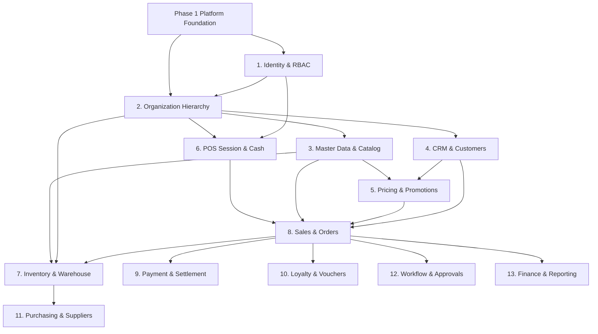

# NEXORA — Phase 2 Domain Implementation Plan

**Document ID:** `docs/architecture/19-phase2-domain-implementation-plan.md`  
**Version:** 1.0.0  
**Status:** DRAFT — Architecture & Domain Planning Baseline  
**Target Repository:** `nexora/`  
**Governing Documents:**
- `AGENTS.md`
- `IMPLEMENTATION_GUIDE.md`
- `TASKS.md`
- `docs/architecture/09-architecture-lock.md`
- `docs/architecture/10-state-machine-catalog.md`
- `docs/architecture/11-permission-matrix.md`
- `docs/architecture/12-event-catalog.md`
- `docs/architecture/13-audit-action-catalog.md`
- `docs/architecture/08-offline-sync-contract.md`
- `docs/architecture/15-openapi-v1.1.md`
- `docs/architecture/16-monorepo-blueprint.md`
- `docs/architecture/17-foundation-implementation-plan.md`
- `docs/architecture/18-operational-readiness-guide.md`
- `docs/architecture/IMPLEMENTATION_STATUS.md`
- `contracts/openapi/openapi-v1.0.0.yaml`

---

## 1. Phase 2 Objectives, Boundaries, Assumptions & Non-Goals

### 1.1 Objectives
1. **Domain-Driven Modular Monolith**: Build out the enterprise business capabilities of NEXORA upon the accepted Foundation Phase 1 platform, respecting clean hexagonal architecture (`transport → application → domain → ports`).
2. **PostgreSQL Authoritative System of Record**: Enforce strict domain ownership over schema tables, eliminating cross-domain direct database mutations.
3. **Transaction-Safe Business Transitions**: Implement explicit command transitions (e.g., `OpenPOSSession`, `ConfirmOrder`, `ReserveStock`, `CapturePayment`) protected by database transactions, Row-Level Security (RLS) tenant isolation, application authorization, distributed idempotency, immutable audit logging, and transactional outbox event publishing.
4. **Offline POS Readiness**: Ensure domain state machines and entity structures support server-authoritative offline synchronization contracts (`docs/architecture/08-offline-sync-contract.md`).
5. **Contract Governance**: Preserve OpenAPI v1.0 specifications and canonical error envelopes (`ErrorResponse`) with zero drift.

### 1.2 Boundaries & Dependency Direction
- **Allowed Direction**:
  ```text
  Transport (HTTP/Worker) → Application (Commands/Queries) → Domain (Entities/Invariants) → Ports (Interfaces)
                                                                 ↑
                                                  Infrastructure (Implements Ports)
  ```
- **Cross-Domain Interaction**: Must occur via explicit application/domain service contracts or asynchronous transactional outbox events. Direct database queries across schema boundaries are strictly forbidden.
- **Transactional Boundary Rule**: A database transaction belongs to a single aggregate root. Cross-domain coordination occurs via transactional outbox events, application service orchestration, or two-phase domain commands. External provider network calls (payment gateways, ERP APIs) must never execute inside an open PostgreSQL transaction.

### 1.3 Assumptions
1. PostgreSQL 16+ is the sole authoritative system of record; schema migrations `000001` through `000005` form the immutable foundation baseline.
2. The platform application role `nexora_app` runs as non-superuser (`NOBYPASSRLS`). Every tenant-scoped transaction establishes context via `platform.set_tenant_context(tenant_id)`.
3. Outbox worker provides at-least-once message delivery; domain consumers where duplicate side effects cannot be tolerated must implement durable database-backed consumer idempotency (e.g., `integration.processed_events`).
4. Redis 7+ serves strictly for distributed rate-limiting and ephemeral caching; it is never authoritative for inventory, payments, or sales.

### 1.4 Non-Goals for Phase 2
- **Premature Microservices**: No separate microservice repositories or gRPC service meshes. All domains reside within the `backend/internal/` modular monolith.
- **Direct External SDK Coupling**: No vendor-specific SDK imports inside domain packages (e.g., Xendit, Midtrans, SAP, Odoo). All vendor interactions remain behind abstract infrastructure ports.
- **Client-Side Authoritative State**: Client devices (POS terminals, web apps) never dictate prices, inventory reservations, or final transaction IDs.
- **Schema Wildcard Mutations**: No ad-hoc table alterations or schema tampering outside of governance-approved, sequentially numbered migrations.

---

## 2. Repository Inventory: Actual State vs Proposed Modules

### 2.1 Current Implementation State (Verified Repository Reality)
- **Implemented Foundation Modules (`backend/internal/platform/`)**:
  - `config`: Strongly-typed configuration validation.
  - `logger`: Structured `log/slog` logging with sensitive key scrubbing.
  - `apperr`: Canonical error envelope mapping (`ErrorResponse`).
  - `postgres`: Pool management, transaction manager (`WithinTx`, `WithinSavepoint`), and RLS session context establishment.
  - `transport/http`: Chi router, middleware (request ID, recovery, rate limiter, logger, timeout), and authentication context binding.
  - `auth`: Session store, opaque token hashing, refresh token single-use rotation, replay detection, RBAC permission checker, and SoD enforcement.
  - `idempotency`: RFC 8785 canonical JSON hasher, database-backed atomic reservations, response caching, and recovery fencing.
  - `audit`: Append-only immutable audit store, action catalog validation, and metadata scrubber.
  - `outbox`: Transactional outbox writer, partitioned worker poller (`SKIP LOCKED`), and exponential backoff retry dispatcher.
  - `observability`: Runtime Prometheus metrics and OTLP/HTTP JSON trace exporter.
- **Existing Domain Code**: **0 packages**. No business domain packages currently exist in `backend/internal/`. Only scaffolding platform infrastructure is present.

### 2.2 Proposed Domain Modules Inventory
The following 14 business domain packages are scheduled for phased construction within `backend/internal/`:

| Module Path | Core Responsibility | Baseline Schema |
| :--- | :--- | :--- |
| `backend/internal/identity` | Users, roles, permissions, scopes, and session lifecycle | `identity` |
| `backend/internal/organization` | Companies, regions, stores, warehouses, and POS terminals | `organization` |
| `backend/internal/master` | Brands, categories, units of measure, products, barcodes | `master` |
| `backend/internal/crm` | Customers, customer groups, delivery addresses | `crm` |
| `backend/internal/pricing` | Price lists, tiered pricing, customer group price rules | `pricing` |
| `backend/internal/promotion` | Promotions, conditions, rewards, application limits | `promotion` |
| `backend/internal/pos` | Terminal registration, shift/session opening/closing, cash drawer | `pos` |
| `backend/internal/sales` | Sales orders, cart checkout, status lifecycle, void, return | `sales` |
| `backend/internal/inventory` | Stock balances, immutable stock ledger, reservations, transfers | `inventory`, `warehouse` |
| `backend/internal/payment` | Payment attempts, gateway adapters, settlement, refunds | `payment` |
| `backend/internal/purchasing` | Suppliers, purchase orders, goods receipts | `purchasing` |
| `backend/internal/loyalty` | Loyalty points, reward accounts, voucher generation/redemption | `loyalty` |
| `backend/internal/workflow` | Multi-step approval workflows, state machines, audit approvals | `workflow` |
| `backend/internal/reporting` | Financial settlement projections, sales reporting aggregates | `reporting`, `finance` |

---

## 3. Domain Dependency Map & Implementation Sequence

### 3.1 Dependency Graph


### 3.2 Recommended Phased Sequence & Rationale
1. **Batch 1: Core Master & Organizational Foundation (`identity`, `organization`, `master`, `crm`)**
   - *Rationale:* Business transactions cannot exist without tenants, stores, terminals, products, and customers. Establishing these master entities first provides the fundamental foreign keys and authorization scopes required by all downstream domains.
2. **Batch 2: Store Operations & Commercial Rules (`pos`, `pricing`, `promotion`, `inventory`)**
   - *Rationale:* Before processing a sale, a terminal must open a session with cash tracking, price lists must resolve base prices with promotion rules, and inventory balances must support stock reservations.
3. **Batch 3: Transaction Execution & Settlement (`sales`, `payment`)**
   - *Rationale:* Combines cart checkout, document numbering, stock deduction, and payment gateway settlement into the critical path of store operations.
4. **Batch 4: Enterprise Extensions & Back-Office (`purchasing`, `loyalty`, `workflow`, `finance/reporting`)**
   - *Rationale:* Non-blocking back-office workflows, loyalty accumulation, voucher redemption, supplier replenishment, and general ledger financial mappings.

---

## 4. Module-Level Architectural Specifications

### 4.1 Module: Identity & Access Management (`backend/internal/identity`)
- **Capabilities:** User account CRUD, role definition, permission assignment, user scope binding (company, store, warehouse), login authentication flow, password policies, MFA registration, session invalidation.
- **Exclusions:** Terminal hardware authentication (delegated to `pos` domain).
- **Dependencies:** Platform `auth`, `postgres`, `audit`.
- **Database Entities:** `identity.user_account`, `identity.role`, `identity.permission`, `identity.user_role`, `identity.role_permission`, `identity.user_scope`, `identity.session`, `identity.mfa_factor`, `identity.login_attempt`, `identity.refresh_token`.
- **Permissions:** `identity:user:create`, `identity:user:read`, `identity:user:update`, `identity:role:assign`, `identity:scope:manage`.
- **Audit Actions:** `USER_CREATED`, `USER_UPDATED`, `USER_LOCKED`, `USER_ROLE_ASSIGNED`, `PASSWORD_RESET`, `MFA_CONFIGURED`.
- **Domain Events:** `identity.user.created.v1`, `identity.user.locked.v1`, `identity.role.assigned.v1`.
- **Concurrency & Invariants:** Unique username/email per tenant (`uq_user_tenant_username`). Segregation of duties enforcement preventing self-granting of admin privileges.

### 4.2 Module: Organization Hierarchy (`backend/internal/organization`)
- **Capabilities:** Multi-tier organizational structure: Company (legal entity), Region, Store (retail outlet), Warehouse (fulfillment center), Terminal (physical POS hardware). Store-to-warehouse mapping.
- **Exclusions:** Financial chart of accounts (delegated to `finance`).
- **Dependencies:** `identity` (for user scope validation).
- **Database Entities:** `organization.company`, `organization.region`, `organization.store`, `organization.warehouse`, `organization.terminal`.
- **Permissions:** `org:company:manage`, `org:store:create`, `org:store:update`, `org:terminal:register`.
- **Audit Actions:** `STORE_CREATED`, `STORE_UPDATED`, `TERMINAL_REGISTERED`, `TERMINAL_DECOMMISSIONED`.
- **Domain Events:** `org.store.created.v1`, `org.terminal.registered.v1`.
- **Concurrency & Invariants:** Unique store code per company. Unique terminal code per store.

### 4.3 Module: Master Data & Catalog (`backend/internal/master`)
- **Capabilities:** Product hierarchy: Brand, Category (hierarchical), Unit of Measure (UOM), Product Master, Product Variant (SKU), Barcode registry, Serial number tracking.
- **Exclusions:** Dynamic pricing and inventory quantities.
- **Dependencies:** `organization`.
- **Database Entities:** `master.brand`, `master.category`, `master.uom`, `master.product`, `master.product_variant`, `master.product_barcode`, `master.serial_number`.
- **Permissions:** `catalog:product:create`, `catalog:product:update`, `catalog:barcode:manage`.
- **Audit Actions:** `PRODUCT_CREATED`, `PRODUCT_UPDATED`, `PRODUCT_DEACTIVATED`, `BARCODE_ASSIGNED`.
- **Domain Events:** `catalog.product.created.v1`, `catalog.variant.created.v1`, `catalog.barcode.assigned.v1`.
- **Concurrency & Invariants:** Unique SKU per tenant. Unique barcode globally or per tenant based on system policy.

### 4.4 Module: Customer Relationship Management (`backend/internal/crm`)
- **Capabilities:** Customer profile management, customer segmentation/groups, delivery and billing addresses, credit limit tracking.
- **Exclusions:** Loyalty point balance tracking (delegated to `loyalty`).
- **Dependencies:** `organization`.
- **Database Entities:** `crm.customer_group`, `crm.customer`, `crm.customer_address`.
- **Permissions:** `crm:customer:create`, `crm:customer:update`, `crm:customer:delete`.
- **Audit Actions:** `CUSTOMER_CREATED`, `CUSTOMER_UPDATED`, `CUSTOMER_BLOCKED`.
- **Domain Events:** `crm.customer.created.v1`, `crm.customer.updated.v1`.
- **Concurrency & Invariants:** Unique customer phone/email per tenant.

### 4.5 Module: POS Session & Cash Management (`backend/internal/pos`)
- **Capabilities:** Terminal binding, POS shift opening (`OpenPOSSession`), cash drawer float declaration, mid-shift cash drops/payouts (`CashMovement`), session closing with blind count (`ClosePOSSession`), cash over/short variance calculation.
- **Exclusions:** Order checkout calculations.
- **Dependencies:** `organization` (Terminal/Store), `identity` (Cashier/Supervisor).
- **Database Entities:** `pos.session`, `pos.cash_movement`.
- **Permissions:** `pos:session:open`, `pos:session:close`, `pos:cash:move`, `pos:variance:override`.
- **Audit Actions:** `POS_SESSION_OPENED`, `POS_SESSION_CLOSED`, `CASH_MOVEMENT_RECORDED`, `VARIANCE_APPROVED`.
- **Domain Events:** `pos.session.opened.v1`, `pos.session.closed.v1`, `pos.variance.flagged.v1`.
- **Concurrency & Invariants:** Exactly one `ACTIVE` session allowed per physical terminal at any given moment (`uq_active_terminal_session` index constraint).

### 4.6 Module: Pricing & Promotion Engine (`backend/internal/pricing`, `backend/internal/promotion`)
- **Capabilities:** Base price lists, store-specific price overrides, customer group price rules, promotional discount rules (percentage, fixed amount, buy-X-get-Y, bundle discounts), promotion validity windows, coupon application limits.
- **Exclusions:** Ledger posting of discounts.
- **Dependencies:** `master` (Products/Variants), `crm` (Customer Groups), `organization` (Store).
- **Database Entities:** `pricing.price_list`, `pricing.price_rule`, `promotion.promotion`, `promotion.promotion_condition`, `promotion.promotion_reward`, `promotion.promotion_application`.
- **Permissions:** `pricing:rule:create`, `pricing:rule:update`, `promotion:rule:create`, `promotion:rule:approve`.
- **Audit Actions:** `PRICE_RULE_CREATED`, `PRICE_RULE_UPDATED`, `PROMOTION_CREATED`, `PROMOTION_APPROVED`.
- **Domain Events:** `pricing.rule.updated.v1`, `promotion.approved.v1`.
- **Concurrency & Invariants:** Deterministic evaluation priority for stacking promotions. Decimal arithmetic with strict 4-decimal precision, rounding half-up at final item total.

### 4.7 Module: Sales & Order Processing (`backend/internal/sales`)
- **Capabilities:** Order creation (`CreateOrder`), item additions, tax calculation, promotion application, order confirmation (`ConfirmOrder`), order completion (`CompleteOrder`), order void (`VoidOrder`), returns and refunds (`RefundOrder`), server-generated document numbering (`platform.document_sequence`).
- **Exclusions:** Physical stock decrement execution (delegated via command/event to `inventory`), payment capture (delegated to `payment`).
- **Dependencies:** `pos` (Session), `master` (Products), `pricing` (Prices), `crm` (Customer), `inventory` (Stock checks).
- **Database Entities:** `sales.sales_order`, `sales.sales_order_item`.
- **Permissions:** `sales:order:create`, `sales:order:confirm`, `sales:order:void`, `sales:order:refund`.
- **Audit Actions:** `ORDER_CREATED`, `ORDER_CONFIRMED`, `ORDER_COMPLETED`, `ORDER_VOIDED`, `ORDER_REFUNDED`.
- **Domain Events:** `sales.order.created.v1`, `sales.order.confirmed.v1`, `sales.order.completed.v1`, `sales.order.voided.v1`.
- **Concurrency & Invariants:** Strict state transitions adhering to `docs/architecture/10-state-machine-catalog.md`:
  `DRAFT → CONFIRMED → COMPLETED (or VOIDED/CANCELLED)`. Idempotent checkout via canonical header `Idempotency-Key`.

### 4.8 Module: Inventory & Warehouse Management (`backend/internal/inventory`)
- **Capabilities:** Real-time stock balance tracking per location, immutable append-only stock ledger (`inventory.stock_ledger`), two-phase stock reservations (`ReserveStock`, `ReleaseStock`, `DeductStock`), stock transfers between warehouses, physical stock counts and adjustments (`AdjustStock`).
- **Exclusions:** Supplier purchasing negotiation.
- **Dependencies:** `organization` (Warehouse/Store), `master` (Product Variants).
- **Database Entities:** `inventory.stock`, `inventory.stock_ledger`, `inventory.stock_reservation`, `inventory.stock_transfer`, `inventory.stock_adjustment`, `warehouse.location`.
- **Permissions:** `inventory:stock:view`, `inventory:stock:adjust`, `inventory:transfer:initiate`, `inventory:transfer:receive`.
- **Audit Actions:** `STOCK_RESERVED`, `STOCK_DEDUCTED`, `STOCK_RELEASED`, `STOCK_ADJUSTED`, `STOCK_TRANSFERRED`.
- **Domain Events:** `inventory.stock.reserved.v1`, `inventory.stock.deducted.v1`, `inventory.stock.adjusted.v1`.
- **Concurrency & Invariants:** Concurrency-safe updates using row locking (`SELECT FOR UPDATE`) on `inventory.stock`. Negative inventory forbidden unless explicitly authorized by store policy flag. Ledger entries are strictly append-only.

### 4.9 Module: Payment & Settlement (`backend/internal/payment`)
- **Capabilities:** Payment initiation (`InitiatePayment`), multi-tender split payments (Cash, Credit Card, QRIS, E-Wallet), payment gateway adapter abstraction, webhook intake, ambiguous state reconciliation (`UNKNOWN → RECONCILIATION_REQUIRED`), payment refund.
- **Exclusions:** Direct external API calls inside database transactions.
- **Dependencies:** `sales` (Order), `organization` (Store/Terminal).
- **Database Entities:** `payment.provider`, `payment.payment`, `payment.payment_attempt`, `payment.refund`.
- **Permissions:** `payment:charge:initiate`, `payment:charge:capture`, `payment:refund:initiate`, `payment:reconcile:resolve`.
- **Audit Actions:** `PAYMENT_INITIATED`, `PAYMENT_CAPTURED`, `PAYMENT_FAILED`, `PAYMENT_REFUNDED`, `PAYMENT_RECONCILED`.
- **Domain Events:** `payment.captured.v1`, `payment.failed.v1`, `payment.refunded.v1`, `payment.reconciliation_required.v1`.
- **Concurrency & Invariants:** Provider state machine: `INITIATED → PROCESSING → CAPTURED (or FAILED/RECONCILIATION_REQUIRED)`. Webhook deduplication via `integration.webhook_event`. External HTTP calls executed strictly outside PostgreSQL transaction boundaries.

---

## 5. Proposed Implementation Batches & Acceptance Gates

```text
┌────────────────────────────────────────────────────────────────────────┐
│ BATCH 1: Core Master & Organizational Setup                            │
│ Modules: identity, organization, master, crm                           │
│ Gate 2.1: Master entity CRUD, RBAC scope enforcement, RLS integrity    │
└───────────────────────────────────┬────────────────────────────────────┘
                                    │
┌───────────────────────────────────▼────────────────────────────────────┐
│ BATCH 2: Store Operations, Rules & Inventory                           │
│ Modules: pos, pricing, promotion, inventory                            │
│ Gate 2.2: Active session uniqueness, price engine, stock reservation   │
└───────────────────────────────────┬────────────────────────────────────┘
                                    │
┌───────────────────────────────────▼────────────────────────────────────┐
│ BATCH 3: Sales Checkout & Payment Engine                               │
│ Modules: sales, payment                                                │
│ Gate 2.3: Atomic checkout, payment reconciliation, idempotency replay  │
└───────────────────────────────────┬────────────────────────────────────┘
                                    │
┌───────────────────────────────────▼────────────────────────────────────┐
│ BATCH 4: Enterprise Extensions & Back-Office                           │
│ Modules: purchasing, loyalty, workflow, reporting/finance              │
│ Gate 2.4: Purchase receipts, voucher redemption, approval workflows    │
└────────────────────────────────────────────────────────────────────────┘
```

### Module Acceptance Criteria:
- **Gate 2.1 (Batch 1 Acceptance)**:
  - Full CRUD operations passing for Users, Roles, Stores, Terminals, Products, Categories, Customers.
  - Multi-tenant RLS isolation verified under `nexora_app` across all Batch 1 tables.
  - Zero cross-tenant data leakage under concurrent tests.
  - 100% compliance with canonical error envelope (`ErrorResponse`).
- **Gate 2.2 (Batch 2 Acceptance)**:
  - POS terminal enforces strictly one active session; concurrent opening attempts return HTTP 409 `SESSION_ALREADY_ACTIVE`.
  - Cash movements balance correctly against closing count variance.
  - Price resolution resolves store and customer-group overrides deterministically.
  - Stock reservations succeed under concurrent contention; negative inventory blocked.
- **Gate 2.3 (Batch 3 Acceptance)**:
  - Full sales order lifecycle (`DRAFT → CONFIRMED → COMPLETED`) verified.
  - Sales order confirmation atomically creates stock ledger deductions and outbox events.
  - Idempotent order checkout verified under 20 concurrent goroutines racing on the same `Idempotency-Key`.
  - Payment timeouts transition to `UNKNOWN` and route to `RECONCILIATION_REQUIRED`; no duplicate automatic captures.
- **Gate 2.4 (Batch 4 Acceptance)**:
  - Purchase order receipts update warehouse stock ledger and balances.
  - Voucher redemption enforces single-use constraints under concurrent requests.
  - Multi-step approval workflows gate sensitive actions (e.g. variance write-offs).

---

## 6. Backlog Decomposition Principles & Readiness Criteria

Before any coding begins in a specific domain batch, the following artifacts must be prepared and reviewed:
1. **Domain Command Specifications**:
   - Exact command signatures (e.g., `ConfirmOrderCommand{OrderID, TenantID, ActorID}`).
   - Explicit state preconditions, validation invariants, and conflict error codes.
2. **Ports & Interfaces Definition**:
   - Domain repository interfaces placed in `domain/ports` or `application/ports`.
   - Domain event contracts defined in `contracts/events/` and versioned.
3. **Database Migration Planning**:
   - If forward schema additions are required (e.g. indexes, lookup views), forward migrations must be prepared and assigned consecutive numbers (`000006+`) without altering migrations `000001` through `000005`.
4. **OpenAPI Alignment**:
   - Endpoints verified against `contracts/openapi/openapi-v1.0.0.yaml`. If path additions are necessary, OpenAPI spec is updated first.
5. **Test Specification**:
   - Pre-written test cases for happy path, unauthorized actor, tenant isolation breach, invalid state transition, duplicate idempotency key, and concurrent race condition.

---

## 7. Decision Register for Unresolved Architecture Questions

| Decision ID | Domain | Unresolved Architectural Question | Options & Tradeoffs | Recommendation | Status |
| :--- | :--- | :--- | :--- | :--- | :--- |
| **DEC-P2-001** | Sales / POS | Sequence Generation for Offline Sales Documents | **Option A:** Server assigns final receipt number upon sync.<br>**Option B:** Terminal generates offline prefix (`OFFLINE-TERM01-0001`) mapped to official server sequence upon synchronization. | **Option B**: Allows immediate physical receipt printing while maintaining server canonical sequence mapping. | **OPEN (Needs Approval)** |
| **DEC-P2-002** | Pricing | Promotion Engine Execution Model | **Option A:** Pure in-memory calculation in Go application layer.<br>**Option B:** Database stored procedure / CTE evaluation. | **Option A**: Keeps business logic testable, reproducible in offline clients, and outside DB transactions. | **RECOMMENDED (Option A)** |
| **DEC-P2-003** | Inventory | Negative Inventory Permission Policy | **Option A:** Strictly forbid negative stock globally.<br>**Option B:** Tenant/Store configurable flag allowing backorders/negative stock with warning. | **Option B**: Configurable per store policy to avoid halting retail checkouts during inventory discrepancies. | **OPEN (Needs Approval)** |
| **DEC-P2-004** | Payment | Default Gateway Integration Adapter | **Option A:** Implement mock gateway adapter only in Phase 2.<br>**Option B:** Implement production adapter for Xendit / Midtrans in Phase 2. | **Option A**: Build robust adapter interfaces and simulator; bind production provider credentials in deployment phase. | **RECOMMENDED (Option A)** |
| **DEC-P2-005** | Identity | Password Hashing Algorithm Selection | **Option A:** Argon2id (modern, memory-hard).<br>**Option B:** bcrypt (standard, wide compatibility). | **Option A**: Argon2id ($m=64\text{MB}, t=3, p=4$, salt 16B, key 32B). | **APPROVED (2026-10-11)** |

> **Batch 1 Pre-Implementation Decisions Approved (2026-10-11):**  
> Decisions DEC-B1-001 through DEC-B1-005 approved by user. Migration Option 1 approved: `000006_identity_permissions.sql` is allocated to Identity permission seeding, while `000007_crm_audit_actions.sql` is deferred to future CRM increment. Implementation of Identity Increment 1 authorized.


---

## 8. Risk Register

| Risk ID | Category | Description | Severity | Mitigation Strategy |
| :--- | :--- | :--- | :--- | :--- |
| **RSK-P2-01** | Performance | High contention on stock balances during flash sales or busy retail periods. | HIGH | Use short transaction scopes, pessimistic row locking (`SELECT FOR UPDATE`), and decoupled stock reservation leases. |
| **RSK-P2-02** | Security | Cross-tenant data leakage via missing RLS context in background workers. | CRITICAL | Enforce mandatory `platform.WithTenantID` context wrapping on all worker repository invocations. |
| **RSK-P2-03** | Reliability | Third-party payment gateway network timeouts leaving payment in indeterminate state. | HIGH | Follow ADR-0008: Transition ambiguous attempts to `UNKNOWN` and require explicit reconciliation; never blindly charge again. |
| **RSK-P2-04** | Data Integrity | Offline synchronization conflicts during price or inventory updates. | HIGH | Server remains authoritative for price and final stock deduction; client offline transactions submit with client timestamps and fail closed if conflict policy dictates. |
| **RSK-P2-05** | Complexity | Monorepo package circular dependency risk between Sales, Inventory, and Pricing. | MEDIUM | Strict adherence to clean architecture: domains communicate via application service interfaces or outbox events; zero cross-domain Go imports. |

---

## 9. Traceability Matrix

| Architectural Contract | Governing Artifact | Target Domain Module | Key Verification Requirement |
| :--- | :--- | :--- | :--- |
| ADR-0001 (Modular Monolith) | `09-architecture-lock.md` | All Modules | Package boundaries linted; zero circular package imports |
| ADR-0004 (Tenant Isolation / RLS) | `09-architecture-lock.md` | All Modules | Every domain query executes under `nexora_app` with forced RLS |
| ADR-0005 (Scope Authorization) | `11-permission-matrix.md` | `identity`, `organization` | Store and warehouse scope boundary enforcement tests |
| ADR-0006 (Idempotency) | `09-architecture-lock.md` | `sales`, `payment`, `pos` | Idempotent command replays and 409 mismatch rejection |
| ADR-0007 (State Machines) | `10-state-machine-catalog.md` | `sales`, `pos`, `payment` | Invalid state transition returns structured conflict error |
| ADR-0008 (Payment Ambiguity) | `09-architecture-lock.md` | `payment` | Timeout sets state to `UNKNOWN` and creates reconciliation log |
| ADR-0009 (Transactional Outbox) | `12-event-catalog.md` | All Modules | Business write and outbox event committed in same transaction |
| ADR-0010 (Document Numbering) | `09-architecture-lock.md` | `sales`, `purchasing` | Server sequence generator used; no `MAX(number)+1` |
| ADR-0011 (Audit By Default) | `13-audit-action-catalog.md` | All Modules | Mandatory audit records generated for all critical commands |
| ADR-0014 (Offline Policy) | `08-offline-sync-contract.md` | `sales`, `pos`, `inventory` | Server is authoritative; sync handles at-least-once delivery |

---

## 10. Entry and Exit Criteria

### 10.1 Phase 2 Planning Entry & Exit Criteria
- **Planning Entry Criteria:**
  - [x] Phase 1 Foundation accepted with documented limitations (`IMPLEMENTATION_STATUS.md`).
  - [x] Approved baseline migration checksum confirmed (`e7cefc2dfcdcf2b90a8418dcc2da8a091289ee00a5806c08278bf1516d5fb09f`).
  - [x] All 29 master findings from WS1–WS8 accounted for.
- **Planning Exit Criteria:**
  - [x] Comprehensive Phase 2 Domain Implementation Plan document (`19-phase2-domain-implementation-plan.md`) created and reviewed.
  - [x] Domain dependency map and batching sequence established.
  - [x] Decision register populated with open architectural decisions.
  - [x] User authorization received before implementing Batch 1 code.

### 10.2 Implementation Batch Entry Criteria (Applies to Batches 1–4)
- Explicit user authorization to begin the specific batch.
- Domain commands, permissions, and audit actions for the batch reconciled against catalogs.
- Zero open blockers from previous batches.

### 10.3 Implementation Batch Exit Criteria (Applies to Batches 1–4)
- 100% of batch unit and live PostgreSQL integration tests pass.
- Zero race conditions detected under `go test -race`.
- Static analysis clean (`golangci-lint run ./...` with 0 issues).
- Redocly OpenAPI linting passes with 0 errors.
- Verified multi-tenant RLS isolation and scope enforcement on all batch tables.
- Batch completion report submitted and approved before advancing.
