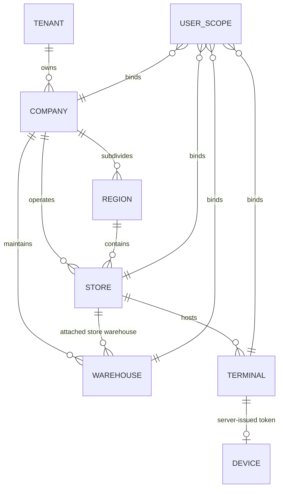

# NEXORA — Organization Increment 2 Pre-Implementation Review

**Document ID:** `docs/architecture/21-organization-increment-pre-implementation-review.md`  
**Version:** 1.0.0  
**Status:** DRAFT — Pre-Implementation Review  
**Target Module:** `backend/internal/organization`  
**Governing Documents:**
- `AGENTS.md`
- `IMPLEMENTATION_GUIDE.md`
- `TASKS.md`
- `docs/architecture/09-architecture-lock.md`
- `docs/architecture/10-state-machine-catalog.md`
- `docs/architecture/11-permission-matrix.md`
- `docs/architecture/12-event-catalog.md`
- `docs/architecture/13-audit-action-catalog.md`
- `docs/architecture/17-foundation-implementation-plan.md`
- `docs/architecture/18-operational-readiness-guide.md`
- `docs/architecture/19-phase2-domain-implementation-plan.md`
- `docs/architecture/20-phase2-batch1-pre-implementation-review.md`
- `docs/architecture/IMPLEMENTATION_STATUS.md`

---

## 1. Executive Summary & Verdict

### Readiness Verdict: **`READY WITH DOCUMENTED DECISIONS`**

Identity Increment 1 has been verified and formally accepted (`PASS`). The foundational schema for the `organization` module (`organization.company`, `organization.region`, `organization.store`, `organization.warehouse`, and `organization.terminal`) exists in the PostgreSQL baseline (`db/migrations/000001_baseline_hardened.sql`). All platform capabilities—transaction management, forced RLS context, append-only audit, transactional outbox, and RFC 8785 idempotency—are operational.

Furthermore, preflight verification confirms:
1. **Permission Catalog**: All 18 canonical Organization permissions (`company.read`, `company.create`, `company.update`, `region.*`, `store.*`, `warehouse.*`, `terminal.*`) are already seeded in `identity.permission` via the accepted migration `000006_identity_permissions.sql`.
2. **Audit Action Catalog**: All 17 canonical Organization audit actions (`COMPANY_CREATED`, `STORE_CREATED`, `TERMINAL_REGISTERED`, `DEVICE_REGISTERED`, etc.) are already seeded in `audit.audit_action_catalog` via `000004_audit_hardening.sql`. Unlike CRM, **no audit action catalog gap exists** for Organization.
3. **User-Scope Integration**: `identity.user_scope` and its service bindings are implemented and tested, ready to bind users to created organizational entities.

However, two concrete schema-level gaps and one device token storage decision require explicit governance decisions prior to application code implementation:
1. **Missing RLS on `organization.region`**: In baseline migration `000001`, RLS was enabled on `company`, `store`, `warehouse`, and `terminal`, but `organization.region` was omitted from `ENABLE ROW LEVEL SECURITY`.
2. **Terminal Status Check Constraint**: Baseline table `organization.terminal` defines `CHECK (status IN ('ACTIVE','INACTIVE','MAINTENANCE'))`, whereas the canonical state machine and audit catalog specify `ACTIVE`, `MAINTENANCE`, `DISABLED`, and `RETIRED`.
3. **Migration Allocation**: With migration `000006` accepted and `000007_crm_audit_actions.sql` reserved for CRM, any new forward migration for Organization hardening must be allocated as **`000008_organization_hardening.sql`**.

---

## 2. Verified Schema & Database Evidence

### 2.1 Table Definitions in `db/migrations/000001_baseline_hardened.sql`

```sql
-- 1. Company (Lines 75-92)
CREATE TABLE organization.company (
  id uuid PRIMARY KEY DEFAULT gen_random_uuid(),
  tenant_id uuid NOT NULL,
  code varchar(30) NOT NULL,
  name varchar(150) NOT NULL,
  legal_name varchar(200),
  tax_id varchar(100),
  base_currency char(3) NOT NULL DEFAULT 'IDR',
  timezone varchar(64) NOT NULL DEFAULT 'Asia/Jakarta',
  status varchar(20) NOT NULL DEFAULT 'ACTIVE'
    CHECK (status IN ('ACTIVE','INACTIVE')),
  created_at timestamptz NOT NULL DEFAULT now(),
  updated_at timestamptz NOT NULL DEFAULT now(),
  created_by uuid,
  updated_by uuid,
  version bigint NOT NULL DEFAULT 1 CHECK (version > 0),
  UNIQUE (tenant_id, code)
);

-- 2. Region (Lines 94-108)
CREATE TABLE organization.region (
  id uuid PRIMARY KEY DEFAULT gen_random_uuid(),
  tenant_id uuid NOT NULL,
  company_id uuid NOT NULL REFERENCES organization.company(id),
  code varchar(30) NOT NULL,
  name varchar(150) NOT NULL,
  status varchar(20) NOT NULL DEFAULT 'ACTIVE'
    CHECK (status IN ('ACTIVE','INACTIVE')),
  created_at timestamptz NOT NULL DEFAULT now(),
  updated_at timestamptz NOT NULL DEFAULT now(),
  created_by uuid,
  updated_by uuid,
  version bigint NOT NULL DEFAULT 1,
  UNIQUE (company_id, code)
);

-- 3. Store (Lines 110-127)
CREATE TABLE organization.store (
  id uuid PRIMARY KEY DEFAULT gen_random_uuid(),
  tenant_id uuid NOT NULL,
  company_id uuid NOT NULL REFERENCES organization.company(id),
  region_id uuid REFERENCES organization.region(id),
  code varchar(30) NOT NULL,
  name varchar(150) NOT NULL,
  address text,
  timezone varchar(64) NOT NULL DEFAULT 'Asia/Jakarta',
  status varchar(20) NOT NULL DEFAULT 'ACTIVE'
    CHECK (status IN ('ACTIVE','INACTIVE')),
  created_at timestamptz NOT NULL DEFAULT now(),
  updated_at timestamptz NOT NULL DEFAULT now(),
  created_by uuid,
  updated_by uuid,
  version bigint NOT NULL DEFAULT 1,
  UNIQUE (company_id, code)
);

-- 4. Warehouse (Lines 129-146)
CREATE TABLE organization.warehouse (
  id uuid PRIMARY KEY DEFAULT gen_random_uuid(),
  tenant_id uuid NOT NULL,
  company_id uuid NOT NULL REFERENCES organization.company(id),
  store_id uuid REFERENCES organization.store(id),
  code varchar(30) NOT NULL,
  name varchar(150) NOT NULL,
  warehouse_type varchar(30) NOT NULL DEFAULT 'STORE'
    CHECK (warehouse_type IN ('STORE','CENTRAL','TRANSIT','VIRTUAL','SERVICE')),
  status varchar(20) NOT NULL DEFAULT 'ACTIVE'
    CHECK (status IN ('ACTIVE','INACTIVE')),
  created_at timestamptz NOT NULL DEFAULT now(),
  updated_at timestamptz NOT NULL DEFAULT now(),
  created_by uuid,
  updated_by uuid,
  version bigint NOT NULL DEFAULT 1,
  UNIQUE (company_id, code)
);

-- 5. Terminal (Lines 148-165)
CREATE TABLE organization.terminal (
  id uuid PRIMARY KEY DEFAULT gen_random_uuid(),
  tenant_id uuid NOT NULL,
  company_id uuid NOT NULL REFERENCES organization.company(id),
  store_id uuid NOT NULL REFERENCES organization.store(id),
  code varchar(30) NOT NULL,
  name varchar(100) NOT NULL,
  device_identifier varchar(150),
  status varchar(20) NOT NULL DEFAULT 'ACTIVE'
    CHECK (status IN ('ACTIVE','INACTIVE','MAINTENANCE')),
  created_at timestamptz NOT NULL DEFAULT now(),
  updated_at timestamptz NOT NULL DEFAULT now(),
  created_by uuid,
  updated_by uuid,
  version bigint NOT NULL DEFAULT 1,
  UNIQUE (store_id, code),
  UNIQUE (device_identifier)
);
```

### 2.2 RLS Status in Baseline
- `organization.company`: `ENABLE ROW LEVEL SECURITY`, `tenant_company_isolation` policy active.
- `organization.store`: `ENABLE ROW LEVEL SECURITY`, `tenant_store_isolation` policy active.
- `organization.warehouse`: `ENABLE ROW LEVEL SECURITY`, `tenant_warehouse_isolation` policy active.
- `organization.terminal`: `ENABLE ROW LEVEL SECURITY`, `tenant_terminal_isolation` policy active.
- **`organization.region`**: **NO RLS ENABLED** in `000001` or `000005`. This represents a latent defense-in-depth gap that must be addressed in forward migration `000008`.

---

## 3. Entity Relationships & Dependency Analysis



### Unidirectional Dependency Flow
1. `Company` has no dependencies outside Tenant UUID.
2. `Region` references `Company`.
3. `Store` references `Company` and optionally `Region`.
4. `Warehouse` references `Company` and optionally `Store`.
5. `Terminal` references `Company` and `Store`.
6. `identity.user_scope` references all the above entities.

---

## 4. Detailed Architectural Analysis (Areas 1–10)

### Area 1: Ownership & Relationship Invariants
- Every organizational entity belongs to a single `tenant_id`. Cross-tenant foreign key references are prevented both by application validation and database schema design.
- A `Store` must reference a `Company` within the same tenant. If an optional `region_id` is supplied, `region.company_id` must match `store.company_id`.
- A `Warehouse` of type `STORE` must reference a `store_id` whose `company_id` matches the warehouse's `company_id`.
- A `Terminal` must reference both `company_id` and `store_id`, where `store.company_id == terminal.company_id`.

### Area 2: Tenant-Scoped Uniqueness & Foreign-Key Integrity
- `Company`: `UNIQUE (tenant_id, code)`
- `Region`: `UNIQUE (company_id, code)`
- `Store`: `UNIQUE (company_id, code)`
- `Warehouse`: `UNIQUE (company_id, code)`
- `Terminal`: `UNIQUE (store_id, code)` and `UNIQUE (device_identifier)`
- Foreign-key rules: Cascading deletes are strictly disallowed (`ON DELETE RESTRICT` / default `NO ACTION`).

### Area 3: Lifecycle States & Deactivation Behavior
- **Hard deletion is prohibited**: Entities are never physically deleted once referenced in operational transactions.
- **Soft deactivation**:
  - `Company`: `ACTIVE ↔ INACTIVE`. When inactive, all child stores, warehouses, and terminals are blocked from creating new sessions, orders, or stock adjustments.
  - `Store`: `ACTIVE ↔ INACTIVE`. When inactive, terminals cannot open new POS sessions; cash movement is blocked.
  - `Warehouse`: `ACTIVE ↔ INACTIVE`. When inactive, stock reservations, receipts, and transfer dispatches are blocked.
  - `Terminal`: `ACTIVE ↔ MAINTENANCE ↔ DISABLED ↔ RETIRED`.
    - `MAINTENANCE`: Blocks transaction processing, allows diagnostic heartbeats.
    - `DISABLED`: Terminal cannot open a new POS session; active sessions must close.
    - `RETIRED`: Terminal device token is permanently revoked; terminal cannot authenticate.

### Area 4: Store and Warehouse Authorization Boundaries
- Handlers enforce canonical permissions:
  - `company.read`, `company.create`, `company.update`
  - `region.read`, `region.create`, `region.update`
  - `store.read`, `store.create`, `store.update`, `store.disable`
  - `warehouse.read`, `warehouse.create`, `warehouse.update`
  - `terminal.read`, `terminal.register`, `terminal.update`, `terminal.disable`, `terminal.retire`
- **Scope Enforcement**: An authenticated principal's operational scope (`principal.Scopes`) determines data access:
  - A user with only `STORE` scope for Store A cannot access Store B or its terminals.
  - A user with `COMPANY` scope has operational authority across all stores/warehouses under that company.

### Area 5: User-Scope Assignment and Revocation
- Identity Increment 1 exposes `AssignScope` and `RevokeScope`.
- Organization Increment 2 must provide high-performance internal domain validation queries (`ValidateEntityScope(tenantID, scopeType, entityID)`), ensuring that any assigned `company_id`, `region_id`, `store_id`, `warehouse_id`, or `terminal_id` is currently `ACTIVE` and belongs to the caller's tenant.

### Area 6: Terminal Device Token Lifecycle under DEC-B1-004
- Approved DEC-B1-004 establishes: Server-issued device token stored securely in client storage.
- **Issuance**:
  - Administrator registers a terminal via `POST /api/v1/organization/terminals/{id}/register-device`.
  - Server generates a high-entropy cryptographically secure random token (e.g., `dev_tok_` + 32-byte hex string).
  - Server stores the SHA-256 hash `sha256(token)` in `organization.terminal.device_identifier`.
  - Plaintext token is returned **only once** in the registration response.
- **Verification**:
  - POS client provides the token in header `X-Device-Token: <token>`.
  - Server hashes incoming token and performs constant-time comparison against `device_identifier`.
- **Rotation & Revocation**:
  - `RotateDeviceToken`: Generates new token, updates hash in DB, invalidating the old token instantly.
  - `RevokeDevice`: Sets `device_identifier = NULL`, status to `DISABLED` or `RETIRED`.

### Area 7: Required Audit Actions & Outbox Events
- **Audit Actions (already seeded in `000004_audit_hardening.sql`)**:
  - `COMPANY_CREATED`, `COMPANY_UPDATED`
  - `REGION_CREATED`, `REGION_UPDATED`
  - `STORE_CREATED`, `STORE_UPDATED`, `STORE_ENABLED`, `STORE_DISABLED`
  - `WAREHOUSE_CREATED`, `WAREHOUSE_UPDATED`
  - `TERMINAL_REGISTERED`, `TERMINAL_ENABLED`, `TERMINAL_DISABLED`, `TERMINAL_RETIRED`
  - `DEVICE_REGISTERED`, `DEVICE_SUSPENDED`, `DEVICE_REVOKED`
- **Domain Events (written atomically to transactional outbox)**:
  - `org.company.created.v1`, `org.company.updated.v1`
  - `org.region.created.v1`, `org.region.updated.v1`
  - `org.store.created.v1`, `org.store.updated.v1`, `org.store.disabled.v1`
  - `org.warehouse.created.v1`, `org.warehouse.updated.v1`
  - `org.terminal.registered.v1`, `org.terminal.disabled.v1`, `org.terminal.retired.v1`
  - `org.device.registered.v1`, `org.device.revoked.v1`

### Area 8: Transaction Atomicity, Idempotency, and Concurrency
- All mutation use cases execute within `tm.WithinTx(ctx, ...)`.
- Optimistic concurrency control is enforced via `version` column:
  `UPDATE ... SET ..., version = version + 1 WHERE id = $id AND version = $expectedVersion`.
- Critical entity creation operations accept `Idempotency-Key` headers via platform idempotency middleware.

### Area 9: Schema Gaps & Forward Migration Plan
Two gaps require schema migration:
1. `organization.region` needs `ENABLE ROW LEVEL SECURITY` and `tenant_region_isolation` policy.
2. `organization.terminal` status check constraint should expand from `('ACTIVE','INACTIVE','MAINTENANCE')` to `('ACTIVE','INACTIVE','MAINTENANCE','DISABLED','RETIRED')`.

**Migration Sequencing**:
- `000006_identity_permissions.sql` is accepted and locked.
- `000007_crm_audit_actions.sql` is reserved for CRM.
- Forward migration for Organization is allocated as **`000008_organization_hardening.sql`**.

### Area 10: Testable Acceptance Criteria
1. **RLS Isolation**: Role `nexora_app` (`NOBYPASSRLS`) querying `organization.company`, `region`, `store`, `warehouse`, or `terminal` without tenant session context returns 0 rows.
2. **Cross-Tenant Prevention**: A tenant cannot view, mutate, or link foreign tenant companies, stores, or warehouses.
3. **Cross-Store Boundary**: A principal scoped to Store A receives `403 FORBIDDEN` when accessing Store B.
4. **Device Token Verification**: Mismatched or revoked `X-Device-Token` returns `401 INVALID_DEVICE_TOKEN`.
5. **Audit & Outbox Atomicity**: Transaction failure rolls back domain record, audit log, and outbox event together.

---

## 5. Decision Register for Organization Increment 2

| Decision ID | Area | Architectural Question | Options & Tradeoffs | Recommended Option | Status |
| :--- | :--- | :--- | :--- | :--- | :--- |
| **DEC-B1-006** | Organization / Security | `organization.region` Missing RLS & Terminal Status Constraint | **Option A:** Allocate forward migration `000008_organization_hardening.sql` to enable RLS on `organization.region`, add policy `tenant_region_isolation`, and expand `terminal.status` check constraint.<br>**Option B:** Enforce `region` isolation purely in application queries without RLS, and map `DISABLED`/`RETIRED` to `INACTIVE`. | **Option A (Recommended)**: Fully aligns with non-negotiable architecture lock: "Forced RLS and the nexora_app NOBYPASSRLS model. Never bypass RLS." | **PROPOSED FOR APPROVAL** |
| **DEC-B1-007** | Organization / Terminal | Terminal Device Token Storage Security | **Option A:** Store SHA-256 hash of device token in `organization.terminal.device_identifier`, returning plaintext token once at registration.<br>**Option B:** Store plaintext high-entropy UUID directly in `device_identifier`. | **Option A (Recommended)**: Follows defense-in-depth principles (similar to password/token hashing), preventing token compromise if read replica is queried. | **PROPOSED FOR APPROVAL** |

---

## 6. Proposed Implementation Scope & Sequence

When authorized, Organization Increment 2 should execute in the following bounded steps:

1. **Step 1 (Migration 000008)**: Create and verify `db/migrations/000008_organization_hardening.sql` with advisory lock, enabling RLS on `organization.region` and expanding `terminal_status_check`.
2. **Step 2 (Domain Models & Store)**: Implement `backend/internal/organization/` models, sentinel errors, and `PgxStore` covering Company, Region, Store, Warehouse, and Terminal CRUD with optimistic concurrency.
3. **Step 3 (Device Token Engine)**: Implement cryptographic device token generator and SHA-256 verifier.
4. **Step 4 (Domain Service & Atomicity)**: Implement `DomainService` orchestrating business validation, audit logging, and outbox event publishing within transactions.
5. **Step 5 (HTTP Handlers & Routing)**: Implement Chi routing at `/api/v1/organization/`, canonical JSON error envelopes, and mount in `backend/api.go`.
6. **Step 6 (Comprehensive Verification)**: Run integration tests on disposable databases (`nexora_app` non-superuser, forced RLS), full race suite, `golangci-lint`, and `go vet`.

---

## 7. Governance Confirmation

- **No Application Code Changes Made**: No files under `backend/internal/organization/` were created or modified.
- **No Migration Changes Made**: Neither `000007_crm_audit_actions.sql` nor `000008_organization_hardening.sql` was created or executed. Existing migrations 000001–000006 remain unmodified.
- **No Database Operations Executed**: No migrations were run against any persistent database.
- **No Git Operations Performed**: Repository branch and commit state remain untouched.
- **Scope Discipline**: Awaiting explicit user authorization before proceeding to implementation.
