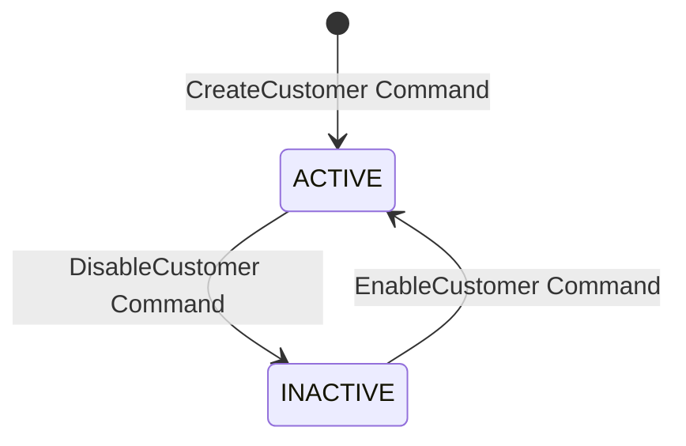

# NEXORA Phase 2 / Batch 1 / Increment 4 — CRM Pre-Implementation Review

**Document ID:** `docs/architecture/28-crm-increment-pre-implementation-review.md`  
**Version:** 1.0.0  
**Status:** DRAFT — Read-Only Architecture Review  
**Date:** 2026-10-11  
**Target Module:** `backend/internal/crm`  
**Governing Documents:**
- `AGENTS.md`
- `IMPLEMENTATION_GUIDE.md`
- `TASKS.md`
- `docs/architecture/09-architecture-lock.md`
- `docs/architecture/10-state-machine-catalog.md`
- `docs/architecture/11-permission-matrix.md`
- `docs/architecture/12-event-catalog.md`
- `docs/architecture/13-audit-action-catalog.md`
- `docs/architecture/08-offline-sync-contract.md`
- `docs/architecture/15-openapi-v1.1.md`
- `docs/architecture/16-monorepo-blueprint.md`
- `docs/architecture/17-foundation-implementation-plan.md`
- `docs/architecture/18-operational-readiness-guide.md`
- `docs/architecture/19-phase2-domain-implementation-plan.md`
- `docs/architecture/20-phase2-batch1-pre-implementation-review.md`
- `docs/architecture/21-organization-increment-pre-implementation-review.md`
- `docs/architecture/22-organization-increment-implementation-report.md`
- `docs/architecture/23-organization-increment-acceptance-review.md`
- `docs/architecture/24-master-data-increment-pre-implementation-review.md`
- `docs/architecture/25-master-data-increment-design-finalization.md`
- `docs/architecture/26-master-data-increment-implementation-report.md`
- `docs/architecture/27-master-data-increment-acceptance-review.md`
- `docs/architecture/IMPLEMENTATION_STATUS.md`
- `contracts/openapi/openapi-v1.0.0.yaml`

---

## 1. Executive Summary & Review Verdict

### Review Verdict: **`READY WITH OPEN DECISIONS`**

This document establishes the pre-implementation review and architectural specification for **NEXORA Phase 2 / Batch 1 / Increment 4 — Customer Relationship Management (CRM)**.

Following the successful implementation, testing, and independent acceptance of Identity Increment 1, Organization Increment 2, and Master Data Increment 3, Increment 4 represents the final domain increment of Phase 2 / Batch 1.

### Key Preflight Verifications
1. **Migration Governance & Invariant Check:**
   - Migrations `000001` through `000006`, `000008`, and `000009` have been verified byte-for-byte against their SHA-256 checksum register.
   - Migration `000007_crm_audit_actions.sql` remains **strictly absent** and reserved exclusively for CRM forward migrations.
2. **Schema Baseline Status:**
   - Core CRM relational structures (`crm.customer_group`, `crm.customer`, `crm.customer_address`) were established in `db/migrations/000001_baseline_hardened.sql`.
   - `crm.customer`, `crm.customer_group`, and `crm.customer_address` have Row Level Security enabled and forced with policy `tenant_isolation_v11` via the baseline schema loop.
   - Cross-tenant foreign key prevention triggers (`trg_same_tenant_*`) are active on `crm.customer.customer_group_id` and `crm.customer_address.customer_id`.
3. **Subsystem Audit Catalog Gap:**
   - While the Go catalog registry (`backend/internal/platform/audit/catalog.go`) contains definitions for `CUSTOMER_CREATED`, `CUSTOMER_UPDATED`, `CUSTOMER_DISABLED`, `CUSTOMER_ADDRESS_CREATED`, `CUSTOMER_ADDRESS_UPDATED`, `CUSTOMER_ADDRESS_DELETED`, and `CUSTOMER_GROUP_CHANGED`, **none of these audit actions have been seeded into the PostgreSQL database** (`audit.audit_action_catalog`).
   - Because `audit.audit_log(action)` enforces a strict foreign key `fk_audit_log_action` against `audit.audit_action_catalog(code)`, any attempt to write audit logs for customer mutations will fail at the database level until migration `000007_crm_audit_actions.sql` seeds them.
   - Furthermore, audit actions for Customer Group creation and modification (`CUSTOMER_GROUP_CREATED`, `CUSTOMER_GROUP_UPDATED`) are absent from both the database and the catalog specification.
4. **Subsystem Permission Catalog Gap:**
   - `db/migrations/000006_identity_permissions.sql` seeded four customer permissions: `customer.read`, `customer.create`, `customer.update`, and `customer.address.manage`.
   - Missing permissions include fine-grained controls for customer groups (`customer_group.read`, `customer_group.create`, `customer_group.update`) and explicit lifecycle operations (`customer.disable`).
5. **OpenAPI v1.0.0 Contract Parity & Gap:**
   - `contracts/openapi/openapi-v1.0.0.yaml` defines customer routes `/customers` and `/customers/{id}` along with `/customers/{id}/addresses` (GET/POST).
   - OpenAPI v1.0.0 lacks address mutation routes (`/customers/{id}/addresses/{address_id}` PATCH/DELETE), customer lifecycle endpoints (`/customers/{id}/disable`), and customer group management routes.

Implementation MUST NOT proceed until the design decisions specified in Section 17 are reviewed and authorized.

---

## 2. Repository Files Inspected & Evidence Reconciliation

All canonical architecture documents and codebase artifacts required by Section 1 were inspected. No listed files were missing.

| File / Artifact | Inspection Method | Status / Evidence |
|---|---|---|
| `AGENTS.md` | Content Inspection | Strict constraints against god services, floating-point money, arbitrary status updates, and bypassing audit/RLS confirmed. |
| `IMPLEMENTATION_GUIDE.md` | Content Inspection | Architectural rules for transaction management, repository patterns, and domain isolation confirmed. |
| `TASKS.md` | Content Inspection | Line 261-263 verifies Customer group, Customer, and Customer address are assigned to Phase 2 / Batch 1 / Increment 4. |
| `docs/architecture/09-architecture-lock.md` | Content Inspection | Modular monolith, PostgreSQL system of record, forced tenant isolation, and transactional outbox confirmed. |
| `docs/architecture/10-state-machine-catalog.md` | Content Inspection | General state transition rules verified; customer states mapped to `ACTIVE` and `INACTIVE` lifecycles. |
| `docs/architecture/11-permission-matrix.md` | Content Inspection | Verified existing entries for `customer.read`, `customer.create`, `customer.update`, `customer.address.manage`. |
| `docs/architecture/12-event-catalog.md` | Content Inspection | Outbox event envelope, idempotency, versioning, and delivery rules confirmed. |
| `docs/architecture/13-audit-action-catalog.md` | Content Inspection | Section 14 confirms `CUSTOMER_CREATED`, `CUSTOMER_UPDATED`, `CUSTOMER_DISABLED`, `CUSTOMER_ADDRESS_CREATED`, `CUSTOMER_ADDRESS_UPDATED`, `CUSTOMER_ADDRESS_DELETED`, `CUSTOMER_GROUP_CHANGED`. |
| `docs/architecture/08-offline-sync-contract.md` | Content Inspection | Section 12 confirms customer master lookup is cached for offline POS, but customer creation prefers online sync. |
| `docs/architecture/15-openapi-v1.1.md` | Content Inspection | Base URI `/api/v1` and standard envelope conventions verified. |
| `docs/architecture/16-monorepo-blueprint.md` | Content Inspection | Module directory structure `backend/internal/crm` confirmed. |
| `docs/architecture/19-phase2-domain-implementation-plan.md` | Content Inspection | Batch 1 Increment 4 milestones and acceptance gates reviewed. |
| `docs/architecture/20-phase2-batch1-pre-implementation-review.md` | Content Inspection | Section 5 confirms Increment 4 scope: CRM & audit action seeding via migration 000007. |
| `docs/architecture/26-master-data-increment-implementation-report.md` | Content Inspection | Section 7 confirms Increment 3 completion and reservation of migration `000007` for CRM. |
| `docs/architecture/27-master-data-increment-acceptance-review.md` | Content Inspection | Final acceptance verdict PASS confirms readiness for Increment 4. |
| `contracts/openapi/openapi-v1.0.0.yaml` | Content Inspection | Lines 868–1124 define `/customers`, `/customers/{id}`, and `/customers/{id}/addresses`. |
| `db/migrations/000001_baseline_hardened.sql` | Schema Inspection | Tables `crm.customer_group`, `crm.customer`, and `crm.customer_address` defined at lines 396–440. |
| `db/migrations/000004_audit_hardening.sql` | Content Inspection | Verified that CRM audit actions were omitted from baseline catalog seeds. |
| `db/migrations/000006_identity_permissions.sql` | Content Inspection | Lines 66–69 verified: 4 customer permissions seeded. |
| `backend/internal/platform/audit/catalog.go` | Code Inspection | Go constants for customer audit actions exist, but are unbacked by DB rows in `audit.audit_action_catalog`. |
| `backend/api.go` | Code Inspection | Route mounting patterns for identity, organization, and master verified; crm router currently unmounted. |

---

## 3. Current Architecture & Dependency Analysis

The NEXORA architecture mandates a modular monolith with strict domain layer decoupling:

```text
HTTP Transport (transport/http)
       │
       ▼
CRM Handler (crm/handler.go)
       │
       ▼
CRM Service (crm/service.go) ──► Validation & Concurrency
       │
       ├─────────────────────────────────────────────┐
       ▼                                             ▼
CRM Repository (crm/store.go)             Platform Subsystems
       │                                  ├── TxManager (platform/postgres)
       │ (SQL under forced RLS)           ├── AuditStore (platform/audit)
       ▼                                  └── OutboxWriter (platform/outbox)
PostgreSQL System of Record
```

### Dependency Rules:
1. `backend/internal/crm` MUST NOT import `backend/internal/master`, `backend/internal/organization`, or `backend/internal/identity`.
2. Cross-domain interactions (such as validating that a user has store-level access to search customers, or linking a customer to a sales order in Phase 6) must occur via authenticated JWT principal context, standard platform abstractions, or exported read-only contracts.
3. No foreign keys exist between `crm` and `organization` or `master`. Customer identity is strictly tenant-scoped.
4. Database interactions must execute through `postgres.TxManager` with explicit RLS tenant context (`platform.current_tenant_id()`).

---

## 4. CRM Domain Scope & Explicit Exclusions

### 4.1 In-Scope Scope (Increment 4)
1. **Customer Group Management:**
   - Tenant-scoped customer group definitions (`crm.customer_group`).
   - Group code and name uniqueness within tenant.
   - Lifecycle management (`ACTIVE`, `INACTIVE`).
   - Read, create, update, and status transitions.
2. **Customer Master Management:**
   - Tenant-scoped customer profile entity (`crm.customer`).
   - Unique customer numbering (`customer_no`) within tenant.
   - Contact normalization and case-insensitive email matching (`citext`).
   - Phone normalization (E.164 format recommendations).
   - Optional customer group affiliation.
   - Optimistic concurrency control via `version` column.
   - Lifecycle management (`ACTIVE`, `INACTIVE` / Disabled).
3. **Customer Address Management:**
   - Tenant-scoped and customer-scoped address book (`crm.customer_address`).
   - Multiple address types: `SHIPPING`, `BILLING`, `OTHER`.
   - Single-primary address guarantee per customer (`is_default = true`) with atomic reassignment.
   - Address creation, updates, listing, and deletion.
4. **Security, Audit & Outbox Integration:**
   - Forced RLS on all queries.
   - Append-only audit logging for all mutations with automated PII masking in change snapshots.
   - Transactional outbox event emission for asynchronous consumers and downstream integrations.
   - Idempotency key protection for state-changing commands.

### 4.2 Explicit Out-of-Scope Exclusions
- **Sales Transactions & Invoicing:** Belongs to Phase 6 (`sales`).
- **Loyalty Accounts, Points & Ledgers:** Belongs to Phase 8 (`loyalty.account`, `loyalty.ledger`).
- **Voucher Issuance & Redemption:** Belongs to Phase 8 (`loyalty.voucher_redemption`).
- **Customer Specific Price Rules:** Belongs to Phase 7 (`pricing.price_rule`).
- **Promotions & Campaigns:** Belongs to Phase 7 (`promotion.promotion`).
- **Credit Limit & AR Ledger:** Belongs to Phase 9 (`finance.ar_ledger`).
- **Offline Direct Write:** POS devices in offline mode do not write directly to the central CRM database; customer synchronization is governed by read caching and reconciliation upon reconnection.

---

## 5. Proposed Data Model & Database Constraints

The relational model relies on the pre-existing DDL in `000001_baseline_hardened.sql` with documented hardening recommendations.

### 5.1 Entity: `crm.customer_group`

```sql
CREATE TABLE crm.customer_group (
  id uuid PRIMARY KEY DEFAULT gen_random_uuid(),
  tenant_id uuid NOT NULL,
  code varchar(50) NOT NULL,
  name varchar(100) NOT NULL,
  UNIQUE (tenant_id, code)
);
```

#### Observations & Hardening Requirements:
- In baseline `000001`, `crm.customer_group` lacks `created_at`, `updated_at`, and `status` columns.
- *Analysis:* While `name` and `code` suffice for basic grouping, enterprise lifecycle management requires tracking creation timestamps and active status.
- *Decision DEC-B1-014:* See Section 17 for proposals on whether to add `status`, `created_at`, `updated_at` via migration `000007` or retain the minimalist baseline schema.

### 5.2 Entity: `crm.customer`

```sql
CREATE TABLE crm.customer (
  id uuid PRIMARY KEY DEFAULT gen_random_uuid(),
  tenant_id uuid NOT NULL,
  customer_no varchar(50) NOT NULL,
  customer_group_id uuid REFERENCES crm.customer_group(id),
  name varchar(200) NOT NULL,
  email citext,
  phone varchar(50),
  tax_id text,
  status varchar(20) NOT NULL DEFAULT 'ACTIVE'
    CHECK (status IN ('ACTIVE','INACTIVE')),
  created_at timestamptz NOT NULL DEFAULT now(),
  updated_at timestamptz NOT NULL DEFAULT now(),
  created_by uuid,
  updated_by uuid,
  version bigint NOT NULL DEFAULT 1,
  UNIQUE (tenant_id, customer_no)
);
```

#### Key Relational Invariants:
1. `UNIQUE (tenant_id, customer_no)`: Strictly prevents duplicate customer numbers per tenant.
2. `ix_customer_email ON crm.customer(tenant_id, email)`: Enables fast lookup for email search.
3. `ix_customer_phone ON crm.customer(tenant_id, phone)`: Enables fast POS phone lookup.
4. `version bigint NOT NULL DEFAULT 1`: Provides authoritative optimistic locking against concurrent edits.
5. `CHECK (status IN ('ACTIVE','INACTIVE'))`: Enforces valid status values at the database layer.

### 5.3 Entity: `crm.customer_address`

```sql
CREATE TABLE crm.customer_address (
  id uuid PRIMARY KEY DEFAULT gen_random_uuid(),
  tenant_id uuid NOT NULL,
  customer_id uuid NOT NULL REFERENCES crm.customer(id),
  address_type varchar(20) NOT NULL
    CHECK (address_type IN ('BILLING','SHIPPING','OTHER')),
  recipient_name varchar(150),
  phone varchar(50),
  address_line text NOT NULL,
  city varchar(100),
  province varchar(100),
  postal_code varchar(20),
  country_code char(2) NOT NULL DEFAULT 'ID',
  is_default boolean NOT NULL DEFAULT false
);
```

#### Key Relational Invariants:
1. `customer_id REFERENCES crm.customer(id)`: Cascading or restricted foreign key linking address to parent customer.
2. `trg_same_tenant_customer_id`: Cross-tenant foreign key trigger ensures address and customer share the exact same `tenant_id`.
3. `is_default boolean`: At most one address per customer should have `is_default = true`. This will be enforced atomically during create/update commands via transactional updates:
   ```sql
   UPDATE crm.customer_address
   SET is_default = false
   WHERE tenant_id = $1 AND customer_id = $2 AND id != $3;
   ```

---

## 6. State Machines & Transition Rules

### 6.1 Customer Lifecycle State Machine



#### Transition Specifications:

| Initial State | Command | Actor Permission | Scope | Target State | Preconditions | Audit Action | Outbox Event |
|---|---|---|---|---|---|---|---|
| *None* | `CreateCustomer` | `customer.create` | Tenant | `ACTIVE` | Unique `customer_no` within tenant; valid `group_id` if provided | `CUSTOMER_CREATED` | `crm.customer.created.v1` |
| `ACTIVE` | `UpdateCustomer` | `customer.update` | Tenant | `ACTIVE` | Customer exists; version matches expected | `CUSTOMER_UPDATED` | `crm.customer.updated.v1` |
| `ACTIVE` | `DisableCustomer` | `customer.update` / `customer.disable` | Tenant | `INACTIVE` | Customer is currently `ACTIVE` | `CUSTOMER_DISABLED` | `crm.customer.disabled.v1` |
| `INACTIVE` | `EnableCustomer` | `customer.update` | Tenant | `ACTIVE` | Customer is currently `INACTIVE` | `CUSTOMER_UPDATED` | `crm.customer.updated.v1` |

#### State Rules:
- An `INACTIVE` customer cannot have new addresses added.
- An `INACTIVE` customer cannot be referenced on new Sales Orders in Phase 6.
- Inactive status DOES NOT delete historical sales or loyalty records.
- Deletion of customer records is strictly forbidden by non-negotiable rules; only status deactivation is permitted.

### 6.2 Customer Address Lifecycle

Customer addresses do not possess complex multi-state workflows; they follow a managed entity lifecycle:
- `CreateAddress`: Creates an address. If `is_default` is true, atomically unsets existing defaults for the customer. Audit: `CUSTOMER_ADDRESS_CREATED`. Outbox: `crm.customer.address_created.v1`.
- `UpdateAddress`: Updates address fields or default status. Audit: `CUSTOMER_ADDRESS_UPDATED`. Outbox: `crm.customer.address_updated.v1`.
- `DeleteAddress`: Deletes an address. Disallowed if the parent customer is `INACTIVE` or if business rules protect the sole default billing address. Audit: `CUSTOMER_ADDRESS_DELETED`. Outbox: `crm.customer.address_deleted.v1`.

---

## 7. Tenant Isolation & Ownership Model

### 7.1 Enterprise-Wide Tenant Boundary
Unlike `organization.store` or `organization.terminal` which represent localized physical infrastructure, customer accounts in NEXORA are **Tenant-Wide (Enterprise-Wide)**:
- A customer registered at Store A in Jakarta must be recognizable and serviceable at Store B in Surabaya.
- Loyalty, purchase history, and customer master records must be accessible across all operating entities of the tenant.
- Therefore, `crm.customer` contains **NO `company_id` or `store_id` foreign keys**.

### 7.2 Authorization & Scope Discipline
1. **Authenticated Context:**
   The `tenant_id` MUST NEVER be accepted from untrusted client payloads. It is extracted strictly from the verified JWT claims (`Claims.TenantID`) or API Key principal.
2. **Forced RLS:**
   Every query executed by `backend/internal/crm` operates within a PostgreSQL transaction where:
   ```sql
   SELECT set_config('app.current_tenant_id', $1, true);
   ```
   has been established by `postgres.TxManager`.
3. **Cross-Tenant Attack Defense:**
   Any request supplying a valid UUID belonging to another tenant (for customer ID, address ID, or group ID) will evaluate to zero rows under RLS and return `404 Not Found` (never `403 Forbidden`), preventing cross-tenant identifier enumeration.

---

## 8. Permission Matrix Additions

### 8.1 Existing Baseline Permissions (`000006_identity_permissions.sql`)
The following permissions are already seeded and available in `identity.permission`:
- `customer.read`: Read customer details, search by phone/email, list customers.
- `customer.create`: Create customer records.
- `customer.update`: Update customer profile details, activate/deactivate.
- `customer.address.manage`: Create, update, or delete customer addresses.

### 8.2 Proposed Permission Additions (Migration 000007)
To align with the fine-grained permission standards established in Master Data Increment 3 (`brand.create`, `category.create`, etc.):

| Permission Code | Name | Module | Action | Justification |
|---|---|---|---|---|
| `customer_group.read` | Read Customer Group | `CRM` | `CUSTOMER_GROUP_READ` | Separate group viewing permissions for reporting/POS cashiers. |
| `customer_group.create` | Create Customer Group | `CRM` | `CUSTOMER_GROUP_CREATE` | Restrict marketing/segment creation to back-office administrators. |
| `customer_group.update` | Update Customer Group | `CRM` | `CUSTOMER_GROUP_UPDATE` | Restrict segment editing and status changes to authorized managers. |

*Decision Record:* See DEC-B1-015 in Section 17.

---

## 9. Audit Action & Resource Type Additions

### 9.1 Existing Catalog vs. Database Seeds
`backend/internal/platform/audit/catalog.go` contains definitions for 7 CRM actions, but **none are present in `audit.audit_action_catalog`**:

| Action Code | Module | Severity | Requires Reason | Seed Status in DB | Proposed Migration 000007 Action |
|---|---|---|---|---|---|
| `CUSTOMER_CREATED` | `CRM` | `NOTICE` | `false` | **ABSENT** | Seed via `000007_crm_audit_actions.sql` |
| `CUSTOMER_UPDATED` | `CRM` | `NOTICE` | `false` | **ABSENT** | Seed via `000007_crm_audit_actions.sql` |
| `CUSTOMER_DISABLED` | `CRM` | `HIGH` | `false` | **ABSENT** | Seed via `000007_crm_audit_actions.sql` |
| `CUSTOMER_ADDRESS_CREATED` | `CRM` | `NOTICE` | `false` | **ABSENT** | Seed via `000007_crm_audit_actions.sql` |
| `CUSTOMER_ADDRESS_UPDATED` | `CRM` | `NOTICE` | `false` | **ABSENT** | Seed via `000007_crm_audit_actions.sql` |
| `CUSTOMER_ADDRESS_DELETED` | `CRM` | `HIGH` | `false` | **ABSENT** | Seed via `000007_crm_audit_actions.sql` |
| `CUSTOMER_GROUP_CHANGED` | `CRM` | `NOTICE` | `false` | **ABSENT** | Seed via `000007_crm_audit_actions.sql` |

### 9.2 Proposed Dedicated Customer Group Actions
Just as dedicated brand actions (`BRAND_CREATED`, `BRAND_UPDATED`) were approved in DEC-B1-008, customer group administration requires dedicated audit actions:
- `CUSTOMER_GROUP_CREATED` (Module: `CRM`, Severity: `NOTICE`, `requires_reason: false`)
- `CUSTOMER_GROUP_UPDATED` (Module: `CRM`, Severity: `NOTICE`, `requires_reason: false`)

### 9.3 PII Masking Requirements
Pursuant to Section 14 of `docs/architecture/13-audit-action-catalog.md`, sensitive customer PII in `audit.data_change` must be masked:
- `email`: Mask user part (e.g. `j***@example.com`).
- `phone`: Mask middle digits (e.g. `+62812****7890`).
- `tax_id`: Mask except last 4 characters.

---

## 10. Outbox Event Catalog Additions

All CRM mutations will emit canonical transactional outbox events to `integration.outbox_event` in the exact same database transaction:

| Event Type | Aggregate Type | Version | Payload Content | Purpose |
|---|---|---|---|---|
| `crm.customer.created.v1` | `customer` | 1 | `id`, `customer_no`, `name`, `email`, `phone`, `group_id`, `status` | Downstream sync, welcome notification, analytics. |
| `crm.customer.updated.v1` | `customer` | 1 | `id`, `customer_no`, `name`, `email`, `phone`, `group_id`, `status`, `version` | Cache invalidation, read-model update. |
| `crm.customer.disabled.v1` | `customer` | 1 | `id`, `customer_no`, `reason`, `version` | POS cache deactivation, loyalty hold. |
| `crm.customer.address_created.v1` | `customer_address` | 1 | `id`, `customer_id`, `address_type`, `city`, `postal_code`, `is_default` | Shipping profile update, ERP customer sync. |
| `crm.customer.address_updated.v1` | `customer_address` | 1 | `id`, `customer_id`, `address_type`, `city`, `postal_code`, `is_default` | ERP customer address sync. |
| `crm.customer.address_deleted.v1` | `customer_address` | 1 | `id`, `customer_id` | Address cache removal. |
| `crm.customer_group.created.v1` | `customer_group` | 1 | `id`, `code`, `name` | POS pricing tier cache initialization. |
| `crm.customer_group.updated.v1` | `customer_group` | 1 | `id`, `code`, `name` | POS pricing tier cache update. |

---

## 11. Proposed Migration `000007` Design & Seed Behavior

### 11.1 Migration Identification
- **Filename:** `db/migrations/000007_crm_audit_actions.sql`
- **Advisory Lock Key:** `hashtext('nexora.crm.audit_actions.v1')`

### 11.2 Draft SQL Content
```sql
-- Migration 000007: CRM Audit Action Seeds and Permissions
-- Seeds canonical CRM audit actions and customer group permissions.

BEGIN;

SELECT pg_advisory_xact_lock(hashtext('nexora.crm.audit_actions.v1'));

-- 1. Seed CRM Audit Action Catalog
INSERT INTO audit.audit_action_catalog (code, module, description, severity, requires_reason, active) VALUES
  ('CUSTOMER_CREATED', 'CRM', 'Customer created', 'NOTICE', false, true),
  ('CUSTOMER_UPDATED', 'CRM', 'Customer updated', 'NOTICE', false, true),
  ('CUSTOMER_DISABLED', 'CRM', 'Customer disabled', 'HIGH', false, true),
  ('CUSTOMER_ADDRESS_CREATED', 'CRM', 'Customer address created', 'NOTICE', false, true),
  ('CUSTOMER_ADDRESS_UPDATED', 'CRM', 'Customer address updated', 'NOTICE', false, true),
  ('CUSTOMER_ADDRESS_DELETED', 'CRM', 'Customer address deleted', 'HIGH', false, true),
  ('CUSTOMER_GROUP_CHANGED', 'CRM', 'Customer group changed', 'NOTICE', false, true),
  ('CUSTOMER_GROUP_CREATED', 'CRM', 'Customer group created', 'NOTICE', false, true),
  ('CUSTOMER_GROUP_UPDATED', 'CRM', 'Customer group updated', 'NOTICE', false, true)
ON CONFLICT (code) DO NOTHING;

-- 2. Seed Customer Group Permissions
INSERT INTO identity.permission (code, name, module, action) VALUES
  ('customer_group.read', 'Read Customer Group', 'CRM', 'CUSTOMER_GROUP_READ'),
  ('customer_group.create', 'Create Customer Group', 'CRM', 'CUSTOMER_GROUP_CREATE'),
  ('customer_group.update', 'Update Customer Group', 'CRM', 'CUSTOMER_GROUP_UPDATE')
ON CONFLICT (code) DO NOTHING;

COMMIT;
```

---

## 12. API Routes & OpenAPI Compatibility Assessment

### 12.1 Canonical Routing Architecture (DEC-B1-018)
Following the pattern established in Master Data (`/api/v1/master/...` canonical with `/api/v1/products/...` compatibility alias), CRM will implement:
1. **Canonical Route Tree:** Mounted under `/api/v1/crm`
   - `/api/v1/crm/customers`: GET, POST
   - `/api/v1/crm/customers/{id}`: GET, PATCH
   - `/api/v1/crm/customers/{id}/addresses`: GET, POST
   - `/api/v1/crm/customers/{id}/addresses/{address_id}`: PATCH, DELETE
   - `/api/v1/crm/customer-groups`: GET, POST
   - `/api/v1/crm/customer-groups/{id}`: GET, PATCH
2. **OpenAPI v1.0.0 Compatibility Alias:** Mounted under `/api/v1/customers`
   - Maps directly to the customer handler methods, satisfying OpenAPI contracts without duplication.

### 12.2 OpenAPI Schema Field Alignment

| Client / API Field (`CustomerCreateRequest`) | Database Column (`crm.customer`) | Mapping Strategy |
|---|---|---|
| `customer_no` | `customer_no` | Server-generated if omitted or formatted per pattern. |
| `name` | `name` | Trimmed, validated non-empty (1–200 chars). |
| `email` | `email` | Lowercased, validated email format, citext in DB. |
| `phone` | `phone` | Normalized string (E.164 recommendation). |
| `group_id` | `customer_group_id` | Mapped transparently in Go struct tags (`json:"group_id"`). |
| `active` | `status` | Mapped between `active: true/false` and `status: 'ACTIVE'/'INACTIVE'`. |

---

## 13. Concurrency & Transactional Guarantees

1. **Idempotency Execution:**
   All state-mutating requests (`POST`, `PATCH`, `DELETE`) require `Idempotency-Key` headers validated by `idempotency.Middleware`. Duplicate requests with identical payload return the cached response; identical key with differing payload yields `409 IDEMPOTENCY_KEY_REUSED`.
2. **Optimistic Locking:**
   Updates to `crm.customer` MUST include the entity `version`. Repository execution:
   ```sql
   UPDATE crm.customer
   SET name = $1, email = $2, phone = $3, customer_group_id = $4, updated_at = now(), version = version + 1
   WHERE id = $5 AND tenant_id = $6 AND version = $7
   RETURNING version;
   ```
   If zero rows are affected, returns `apperr.ErrConflict` (`CUSTOMER_VERSION_CONFLICT`).
3. **Atomic Address Default Management:**
   When setting `is_default = true`, the service transaction updates the target address and clears `is_default` on all sibling addresses of that customer within the same transaction.
4. **All-or-Nothing Mutation Atomicity:**
   Domain mutation, append-only audit log, and transactional outbox event commit in the exact same database transaction. A failure to write the audit record or outbox event rolls back the domain mutation.

---

## 14. Security & Privacy Considerations

1. **PII Classification:**
   Customer names, email addresses, phone numbers, and physical addresses constitute Personal Identifiable Information (PII).
2. **Redaction & Masking:**
   Log statements (`slog`) MUST NEVER output raw email, phone, or address details. Audit snapshots in `audit.data_change` must mask PII fields.
3. **Enumeration Protection:**
   Cross-tenant or nonexistent resource lookups must consistently return `404 Not Found`, never `403 Forbidden` or database-specific error messages.
4. **NOBYPASSRLS Verification:**
   All CRM tests and production workloads must execute under database roles configured with `NOBYPASSRLS` to ensure PostgreSQL kernel-level policy enforcement.

---

## 15. Detailed Acceptance Criteria

| ID | Category | Requirement Description |
|---|---|---|
| **AC-CRM-01** | **Customer Group Creation** | User with `customer_group.create` can create a group with code and name. Duplicate code within tenant fails with 409 Conflict. |
| **AC-CRM-02** | **Customer Creation** | User with `customer.create` can create customer. Unique `customer_no` enforced per tenant. Group association validated. |
| **AC-CRM-03** | **Customer Search & List** | User with `customer.read` can paginate and filter customers by query (name, email, phone). Deterministic ordering by `created_at DESC`. |
| **AC-CRM-04** | **Optimistic Concurrency** | Concurrent updates with stale version fail with 409 Conflict (`CUSTOMER_VERSION_CONFLICT`). |
| **AC-CRM-05** | **Customer Address Management** | User with `customer.address.manage` can add and update addresses. Setting default atomically resets prior default address. |
| **AC-CRM-06** | **Parent Invariant** | Adding address to non-existent or foreign-tenant customer fails closed with 404 Not Found. |
| **AC-CRM-07** | **Atomic Audit & Outbox** | Customer and address mutations atomically write to `audit.audit_log` and `integration.outbox_event`. Failure in outbox rolls back domain record. |
| **AC-CRM-08** | **Tenant Isolation** | Tenant B cannot read, update, or delete Tenant A customer or address records under `NOBYPASSRLS`. |
| **AC-CRM-09** | **Idempotency Protection** | Replaying identical customer creation request with same `Idempotency-Key` returns original 200 response without duplicate insertion. |
| **AC-CRM-10** | **OpenAPI Parity** | Routes respond on `/api/v1/crm/customers` and `/api/v1/customers` with `apperr.ErrorResponse` envelope on failure. |

---

## 16. Test Strategy & Required Commands

### 16.1 Test Suites
1. **Unit Tests (`crm_test.go`):**
   - Address validation and phone normalization logic.
   - PII masking logic for audit payloads.
   - Error code mapping and status transitions.
2. **Disposable PostgreSQL Integration Tests (`crm_integration_test.go`):**
   - Docker-based or isolated PostgreSQL container.
   - Migrations executed sequentially (`000001` through `000007`).
   - Forced RLS verification using `nexora_app` (`NOBYPASSRLS`).
   - Multi-tenant boundary tests: Tenant A vs Tenant B.
   - Outbox event and audit log verification.
   - Concurrent update races testing optimistic locking.

### 16.2 Required Validation Commands
```bash
# Static analysis and linting
golangci-lint run ./backend/internal/crm/...

# Unit and integration test execution with race detector
go test -v -race -timeout 120s ./backend/internal/crm/...

# Full batch integration regression
go test -v -race -timeout 300s ./backend/internal/{identity,organization,master,crm}/...
```

---

## 17. Risks, Unresolved Questions & Explicit Design Decisions

The following architectural decisions require explicit user authorization prior to implementation:

### DEC-B1-014 — Customer Group Schema Hardening vs. Minimal Baseline
- **Context:** `crm.customer_group` in baseline `000001` contains only `id`, `tenant_id`, `code`, and `name`. It lacks `status`, `created_at`, and `updated_at`.
- **Option A (Recommended):** In migration `000007`, add `created_at timestamptz NOT NULL DEFAULT now()`, `updated_at timestamptz NOT NULL DEFAULT now()`, and `status varchar(20) NOT NULL DEFAULT 'ACTIVE' CHECK (status IN ('ACTIVE','INACTIVE'))` to `crm.customer_group`. Enables full lifecycle management.
- **Option B:** Leave `crm.customer_group` schema unaltered. Customer groups have no status lifecycle and cannot be deactivated.

### DEC-B1-015 — Customer Group & Disable Permissions
- **Context:** Migration `000006` seeded only `customer.read`, `customer.create`, `customer.update`, and `customer.address.manage`.
- **Option A (Recommended):** In migration `000007`, seed dedicated permissions `customer_group.read`, `customer_group.create`, `customer_group.update`, and maintain customer deactivation under `customer.update`.
- **Option B:** Overload `customer.create` and `customer.update` to also govern customer groups without adding new permission codes.

### DEC-B1-016 — Customer Number Generation Strategy
- **Context:** OpenAPI `CustomerCreateRequest` lists `customer_no` as optional, but DB enforces `NOT NULL UNIQUE (tenant_id, customer_no)`.
- **Option A (Recommended):** If `customer_no` is provided by the client, validate uniqueness; if omitted or blank, server automatically generates a deterministic sequence `CUST-<TIMESTAMP>-<RAND4>` (or tenant-scoped prefix), avoiding `MAX(number)+1`.
- **Option B:** Mandate `customer_no` in request validation, failing with HTTP 422 if omitted.

### DEC-B1-017 — Customer Address Default Constraint
- **Context:** Ensure at most one address is marked default per customer.
- **Option A (Recommended):** Service-layer transactional enforcement: when an address is marked `is_default: true`, atomically set `is_default = false` on all existing addresses for that customer within the same transaction.
- **Option B:** Add a partial unique index in migration `000007`:
  `CREATE UNIQUE INDEX ux_customer_default_address ON crm.customer_address(tenant_id, customer_id) WHERE is_default = true;`

### DEC-B1-018 — Canonical Routing & Compatibility Aliases
- **Context:** OpenAPI v1.0.0 defines `/customers` directly, but the monorepo architecture prefers namespaced domain routes `/api/v1/crm/...`.
- **Option A (Recommended):** Implement canonical routes at `/api/v1/crm/customers` and `/api/v1/crm/customer-groups`, while simultaneously mounting compatibility aliases at `/api/v1/customers` to maintain 100% OpenAPI v1.0.0 parity.
- **Option B:** Mount routes strictly at `/api/v1/customers` without domain namespacing.

---

## 18. Implementation Prerequisites & Go/No-Go Checklist

Before any implementation begins for Increment 4:

- [x] Canonical architecture documents reconciled.
- [x] Migrations `000001`–`000006`, `000008`, `000009` checksum integrity verified.
- [x] Absence of `000007_crm_audit_actions.sql` confirmed.
- [x] Schema baseline and RLS policies on `crm.*` verified.
- [ ] User approval received for decisions `DEC-B1-014` through `DEC-B1-018`.
- [ ] Authorization granted to create migration `000007_crm_audit_actions.sql`.
- [ ] Authorization granted to implement `backend/internal/crm`.
