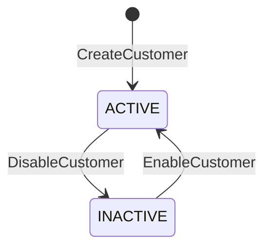
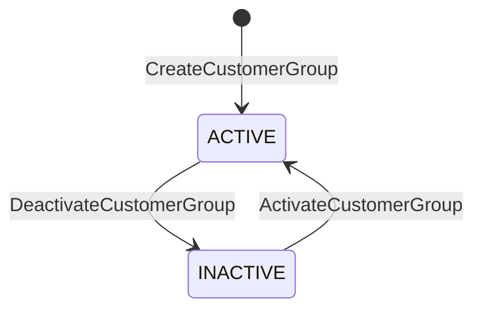

# NEXORA — CRM Increment 4 Design Finalization

## Document Metadata

- **Document ID:** `docs/architecture/29-crm-increment-design-finalization.md`
- **Target Increment:** Phase 2 / Batch 1 / Increment 4: Customer Relationship Management (`crm`)
- **Review & Finalization Date:** 2026-10-11
- **Status:** **DESIGN FINALIZATION (READ-ONLY — NO IMPLEMENTATION AUTHORIZED)**
- **Authoritative Decisions:** `DEC-B1-014` (Option A), `DEC-B1-015` (Option A), `DEC-B1-016` (Option A), `DEC-B1-017` (Option B + Option A), `DEC-B1-018` (Option A)
- **Final Design Verdict:** **`READY FOR IMPLEMENTATION AUTHORIZATION`**

---

## 1. Executive Summary

This document establishes the finalized, approved architectural design and technical specification for **NEXORA Phase 2 / Batch 1 / Increment 4 — Customer Relationship Management (CRM)**.

Following the read-only pre-implementation review in [`docs/architecture/28-crm-increment-pre-implementation-review.md`](file:///Users/trmmac/Library/CloudStorage/GoogleDrive-dev.mikamiko@gmail.com/My%20Drive/nexora/docs/architecture/28-crm-increment-pre-implementation-review.md), the user has formally evaluated and approved all five architectural decisions:
1. **DEC-B1-014 (Option A):** Customer Group Schema Hardening (`created_at`, `updated_at`, `status` lifecycle).
2. **DEC-B1-015 (Option A):** Dedicated Customer Group Permissions (`customer_group.read`, `customer_group.create`, `customer_group.update`).
3. **DEC-B1-016 (Option A):** Server-Generated Collision-Resistant Customer Numbering with Bounded Retries (strictly prohibiting `MAX+1`).
4. **DEC-B1-017 (Option B + Option A):** Dual-Layer Default Address Enforcement (PostgreSQL Partial Unique Index + Service-Layer Atomic Transaction).
5. **DEC-B1-018 (Option A):** Canonical Route Namespacing (`/api/v1/crm/...`) with Backward-Compatible Aliases (`/api/v1/customers`).

This finalization reconciles the existing PostgreSQL baseline (`000001_baseline_hardened.sql`), approved forward migrations (`000002` through `000006`, `000008`, `000009`), OpenAPI v1.0.0 contracts, permission matrices, audit catalogs, transactional outbox contracts, and domain boundary isolation rules.

**Governance Notice:** This document is STRICTLY READ-ONLY ARCHITECTURAL DESIGN. **Implementation is NOT authorized.** No application code, test files, OpenAPI contracts, migrations, or database states have been altered.

---

## 2. Evidence Sources & Repository Reconciliation

All canonical architecture and governance documents were reviewed and reconciled:

| Canonical Document | Local URI | Reconciled Status / Evidence |
|---|---|---|
| Platform Architecture Lock | [`docs/architecture/09-architecture-lock.md`](file:///Users/trmmac/Library/CloudStorage/GoogleDrive-dev.mikamiko@gmail.com/My%20Drive/nexora/docs/architecture/09-architecture-lock.md) | **CONFIRMED**: Monolith modularity, PostgreSQL system of record, mandatory RLS, outbox atomicity, append-only audit, idempotency. |
| State Machine Catalog | [`docs/architecture/10-state-machine-catalog.md`](file:///Users/trmmac/Library/CloudStorage/GoogleDrive-dev.mikamiko@gmail.com/My%20Drive/nexora/docs/architecture/10-state-machine-catalog.md) | **CONFIRMED**: General transition invariants; customer lifecycle states `ACTIVE` and `INACTIVE` aligned with schema check constraints. |
| Permission Matrix | [`docs/architecture/11-permission-matrix.md`](file:///Users/trmmac/Library/CloudStorage/GoogleDrive-dev.mikamiko@gmail.com/My%20Drive/nexora/docs/architecture/11-permission-matrix.md) | **CONFIRMED**: Section 8.3 defines `customer.read`, `customer.create`, `customer.update`, `customer.address.manage`. Customer group permissions identified as gap. |
| Event Catalog | [`docs/architecture/12-event-catalog.md`](file:///Users/trmmac/Library/CloudStorage/GoogleDrive-dev.mikamiko@gmail.com/My%20Drive/nexora/docs/architecture/12-event-catalog.md) | **CONFIRMED**: Canonical outbox event envelope, idempotency, versioning, delivery semantics. |
| Audit Action Catalog | [`docs/architecture/13-audit-action-catalog.md`](file:///Users/trmmac/Library/CloudStorage/GoogleDrive-dev.mikamiko@gmail.com/My%20Drive/nexora/docs/architecture/13-audit-action-catalog.md) | **CONFIRMED**: Section 14 enumerates `CUSTOMER_CREATED`, `CUSTOMER_UPDATED`, `CUSTOMER_DISABLED`, `CUSTOMER_ADDRESS_CREATED`, `CUSTOMER_ADDRESS_UPDATED`, `CUSTOMER_ADDRESS_DELETED`, `CUSTOMER_GROUP_CHANGED`. |
| Offline Sync Contract | [`docs/architecture/08-offline-sync-contract.md`](file:///Users/trmmac/Library/CloudStorage/GoogleDrive-dev.mikamiko@gmail.com/My%20Drive/nexora/docs/architecture/08-offline-sync-contract.md) | **CONFIRMED**: Customer lookup cached on POS terminal; customer creation prefers online execution; offline client state never overrides central server state. |
| OpenAPI Specification | [`contracts/openapi/openapi-v1.0.0.yaml`](file:///Users/trmmac/Library/CloudStorage/GoogleDrive-dev.mikamiko@gmail.com/My%20Drive/nexora/contracts/openapi/openapi-v1.0.0.yaml) | **CONFIRMED**: `/customers`, `/customers/{id}`, `/customers/{id}/addresses` (GET/POST). Identified omission of address PATCH/DELETE and group endpoints in OpenAPI v1.0.0. |
| Baseline Hardened Migration | [`db/migrations/000001_baseline_hardened.sql`](file:///Users/trmmac/Library/CloudStorage/GoogleDrive-dev.mikamiko@gmail.com/My%20Drive/nexora/db/migrations/000001_baseline_hardened.sql) | **CONFIRMED**: Tables `crm.customer_group`, `crm.customer`, `crm.customer_address` defined at lines 396–440; tenant isolation triggers active. |
| Identity Permissions Migration | [`db/migrations/000006_identity_permissions.sql`](file:///Users/trmmac/Library/CloudStorage/GoogleDrive-dev.mikamiko@gmail.com/My%20Drive/nexora/db/migrations/000006_identity_permissions.sql) | **CONFIRMED**: Lines 66–69 seed `customer.read`, `customer.create`, `customer.update`, `customer.address.manage`. |
| CRM Pre-Implementation Review | [`docs/architecture/28-crm-increment-pre-implementation-review.md`](file:///Users/trmmac/Library/CloudStorage/GoogleDrive-dev.mikamiko@gmail.com/My%20Drive/nexora/docs/architecture/28-crm-increment-pre-implementation-review.md) | **CONFIRMED**: Pre-implementation findings and decision options verified. |

---

## 3. Approved Decision Register (DEC-B1-014 through DEC-B1-018)

The user has explicitly approved the following decisions for Increment 4:

| Decision ID | Topic | Approved Option | Core Architectural Principle | Status |
|---|---|---|---|---|
| **DEC-B1-014** | Customer Group Schema Hardening | **Option A:** Lifecycle Schema Extension | Add `created_at`, `updated_at`, and `status` (`ACTIVE`/`INACTIVE`) to `crm.customer_group` via migration `000007`. Inactive groups cannot be assigned to new customers or reassignments. Existing customer links remain readable. | **APPROVED** |
| **DEC-B1-015** | Customer Group Permissions | **Option A:** Dedicated Fine-Grained Permissions | Register `customer_group.read`, `customer_group.create`, `customer_group.update` in `identity.permission` via migration `000007`. Enforce Segregation of Duties between POS cashiers and marketing administrators. | **APPROVED** |
| **DEC-B1-016** | Customer Number Generation | **Option A:** Server-Side Collision-Resistant Generation | Client may supply custom `customer_no` (validated & normalized); if omitted, server generates deterministic sequence `CUST-<TIMESTAMP>-<RAND4>` (or crypto-random alphanumeric) with bounded retry on unique collision. Strictly forbid `MAX+1`. | **APPROVED** |
| **DEC-B1-017** | Default Address Enforcement | **Option B + Option A:** Dual-Layer Invariant Protection | Layer 1: PostgreSQL partial unique index `ux_customer_default_address` enforces at most one default address per customer per tenant. Layer 2: Service-layer transaction atomically unsets previous default before setting new default. | **APPROVED** |
| **DEC-B1-018** | Route Namespacing & Aliases | **Option A:** Canonical Domain Mount with Aliases | Canonical routes mounted at `/api/v1/crm/...`. Compatibility alias mounted at `/api/v1/customers` to maintain 100% parity with OpenAPI v1.0.0 client contracts without code duplication. | **APPROVED** |

---

## 4. CRM Domain Boundaries & Explicit Exclusions

The CRM domain in NEXORA manages customer identities, segmentation groups, and physical addresses.

```text
┌────────────────────────────────────────────────────────────────────────┐
│                          CRM DOMAIN BOUNDARY                           │
│                                                                        │
│   ┌────────────────────┐   1:N   ┌────────────────────┐   1:N          │
│   │ crm.customer_group ├────────►│    crm.customer    ├───────┐        │
│   │  (Segmentation)    │         │ (Tenant Identity)  │       │        │
│   └────────────────────┘         └────────────────────┘       │        │
│                                                               ▼        │
│                                                   ┌──────────────────┐ │
│                                                   │crm.customer_addr │ │
│                                                   │  (Address Book)  │ │
│                                                   └──────────────────┘ │
└────────────────────────────────────────────────────────────────────────┘
                                 │ References
                                 ▼
┌────────────────────────────────────────────────────────────────────────┐
│                   DOWNSTREAM / CROSS-DOMAIN CONSUMERS                  │
│                                                                        │
│   • Sales Order (Phase 6): Read customer & address snapshots           │
│   • Pricing & Promotions (Phase 7): Match price rules by customer_group│
│   • Loyalty (Phase 8): Points ledger linked to customer_id             │
│   • POS Session (Phase 5): Offline customer lookup cache               │
│   • Finance (Phase 9): AR account ledger linked to customer_id         │
└────────────────────────────────────────────────────────────────────────┘
```

### Strictly Excluded from Increment 4 Scope:
1. **Sales Transactions & Invoicing:** Owned exclusively by `sales.sales_order`. Customer purchase history is queried through Sales domain contracts.
2. **Loyalty Accounts & Points Ledgers:** Owned exclusively by `loyalty.account` and `loyalty.ledger_entry`. Increment 4 creates no loyalty balances.
3. **Voucher Redemption:** Owned exclusively by `loyalty.voucher_redemption`.
4. **Price Rules & Discounts:** Owned exclusively by `pricing.price_rule`. Customer groups serve as classification metadata only; prices are calculated in Pricing.
5. **Credit Limits & Accounts Receivable:** Owned exclusively by `finance.ar_ledger`.
6. **Direct Offline Mutation:** Offline POS nodes cannot authoritatively create or mutate customers in PostgreSQL. Offline POS lookups use cached read models.

---

## 5. Data Model & Database Constraints

### 5.1 Entity: `crm.customer_group` (Hardened under DEC-B1-014)

```sql
-- DDL definition as amended by migration 000007:
ALTER TABLE crm.customer_group
  ADD COLUMN IF NOT EXISTS status varchar(20) NOT NULL DEFAULT 'ACTIVE'
    CHECK (status IN ('ACTIVE','INACTIVE')),
  ADD COLUMN IF NOT EXISTS created_at timestamptz NOT NULL DEFAULT now(),
  ADD COLUMN IF NOT EXISTS updated_at timestamptz NOT NULL DEFAULT now();
```

#### Invariants & Rules:
- Primary Key: `id uuid DEFAULT gen_random_uuid()`.
- Tenant Isolation: `tenant_id uuid NOT NULL`. Forced RLS with policy `tenant_isolation_v11`.
- Uniqueness: `UNIQUE (tenant_id, code)`.
- Name: `varchar(100) NOT NULL`.
- Status Constraint: Only `ACTIVE` or `INACTIVE` permitted.
- Inactive Group Assignment Invariant:
  - An `INACTIVE` group CANNOT be assigned to a new customer.
  - An existing customer cannot be updated to reference an `INACTIVE` group.
  - Existing customers already associated with an inactive group remain completely readable; their historical group reference is preserved until explicitly updated.

### 5.2 Entity: `crm.customer`

```sql
-- Baseline definition in 000001_baseline_hardened.sql:
CREATE TABLE crm.customer (
  id uuid PRIMARY KEY DEFAULT gen_random_uuid(),
  tenant_id uuid NOT NULL,
  customer_no varchar(50) NOT NULL,
  customer_group_id uuid REFERENCES crm.customer_group(id),
  name varchar(200) NOT NULL,
  email citext,
  phone varchar(50),
  tax_id text,
  status varchar(20) NOT NULL DEFAULT 'ACTIVE'
    CHECK (status IN ('ACTIVE','INACTIVE')),
  created_at timestamptz NOT NULL DEFAULT now(),
  updated_at timestamptz NOT NULL DEFAULT now(),
  created_by uuid,
  updated_by uuid,
  version bigint NOT NULL DEFAULT 1,
  UNIQUE (tenant_id, customer_no)
);
```

#### Invariants & Rules:
- Primary Key: `id uuid DEFAULT gen_random_uuid()`.
- Uniqueness: `UNIQUE (tenant_id, customer_no)`.
- Foreign Key: `customer_group_id REFERENCES crm.customer_group(id)` (optional / nullable).
- Multi-Tenant FK Enforcement: Trigger `trg_same_tenant_customer_group_id` verifies `customer_group.tenant_id == customer.tenant_id`.
- Optimistic Concurrency: `version bigint NOT NULL DEFAULT 1`. Every update increments `version = version + 1` and matches expected version.
- Contact Fields: `email citext` (case-insensitive indexing `ix_customer_email`), `phone varchar(50)` (indexed `ix_customer_phone`).
- Lifecycle: `CHECK (status IN ('ACTIVE','INACTIVE'))`. Deletion is strictly prohibited; disabling sets `status = 'INACTIVE'`.

### 5.3 Entity: `crm.customer_address` (Hardened under DEC-B1-017)

```sql
-- Baseline definition in 000001_baseline_hardened.sql:
CREATE TABLE crm.customer_address (
  id uuid PRIMARY KEY DEFAULT gen_random_uuid(),
  tenant_id uuid NOT NULL,
  customer_id uuid NOT NULL REFERENCES crm.customer(id),
  address_type varchar(20) NOT NULL
    CHECK (address_type IN ('BILLING','SHIPPING','OTHER')),
  recipient_name varchar(150),
  phone varchar(50),
  address_line text NOT NULL,
  city varchar(100),
  province varchar(100),
  postal_code varchar(20),
  country_code char(2) NOT NULL DEFAULT 'ID',
  is_default boolean NOT NULL DEFAULT false
);

-- Partial Unique Index added in migration 000007 (DEC-B1-017):
CREATE UNIQUE INDEX IF NOT EXISTS ux_customer_default_address
  ON crm.customer_address (tenant_id, customer_id)
  WHERE (is_default = true);
```

#### Invariants & Rules:
- Primary Key: `id uuid DEFAULT gen_random_uuid()`.
- Customer Association: `customer_id REFERENCES crm.customer(id)`.
- Multi-Tenant FK Enforcement: Trigger `trg_same_tenant_customer_id` enforces same tenant.
- Address Types: Restricted to `BILLING`, `SHIPPING`, `OTHER`.
- Single Default Invariant: At most one address per customer per tenant may have `is_default = true`. Enforced by partial index `ux_customer_default_address`. Customers with zero addresses or zero default addresses are valid ("at most one", not "exactly one").

---

## 6. Tenant Ownership, RLS & Uniqueness Rules

1. **Enterprise-Wide Ownership Model:**
   Customer accounts represent human shoppers across the retail organization. Unlike POS terminals or warehouses (which are store- or warehouse-scoped), `crm.customer` has no `company_id` or `store_id` columns. A customer belongs to the `tenant_id` and can purchase at any store within the tenant.
2. **Context Resolution & RLS Enforcement:**
   Every protected request extracts `tenant_id` from the verified JWT claims (`Claims.TenantID`). Untrusted client headers (`X-Tenant-ID`) are strictly ignored for authorization. In every database transaction, `postgres.TxManager` sets:
   ```sql
   SELECT set_config('app.current_tenant_id', $1, true);
   ```
   PostgreSQL RLS policy `tenant_isolation_v11` filters all selects and validates all inserts/updates (`WITH CHECK`).
3. **Negative Security Invariant:**
   Supplying an ID belonging to another tenant for `customer_id`, `group_id`, or `address_id` results in 0 rows under RLS. The service must immediately return HTTP 404 `ErrNotFound` (never 403), preventing existence enumeration across tenants.

---

## 7. State Machines & Lifecycle Transitions

### 7.1 Customer State Machine



| Current State | Command | Permission | Preconditions | Target State | Audit Action | Outbox Event |
|---|---|---|---|---|---|---|
| *None* | `CreateCustomer` | `customer.create` | Valid name; unique `customer_no`; if `group_id` provided, group must exist and be `ACTIVE` | `ACTIVE` | `CUSTOMER_CREATED` | `crm.customer.created.v1` |
| `ACTIVE` | `UpdateCustomer` | `customer.update` | Version matches; if `group_id` provided, group must be `ACTIVE` | `ACTIVE` | `CUSTOMER_UPDATED` | `crm.customer.updated.v1` |
| `ACTIVE` | `DisableCustomer` | `customer.update` | Version matches | `INACTIVE` | `CUSTOMER_DISABLED` | `crm.customer.disabled.v1` |
| `INACTIVE` | `EnableCustomer` | `customer.update` | Version matches | `ACTIVE` | `CUSTOMER_UPDATED` | `crm.customer.updated.v1` |

- **Invariants:**
  - An `INACTIVE` customer cannot have new addresses added.
  - An `INACTIVE` customer cannot be placed on new sales orders.
  - Customer records are never hard-deleted.

### 7.2 Customer Group State Machine



| Current State | Command | Permission | Preconditions | Target State | Audit Action | Outbox Event |
|---|---|---|---|---|---|---|
| *None* | `CreateCustomerGroup` | `customer_group.create` | Unique `code` per tenant | `ACTIVE` | `CUSTOMER_GROUP_CREATED` | `crm.customer_group.created.v1` |
| `ACTIVE` | `UpdateCustomerGroup` | `customer_group.update` | Group exists | `ACTIVE` | `CUSTOMER_GROUP_UPDATED` | `crm.customer_group.updated.v1` |
| `ACTIVE` | `DeactivateGroup` | `customer_group.update` | Group exists | `INACTIVE` | `CUSTOMER_GROUP_UPDATED` | `crm.customer_group.updated.v1` |
| `INACTIVE` | `ActivateGroup` | `customer_group.update` | Group exists | `ACTIVE` | `CUSTOMER_GROUP_UPDATED` | `crm.customer_group.updated.v1` |

- **Invariants:**
  - Deactivating a group DOES NOT orphan existing customers; their `customer_group_id` remains intact.
  - Inactive groups are omitted from active selection dropdowns/lookups.

---

## 8. Permission Matrix Additions (DEC-B1-015)

Under approved decision **DEC-B1-015 (Option A)**, fine-grained customer group permissions are introduced:

| Permission Code | Name | Module | Action Identifier | Intended Roles | Enforcement Endpoints |
|---|---|---|---|---|---|
| `customer.read` | Read Customer | `CRM` | `CUSTOMER_READ` | Cashier, Supervisor, Store Mgr, Backoffice | `GET /customers`, `GET /customers/{id}`, `GET /customers/{id}/addresses` |
| `customer.create` | Create Customer | `CRM` | `CUSTOMER_CREATE` | Cashier, Supervisor, Store Mgr, Backoffice | `POST /customers` |
| `customer.update` | Update Customer | `CRM` | `CUSTOMER_UPDATE` | Supervisor, Store Mgr, Backoffice | `PATCH /customers/{id}`, `POST /customers/{id}/disable`, `POST /customers/{id}/enable` |
| `customer.address.manage` | Manage Customer Addresses | `CRM` | `ADDRESS_MANAGE` | Cashier, Supervisor, Store Mgr, Backoffice | `POST /customers/{id}/addresses`, `PATCH /customers/{id}/addresses/{addr_id}`, `DELETE ...` |
| `customer_group.read` | Read Customer Group | `CRM` | `CUSTOMER_GROUP_READ` | Cashier, Supervisor, Store Mgr, Backoffice | `GET /crm/customer-groups`, `GET /crm/customer-groups/{id}` |
| `customer_group.create` | Create Customer Group | `CRM` | `CUSTOMER_GROUP_CREATE` | Marketing Mgr, System Admin | `POST /crm/customer-groups` |
| `customer_group.update` | Update Customer Group | `CRM` | `CUSTOMER_GROUP_UPDATE` | Marketing Mgr, System Admin | `PATCH /crm/customer-groups/{id}` |

---

## 9. Proposed CRM Audit Actions & PII Masking

### 9.1 Audit Action Catalog Seeds (Migration 000007)
All CRM audit actions must be registered in `audit.audit_action_catalog` before application logging:

| Code | Module | Severity | Requires Reason | Seed Status |
|---|---|---|---|---|
| `CUSTOMER_CREATED` | `CRM` | `NOTICE` | `false` | Proposed for `000007` |
| `CUSTOMER_UPDATED` | `CRM` | `NOTICE` | `false` | Proposed for `000007` |
| `CUSTOMER_DISABLED` | `CRM` | `HIGH` | `false` | Proposed for `000007` |
| `CUSTOMER_ADDRESS_CREATED` | `CRM` | `NOTICE` | `false` | Proposed for `000007` |
| `CUSTOMER_ADDRESS_UPDATED` | `CRM` | `NOTICE` | `false` | Proposed for `000007` |
| `CUSTOMER_ADDRESS_DELETED` | `CRM` | `HIGH` | `false` | Proposed for `000007` |
| `CUSTOMER_GROUP_CHANGED` | `CRM` | `NOTICE` | `false` | Proposed for `000007` |
| `CUSTOMER_GROUP_CREATED` | `CRM` | `NOTICE` | `false` | Proposed for `000007` |
| `CUSTOMER_GROUP_UPDATED` | `CRM` | `NOTICE` | `false` | Proposed for `000007` |

### 9.2 Mandatory PII Masking in `audit.data_change`
To comply with Section 14 of `docs/architecture/13-audit-action-catalog.md`, sensitive customer attributes in `before_state` and `after_state` snapshots must be masked prior to persistence:
- **Email:** `MaskEmail(val)` $\rightarrow$ `j***@example.com`
- **Phone:** `MaskPhone(val)` $\rightarrow$ `+62812****7890`
- **Tax ID:** `MaskTaxID(val)` $\rightarrow$ `***-***-1234`
- **Address Line:** Retain city and province, mask exact street numbers in audit logs.
- **Log Sanitation:** Plaintext email, phone, or tax IDs MUST NEVER appear in structured logs (`slog`).

---

## 10. Outbox Event Catalog & Transactional Guarantees

Every CRM state mutation writes a canonical outbox event into `integration.outbox_event` in the exact same database transaction:

| Event Type | Aggregate Type | Version | Payload Schema | Triggering Action |
|---|---|---|---|---|
| `crm.customer.created.v1` | `customer` | 1 | `id`, `customer_no`, `name`, `email`, `phone`, `group_id`, `status` | Successful customer creation |
| `crm.customer.updated.v1` | `customer` | 1 | `id`, `customer_no`, `name`, `email`, `phone`, `group_id`, `status`, `version` | Profile change or group update |
| `crm.customer.disabled.v1` | `customer` | 1 | `id`, `customer_no`, `version` | Customer status transition to `INACTIVE` |
| `crm.customer.address_created.v1` | `customer_address` | 1 | `id`, `customer_id`, `address_type`, `city`, `postal_code`, `is_default` | Address added |
| `crm.customer.address_updated.v1` | `customer_address` | 1 | `id`, `customer_id`, `address_type`, `city`, `postal_code`, `is_default` | Address modified |
| `crm.customer.address_deleted.v1` | `customer_address` | 1 | `id`, `customer_id` | Address removed |
| `crm.customer_group.created.v1` | `customer_group` | 1 | `id`, `code`, `name`, `status` | Customer group created |
| `crm.customer_group.updated.v1` | `customer_group` | 1 | `id`, `code`, `name`, `status` | Customer group modified |

**Transactional Atomicity Rule:** If writing the outbox event or audit record fails, the entire database transaction rolls back. A customer mutation can never commit without its corresponding audit log and outbox event.

---

## 11. Proposed Migration `000007_crm_audit_actions.sql` Design

```sql
-- Migration 000007: CRM Audit Action Seeds, Permissions, and Schema Hardening
-- Implements DEC-B1-014, DEC-B1-015, and DEC-B1-017.

BEGIN;

SELECT pg_advisory_xact_lock(hashtext('nexora.crm.migration.v1'));

-- 1. Schema Hardening on crm.customer_group (DEC-B1-014)
ALTER TABLE crm.customer_group
  ADD COLUMN IF NOT EXISTS status varchar(20) NOT NULL DEFAULT 'ACTIVE'
    CHECK (status IN ('ACTIVE','INACTIVE')),
  ADD COLUMN IF NOT EXISTS created_at timestamptz NOT NULL DEFAULT now(),
  ADD COLUMN IF NOT EXISTS updated_at timestamptz NOT NULL DEFAULT now();

-- 2. Partial Unique Index on crm.customer_address (DEC-B1-017)
CREATE UNIQUE INDEX IF NOT EXISTS ux_customer_default_address
  ON crm.customer_address (tenant_id, customer_id)
  WHERE (is_default = true);

-- 3. Seed Canonical CRM Audit Actions
INSERT INTO audit.audit_action_catalog (code, module, description, severity, requires_reason, active) VALUES
  ('CUSTOMER_CREATED', 'CRM', 'Customer created', 'NOTICE', false, true),
  ('CUSTOMER_UPDATED', 'CRM', 'Customer updated', 'NOTICE', false, true),
  ('CUSTOMER_DISABLED', 'CRM', 'Customer disabled', 'HIGH', false, true),
  ('CUSTOMER_ADDRESS_CREATED', 'CRM', 'Customer address created', 'NOTICE', false, true),
  ('CUSTOMER_ADDRESS_UPDATED', 'CRM', 'Customer address updated', 'NOTICE', false, true),
  ('CUSTOMER_ADDRESS_DELETED', 'CRM', 'Customer address deleted', 'HIGH', false, true),
  ('CUSTOMER_GROUP_CHANGED', 'CRM', 'Customer group changed', 'NOTICE', false, true),
  ('CUSTOMER_GROUP_CREATED', 'CRM', 'Customer group created', 'NOTICE', false, true),
  ('CUSTOMER_GROUP_UPDATED', 'CRM', 'Customer group updated', 'NOTICE', false, true)
ON CONFLICT (code) DO NOTHING;

-- 4. Seed Dedicated Customer Group Permissions (DEC-B1-015)
INSERT INTO identity.permission (code, name, module, action) VALUES
  ('customer_group.read', 'Read Customer Group', 'CRM', 'CUSTOMER_GROUP_READ'),
  ('customer_group.create', 'Create Customer Group', 'CRM', 'CUSTOMER_GROUP_CREATE'),
  ('customer_group.update', 'Update Customer Group', 'CRM', 'CUSTOMER_GROUP_UPDATE')
ON CONFLICT (code) DO NOTHING;

COMMIT;
```

---

## 12. API Route Inventory & Compatibility Parity (DEC-B1-018)

### 12.1 Route Matrix

| Method | Canonical Route (`/api/v1/crm/...`) | Compatibility Alias (`/api/v1/customers...`) | Required Permission | Description |
|---|---|---|---|---|
| `GET` | `/api/v1/crm/customers` | `/api/v1/customers` | `customer.read` | List & search customers (query, phone, email, pagination). |
| `POST` | `/api/v1/crm/customers` | `/api/v1/customers` | `customer.create` | Create customer. Client may omit `customer_no`. |
| `GET` | `/api/v1/crm/customers/{id}` | `/api/v1/customers/{id}` | `customer.read` | Get customer profile by ID. |
| `PATCH`| `/api/v1/crm/customers/{id}` | `/api/v1/customers/{id}` | `customer.update` | Update customer profile (optimistic locking). |
| `POST` | `/api/v1/crm/customers/{id}/disable` | *N/A (Canonical only)* | `customer.update` | Deactivate customer lifecycle (`status = 'INACTIVE'`). |
| `POST` | `/api/v1/crm/customers/{id}/enable` | *N/A (Canonical only)* | `customer.update` | Activate customer lifecycle (`status = 'ACTIVE'`). |
| `GET` | `/api/v1/crm/customers/{id}/addresses` | `/api/v1/customers/{id}/addresses` | `customer.read` | List addresses for a customer. |
| `POST` | `/api/v1/crm/customers/{id}/addresses` | `/api/v1/customers/{id}/addresses` | `customer.address.manage` | Add address to customer book (handles atomic default). |
| `PATCH`| `/api/v1/crm/customers/{id}/addresses/{address_id}` | *N/A (Canonical only)* | `customer.address.manage` | Update address details or default status. |
| `DELETE`| `/api/v1/crm/customers/{id}/addresses/{address_id}` | *N/A (Canonical only)* | `customer.address.manage` | Delete address from customer book. |
| `GET` | `/api/v1/crm/customer-groups` | *N/A (Canonical only)* | `customer_group.read` | List customer groups. |
| `POST` | `/api/v1/crm/customer-groups` | *N/A (Canonical only)* | `customer_group.create` | Create customer group. |
| `GET` | `/api/v1/crm/customer-groups/{id}` | *N/A (Canonical only)* | `customer_group.read` | Get customer group details. |
| `PATCH`| `/api/v1/crm/customer-groups/{id}` | *N/A (Canonical only)* | `customer_group.update` | Update customer group code/name/status. |

### 12.2 Strict Alias Parity Requirements
The compatibility alias `/api/v1/customers` MUST execute the exact same handler logic as `/api/v1/crm/customers`:
- Identical authentication and `tenant_id` extraction.
- Identical permission check (`customer.read`, `customer.create`, etc.).
- Identical `Idempotency-Key` header enforcement for mutations.
- Identical error response envelope (`apperr.ErrorResponse`).
- Zero duplicated business logic (mounted via chi router sub-mounting or handler delegation).

---

## 13. Customer Number Generation Design (DEC-B1-016)

Under approved decision **DEC-B1-016 (Option A)**, customer number generation is governed by strict anti-collision invariants:

### 13.1 Generation Rules
1. **Client-Supplied Number:** If client supplies a non-empty `customer_no`, it is trimmed and validated (alphanumeric, dashes, underscores; 3–50 chars). PostgreSQL enforces `UNIQUE (tenant_id, customer_no)`. A collision returns HTTP 409 `ErrCustomerNumberConflict`.
2. **Server-Generated Number:** If `customer_no` is omitted or empty, the server automatically generates a deterministic sequence:
   $$\text{Format: } \mathbf{CUST\text{-}YYYYMMDD\text{-}XXXXXX}$$
   - `YYYYMMDD`: UTC date string.
   - `XXXXXX`: 6-character cryptographic pseudo-random uppercase alphanumeric string (entropy: $36^6 \approx 2.17 \times 10^9$ possibilities per day).
3. **Strict Prohibition of `MAX(number)+1`:** Under no circumstances may code perform `SELECT MAX(customer_no) + 1`. This pattern causes serial lock contention, race conditions under concurrency, and gap anomalies.
4. **Bounded Retry Strategy:**
   During insert, if PostgreSQL raises unique violation `23505` on `crm_customer_tenant_id_customer_no_key`:
   - If `customer_no` was client-supplied: Immediately abort with HTTP 409 `ErrCustomerNumberConflict`.
   - If `customer_no` was server-generated: Bounded retry loop (maximum 3 attempts) generating a fresh random suffix within a new transaction attempt. If all 3 attempts fail (statistically infinitesimal), return HTTP 500 `ErrCustomerNumberExhausted`.

---

## 14. Default Address Transaction & Partial Unique Index (DEC-B1-017)

Under approved decision **DEC-B1-017 (Option B + Option A)**, default address integrity is defended at both the database and service layers.

### 14.1 Database Layer (PostgreSQL Constraint)
```sql
CREATE UNIQUE INDEX ux_customer_default_address
  ON crm.customer_address (tenant_id, customer_id)
  WHERE (is_default = true);
```
- If any concurrent process attempts to write two default addresses for the same customer, the database immediately aborts with error `23505`.

### 14.2 Service Layer Transaction Sequence
When creating or updating an address where `is_default = true`:

```text
TxManager.Run(ctx, func(txCtx context.Context) error {
    1. Lock parent customer:
       SELECT id FROM crm.customer WHERE id = $customer_id AND tenant_id = $tenant_id FOR UPDATE;
       (Guarantees single-writer order per customer)

    2. Reset existing defaults:
       UPDATE crm.customer_address
       SET is_default = false
       WHERE customer_id = $customer_id
         AND tenant_id = $tenant_id
         AND is_default = true;

    3. Insert or update target address with is_default = true:
       INSERT INTO crm.customer_address (...) VALUES (..., true);
       (Protected by ux_customer_default_address)

    4. Write audit log (CUSTOMER_ADDRESS_CREATED or UPDATED).
    5. Write outbox event (crm.customer.address_created.v1 or UPDATED).
    6. Return committed result.
})
```

- **Invariant Clarification:** The business invariant is **"at most one default address"**, NOT "exactly one". Customers with zero addresses or customers whose addresses are all non-default are fully valid.

---

## 15. Validation, Error Handling & Canonical Error Envelopes

### 15.1 Request Validation Rules
- **Customer Name:** 1 to 200 characters, whitespace trimmed, required.
- **Email:** Valid RFC 5322 format, lowercased, optional. Stored as `citext`.
- **Phone:** 7 to 50 characters, normalized (digits, optional leading `+`), optional.
- **Group ID:** Optional UUID. If provided, must resolve to an active group within the same tenant.
- **Customer Address:** Recipient name (1–150 chars), address line (1–255 chars), city (1–100 chars), postal code (1–20 chars), country code (ISO 3166-1 alpha-2, default `'ID'`).

### 15.2 Canonical Error Mapping (`apperr.ErrorResponse`)
All API responses upon failure adhere strictly to the established error envelope:

| Failure Scenario | Domain Error | HTTP Status | Error Code | Error Message |
|---|---|---|---|---|
| Invalid email or phone syntax | `apperr.ErrValidation` | 422 | `VALIDATION_ERROR` | `"invalid email format"` / `"invalid phone format"` |
| Duplicate customer number | `apperr.ErrConflict` | 409 | `CUSTOMER_NUMBER_EXISTS` | `"customer number already exists in tenant"` |
| Duplicate group code | `apperr.ErrConflict` | 409 | `CUSTOMER_GROUP_EXISTS` | `"customer group code already exists in tenant"` |
| Stale version on update | `apperr.ErrConflict` | 409 | `CUSTOMER_VERSION_CONFLICT` | `"customer has been modified by another transaction"` |
| Assigning inactive group | `apperr.ErrConflict` | 409 | `CUSTOMER_GROUP_INACTIVE` | `"customer group is inactive and cannot be assigned"` |
| Adding address to inactive customer | `apperr.ErrConflict` | 409 | `CUSTOMER_INACTIVE` | `"cannot add or modify addresses for an inactive customer"` |
| Customer or address not found | `apperr.ErrNotFound` | 404 | `NOT_FOUND` | `"customer not found"` / `"address not found"` |
| Reused idempotency key with different payload | `apperr.ErrConflict` | 409 | `IDEMPOTENCY_KEY_REUSED` | `"idempotency key reused with different request payload"` |

---

## 16. Detailed Acceptance Criteria

| Criteria ID | Category | Objective Verification Target |
|---|---|---|
| **AC-CRM-01** | **Customer Group Creation** | User with `customer_group.create` creates group with code, name. Status defaults to `ACTIVE`. Duplicate code in same tenant returns 409. |
| **AC-CRM-02** | **Customer Group Lifecycle** | User with `customer_group.update` can transition status to `INACTIVE`. Assigning this inactive group to a new customer fails with 409. Existing customers with this group remain readable. |
| **AC-CRM-03** | **Customer Creation with Auto-Number** | Creating customer omitting `customer_no` generates valid `CUST-YYYYMMDD-XXXXXX`. Persists with `version = 1`, status `ACTIVE`. |
| **AC-CRM-04** | **Customer Creation Custom Number** | Creating customer with custom `customer_no` validates format and persists. Duplicate within tenant returns 409. |
| **AC-CRM-05** | **Optimistic Concurrency** | Two concurrent PATCH requests on same customer: first succeeds (increments version to 2); second fails with 409 `CUSTOMER_VERSION_CONFLICT`. |
| **AC-CRM-06** | **Atomic Default Address** | Adding Address A (`is_default = true`) sets it default. Adding Address B (`is_default = true`) atomically makes B default and resets A to `false`. Partial index `ux_customer_default_address` prevents duplicates. |
| **AC-CRM-07** | **Customer Deactivation & Address Guard** | Deactivating customer sets `status = 'INACTIVE'`. Attempting to add an address to this inactive customer returns 409 `CUSTOMER_INACTIVE`. |
| **AC-CRM-08** | **Cross-Tenant Isolation (NOBYPASSRLS)** | Executing queries under role `nexora_app` (`NOBYPASSRLS`): Tenant B cannot view or update Tenant A customers or addresses. Supplying Tenant A UUID returns 404. |
| **AC-CRM-09** | **Audit Log & PII Masking** | Every customer/address mutation writes to `audit.audit_log` with correct catalog action. Snapshots in `audit.data_change` have email, phone, and tax_id masked. |
| **AC-CRM-10** | **Transactional Outbox Event** | Customer create, update, disable, address create/update/delete emit corresponding `crm.customer.*.v1` events in the same database transaction. Outbox failure rolls back domain change. |
| **AC-CRM-11** | **Idempotency Protection** | Replaying identical POST/PATCH request with same `Idempotency-Key` returns original response without duplicate insertion or version increment. |
| **AC-CRM-12** | **Route Parity & OpenAPI Compatibility** | Both `/api/v1/crm/customers` and `/api/v1/customers` accept identical payloads, require identical permissions, and return identical schema responses. |

---

## 17. Comprehensive Test Strategy

### 17.1 Test Organization
Implementation must provide:
- `backend/internal/crm/model_test.go`: Entity validation, phone normalization, email normalization.
- `backend/internal/crm/service_test.go`: Mocked service unit tests for state machine, number generation retry loop, address default logic.
- `backend/internal/crm/crm_integration_test.go`: End-to-end integration tests using disposable PostgreSQL container and `NOBYPASSRLS` app user.

### 17.2 Specific Test Scenarios (Integration Suite)
1. **Happy Path:** Create group $\rightarrow$ Create customer $\rightarrow$ Add 2 addresses $\rightarrow$ Update profile $\rightarrow$ Deactivate customer.
2. **Concurrency Race:** 10 simultaneous workers creating customers with auto-generated numbers: 0 collisions, 10 unique records.
3. **Concurrency Optimistic Lock:** 2 concurrent updates on same customer: exactly 1 succeeds, 1 receives 409.
4. **Dual Default Race:** 2 concurrent requests setting different addresses as default for same customer: exactly 1 wins, exactly 1 default address exists in DB.
5. **Multi-Tenant Boundary:** Tenant A creates customer; Tenant B attempts lookup, list, update, and delete: all return 404 or empty list.
6. **Audit & Outbox Atomicity:** Force fault on outbox insert: customer table row must NOT persist.

### 17.3 Validation Execution Commands
```bash
# 1. Linting and Static Analysis
golangci-lint run ./backend/internal/crm/...

# 2. Unit and Integration Tests with Race Detector
go test -v -race -timeout 120s ./backend/internal/crm/...

# 3. Full Batch 1 Regression Suite
go test -v -race -timeout 300s ./backend/internal/{identity,organization,master,crm}/...
```

---

## 18. Implementation Prerequisites & Go/No-Go Checklist

### Status of Pre-Implementation Gates:
- [x] Canonical architecture documents reconciled.
- [x] Migrations `000001`–`000006`, `000008`, `000009` checksums verified unchanged.
- [x] Absence of `000007_crm_audit_actions.sql` confirmed.
- [x] Five architectural decisions (`DEC-B1-014` through `DEC-B1-018`) formally approved.
- [x] Detailed design finalization specification completed (`docs/architecture/29-crm-increment-design-finalization.md`).
- [ ] **Implementation Authorization Granted by User.** (Pending user decision)

---

## 19. Verdict

### **`READY FOR IMPLEMENTATION AUTHORIZATION`**

The architectural design for NEXORA CRM Increment 4 is complete, fully reconciled, and locked. All database constraints, permission additions, audit actions, outbox events, and concurrency safeguards are unambiguously defined.

**STOP.** Do not modify application code, migrations, tests, OpenAPI, `IMPLEMENTATION_STATUS.md`, or `TASKS.md` until explicit user authorization to begin implementation is granted.
