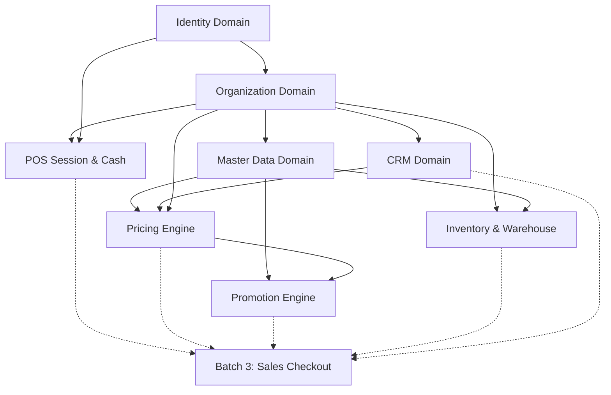

# NEXORA Phase 2 / Batch 2 — Pre-Implementation Review

## Document Metadata

- **Document ID:** `docs/architecture/33-phase2-batch2-pre-implementation-review.md`
- **Topic:** Architecture & Governance Pre-Implementation Review for Phase 2 / Batch 2
- **Domains Covered:** POS, Pricing, Promotion, Inventory
- **Author:** Antigravity Engineering Agent
- **Date:** 2026-10-11
- **Status:** DRAFT / FOR USER REVIEW
- **Verdict:** `READY WITH OPEN DECISIONS`

---

## 1. Executive Summary and Review Verdict

### 1.1 Executive Summary
Following the formal acceptance and closure of NEXORA Phase 2 / Batch 1 (`Identity`, `Organization`, `Master Data & Catalog`, `CRM`) documented in [32-phase2-batch1-closure-review.md](file:///Users/trmmac/Library/CloudStorage/GoogleDrive-dev.mikamiko@gmail.com/My%20Drive/nexora/docs/architecture/32-phase2-batch1-closure-review.md) and synchronized in [IMPLEMENTATION_STATUS.md](file:///Users/trmmac/Library/CloudStorage/GoogleDrive-dev.mikamiko@gmail.com/My%20Drive/nexora/docs/architecture/IMPLEMENTATION_STATUS.md), this review establishes the technical baseline, domain boundaries, dependencies, increment decomposition, database migration needs, catalog gaps, and acceptance criteria for **Phase 2 / Batch 2**.

Batch 2 covers four core operational domains:
1. **POS:** POS session lifecycle, terminal binding, float declaration, mid-shift cash drops/payouts, session blind closing, and cash variance reconciliation.
2. **Pricing:** Price lists, product and variant price rules, customer group overrides, store-specific overrides, currency/precision rules, and deterministic price resolution.
3. **Promotion:** Promotion lifecycle, rule definitions (percentage, fixed discount, bundle, buy-X-get-Y), eligibility criteria, stacking modes, and discount evaluation.
4. **Inventory:** Stock balance per warehouse/location, append-only immutable stock ledger, stock reservations, transfer workflows, adjustments, and physical serial tracking.

Sales order checkout, cart calculations, multi-tender payment capture, payment gateway integration, refunds, and final sales ledger posting remain strictly out of scope for Batch 2 and are deferred to **Batch 3**.

### 1.2 Review Verdict

**VERDICT:** `READY WITH OPEN DECISIONS`

#### Rationale:
1. **Upstream Foundation is Solid:** Batch 1 is 100% closed, with migrations `000001` through `000009` verified against canonical checksum registers.
2. **Baseline Database Schemas Exist:** The baseline schemas for POS (`pos.session`, `pos.cash_movement`), Pricing (`pricing.price_list`, `pricing.price_rule`), Promotion (`promotion.promotion`, `promotion_condition`, `promotion_reward`, `promotion_application`), and Inventory (`inventory.stock`, `inventory.stock_ledger`, `inventory.stock_reservation`, `inventory.stock_transfer`, `inventory.stock_adjustment`, `warehouse.location`) are already created with PostgreSQL RLS policies in [000001_baseline_hardened.sql](file:///Users/trmmac/Library/CloudStorage/GoogleDrive-dev.mikamiko@gmail.com/My%20Drive/nexora/db/migrations/000001_baseline_hardened.sql).
3. **Material Database Catalog Gaps Identified:** 
   - In [000004_audit_hardening.sql](file:///Users/trmmac/Library/CloudStorage/GoogleDrive-dev.mikamiko@gmail.com/My%20Drive/nexora/db/migrations/000004_audit_hardening.sql), zero POS audit actions are seeded, only 1 pricing action (`PRICE_UPDATED`), only 1 promotion action (`PROMOTION_DEACTIVATED`), and only 3 inventory actions (`STOCK_TRANSFER_RECEIVED`, `STOCK_RESERVED`, `STOCK_RELEASED`) are seeded. Foreign key `fk_audit_log_action` prevents audit writing without forward migration seeds.
   - In [000006_identity_permissions.sql](file:///Users/trmmac/Library/CloudStorage/GoogleDrive-dev.mikamiko@gmail.com/My%20Drive/nexora/db/migrations/000006_identity_permissions.sql), zero pricing permissions, zero promotion permissions, and incomplete inventory permissions are seeded.
   - Relational child line item tables for `inventory.stock_adjustment` and `inventory.stock_transfer` are absent in baseline SQL despite being required by OpenAPI schemas.
4. Implementation cannot begin until design finalization documents resolve the identified open decisions (DEC-B2-001 through DEC-B2-009) and authorize forward migrations starting at sequence `000010`.

---

## 2. Repository Evidence Inventory and Missing Evidence

### 2.1 Inspected Artifacts
The following active repository files were directly inspected:

| Category | File Path | Verified Content / Evidence |
|---|---|---|
| **Governance** | `AGENTS.md` | Modular monolith, PostgreSQL system of record, RLS enforcement, outbox, audit, no arbitrary status updates, non-negotiable rules. |
| **Governance** | `IMPLEMENTATION_GUIDE.md` | Verification checklists, migration integrity rules, zero-warning test requirements. |
| **Governance** | `TASKS.md` | Project task ledger; Phase 2 Batch 1 closed, Batch 2 listed. |
| **Architecture** | `docs/architecture/09-architecture-lock.md` | Architectural lock on multi-tenant RLS, event outbox, authorization model. |
| **Architecture** | `docs/architecture/10-state-machine-catalog.md` | State machines for POS Session (Sec 21–26), Inventory Reservation/Adjustment/Transfer (Sec 27–35), Promotion (Sec 36–37), Price Rule (Sec 38). |
| **Architecture** | `docs/architecture/11-permission-matrix.md` | Canonical permission matrices for POS Session (Sec 11), Inventory (Sec 12), Pricing (Sec 13), Promotion (Sec 14). |
| **Architecture** | `docs/architecture/12-event-catalog.md` | Domain event specifications for Inventory (Sec 11), Pricing (Sec 12), Promotion (Sec 13), POS Session (Sec 14). |
| **Architecture** | `docs/architecture/13-audit-action-catalog.md` | Canonical audit actions for Pricing (Sec 15), Promotion (Sec 16), POS Session (Sec 18), Inventory (Sec 20). |
| **Architecture** | `docs/architecture/08-offline-sync-contract.md` | Offline policies: server-authoritative inventory/pricing, POS session online requirement, offline sync idempotency. |
| **Architecture** | `docs/architecture/15-openapi-v1.1.md` | API versioning guidelines, canonical routes `/api/v1/{domain}`, idempotency headers. |
| **Architecture** | `docs/architecture/16-monorepo-blueprint.md` | Package structure: `backend/internal/{domain}`, dependency flow: transport → application → domain → ports. |
| **Architecture** | `docs/architecture/17-foundation-implementation-plan.md` | Platform foundation patterns, outbox worker, test fixtures. |
| **Architecture** | `docs/architecture/18-operational-readiness-guide.md` | Operational checks, disposable DB harness, RLS validation. |
| **Architecture** | `docs/architecture/19-phase2-domain-implementation-plan.md` | Phase 2 domain breakdown: Batch 1 (Identity, Org, Master, CRM), Batch 2 (POS, Pricing, Promotion, Inventory), Batch 3 (Sales, Payment). |
| **Architecture** | `docs/architecture/32-phase2-batch1-closure-review.md` | Formally closed Batch 1 with documented follow-ups. |
| **Architecture** | `docs/architecture/IMPLEMENTATION_STATUS.md` | Verified status: Batch 1 100% closed, Batch 2 unstarted. |
| **API Contract** | `contracts/openapi/openapi-v1.0.0.yaml` | OpenAPI contract (SHA-256: `7fa566ac...`). POS endpoints (L2170–2290), Pricing quote (L2498–2531), Promotion (L2377–2496), Inventory (L2532–2767). |
| **Database** | `db/migrations/000001_baseline_hardened.sql` | Baseline DDL for Pricing (L445–479), Promotion (L481–532), POS (L592–635), Inventory (L704–795), RLS policies (L1287–1340). |
| **Database** | `db/migrations/000004_audit_hardening.sql` | Audit catalog table and FK constraint `fk_audit_log_action` (L130–139). |
| **Database** | `db/migrations/000006_identity_permissions.sql` | Seeded canonical permissions (L9–107). |
| **Database** | `db/migrations/000007_crm_audit_actions.sql` | CRM forward migration pattern for audit and permissions. |
| **Database** | `db/migrations/000008_organization_hardening.sql` | Organization hardening migration. |
| **Database** | `db/migrations/000009_master_hardening.sql` | Master data hardening migration. |
| **Application** | `backend/internal/platform/audit/catalog.go` | In-memory audit registry containing POS, Pricing, Promotion, Inventory definitions. |
| **Application** | `backend/api.go` | Root server route mounting for Identity, Organization, Master, CRM. |

### 2.2 Missing or Deferred Evidence
1. **No Code in Batch 2 Domains:** As expected, `backend/internal/pos`, `backend/internal/pricing`, `backend/internal/promotion`, and `backend/internal/inventory` do not exist yet.
2. **Missing Database Line Item Tables:** No child tables exist for `inventory.stock_transfer_item` or `inventory.stock_adjustment_item` in `000001_baseline_hardened.sql`.
3. **Missing Pricing Admin Routes in OpenAPI:** OpenAPI v1.0.0 defines `POST /pricing/quote` but does not define CRUD routes for price lists (`/pricing/price-lists`) or price rules (`/pricing/rules`).

---

## 3. Batch 1 Baseline and Governance Verification

### 3.1 Batch 1 Closure Integrity
- **Increment 1 (Identity):** Accepted in Phase 1 / Phase 2 Foundation.
- **Increment 2 (Organization):** Accepted with limitations in [23-organization-increment-acceptance-review.md](file:///Users/trmmac/Library/CloudStorage/GoogleDrive-dev.mikamiko@gmail.com/My%20Drive/nexora/docs/architecture/23-organization-increment-acceptance-review.md). Hardened in migration `000008`.
- **Increment 3 (Master Data & Catalog):** Accepted with limitations in [27-master-data-increment-acceptance-review.md](file:///Users/trmmac/Library/CloudStorage/GoogleDrive-dev.mikamiko@gmail.com/My%20Drive/nexora/docs/architecture/27-master-data-increment-acceptance-review.md). Hardened in migration `000009`. Physical serial movements explicitly deferred to Inventory.
- **Increment 4 (CRM):** Accepted with limitations in [31-crm-increment-acceptance-review.md](file:///Users/trmmac/Library/CloudStorage/GoogleDrive-dev.mikamiko@gmail.com/My%20Drive/nexora/docs/architecture/31-crm-increment-acceptance-review.md). Hardened in migration `000007`.
- **Batch 1 Closure Review:** Fully completed and approved in [32-phase2-batch1-closure-review.md](file:///Users/trmmac/Library/CloudStorage/GoogleDrive-dev.mikamiko@gmail.com/My%20Drive/nexora/docs/architecture/32-phase2-batch1-closure-review.md).
- **Status Alignment:** [IMPLEMENTATION_STATUS.md](file:///Users/trmmac/Library/CloudStorage/GoogleDrive-dev.mikamiko@gmail.com/My%20Drive/nexora/docs/architecture/IMPLEMENTATION_STATUS.md) accurately reflects Batch 1 as formally closed with 29 passing integration tests.

### 3.2 Migration Checksum Governance
Migrations `000001` through `000009` remain completely untouched and match their recorded checksums byte-for-byte:
- `000001_baseline_hardened.sql`: `9eeb020294fe70a6c6a1523b090a98f4604a43fc333bcfa4c99c5c24e738ec6f`
- `000002_refresh_tokens.sql`: `c9b0e14e7473b98c39e0eb374528ce0a9f5cbbcf8ee1f173b9e4a3c2ce525046`
- `000003_outbox_leases.sql`: `07cb95a31a90c2394541bf7bf59ca1ee52c2125bb7963be2c8ca0be4ec657688`
- `000004_audit_hardening.sql`: `3593a62886cfa358ae8e442c52aa7fa2976722d573f05b9b9a67440938f2b1a1`
- `000005_auth_rls_bootstrap.sql`: `a835a78241e330541740fb354c40b8529cb6ba19d9b4b0eb0326442657a6e13e`
- `000006_identity_permissions.sql`: `df3544fdb23ea8e52dbb557c3e5904838ce9bfa77a4a984020c78a02a9ebfa41`
- `000007_crm_audit_actions.sql`: `20921473215264b38d33ae81a5476a666e51e443cefc13e2df98c679a9bb9697`
- `000008_organization_hardening.sql`: `1adcf666d9c79fa4510dd169eb943c22dafa95fe29f122ec047970d4cbbfa043`
- `000009_master_hardening.sql`: `3fbbf7a53c15ca9fe5d9185a8559091873173d1597a7e800d110191834278440`

Next migration sequence for Batch 2: **`000010`**.

---

## 4. Current Architecture and Dependency Analysis

### 4.1 Monorepo & Backend Architecture Compliance
In accordance with `AGENTS.md` and `docs/architecture/06-go-backend-architecture.md`:
1. **Modular Monolith:** All business logic resides in `backend/internal/{domain}`. Cross-domain interaction occurs via exported service interfaces or application contracts; direct table cross-queries or cross-mutations are strictly prohibited.
2. **PostgreSQL as Sole System of Record:** Redis is restricted to rate limiting, session caching, and outbox distribution; it must never hold authoritative inventory counts, prices, or POS shift state.
3. **Transaction Flow:**
   `authenticate → authorize (scope/RBAC) → begin tx → set_config(app.current_tenant_id) → idempotency check → execute domain logic → audit_log → outbox → commit`.
4. **Error Handling:** Standardized error response envelope `apperr.ErrorResponse`.
5. **Idempotency:** Enforced via `Idempotency-Key` canonical header using `backend/internal/platform/idempotency`.

### 4.2 Cross-Domain Dependency Reality


---

## 5. Proposed Scope for the Four Batch 2 Domains

### 5.1 Domain A: POS (Session & Cash Management)
- **Included Scope:**
  - POS session lifecycle: `OPENING → OPEN → CLOSING → CLOSED` and `VARIANCE_REVIEW → CLOSED`.
  - Terminal binding: Validation of terminal operational status (`organization.terminal.status = 'ACTIVE'`).
  - Terminal session uniqueness: Enforced at database level via `ux_pos_session_terminal_open`.
  - Cash movements: Float declaration (`OPENING`), mid-shift cash drops (`CASH_OUT`), cash additions (`CASH_IN`), and adjustments (`ADJUSTMENT`).
  - Blind count closing: Cashier submits `actual_cash` without viewing `expected_cash`.
  - Variance calculation: `variance = actual_cash - expected_cash`. If variance exceeds policy threshold, session routes to `VARIANCE_REVIEW`.
  - Supervisor variance approval: Overriding/accepting cash variances with documented reason.
  - Audit logging and transactional outbox events for session and cash transitions.
- **Explicit Exclusions:**
  - Sales order creation, item ringing, payment capture, and receipt generation (strictly Batch 3).
  - Hardware peripheral drivers (ESC/POS printer, cash drawer kick, barcode scanner raw serial interfaces).
  - Offline session opening (POS session opening requires online server validation per `docs/architecture/08-offline-sync-contract.md`).

### 5.2 Domain B: Pricing (Price Lists & Rules)
- **Included Scope:**
  - Price list lifecycle: `ACTIVE`, `INACTIVE`. Multi-currency support (default `IDR`).
  - Price rules: Assigned to product/variant with `min_qty`, `unit_price`, and validity date ranges (`effective_from`, `effective_to`).
  - Scope overrides: Customer group price rules (`crm.customer_group`), store-specific price overrides (`organization.store`).
  - Deterministic price resolution: Given `(tenant_id, store_id, customer_group_id, product_id, variant_id, qty, timestamp)`, resolve exact unit price using explicit priority hierarchy:
    1. Store-specific customer group price rule.
    2. Store-specific price rule.
    3. Global customer group price rule.
    4. Base price list rule.
  - Price quote endpoint: Implementation of `POST /pricing/quote` in OpenAPI v1.0.0.
  - Currency precision: Fixed 4-decimal precision (`numeric(19,4)`), rounding half-up at line total.
  - Historical reproducibility: Price rules are immutable once active; modifications create new versions.
- **Explicit Exclusions:**
  - Promotion discounts, coupons, vouchers (delegated to Promotion domain).
  - Tax calculation engine and VAT rules (delegated to Sales domain / Finance).
  - Dynamic surge pricing algorithms or machine-learning price optimization.

### 5.3 Domain C: Promotion (Promotions & Rewards Engine)
- **Included Scope:**
  - Promotion lifecycle: `DRAFT → PENDING_APPROVAL → APPROVED → SCHEDULED → ACTIVE → PAUSED → EXPIRED` / `REJECTED`.
  - Scope targeting: Product, variant, category, customer group, store, channel (`POS`, `ONLINE`, `ALL`).
  - Rule condition types:
    - Minimum spend threshold (`MIN_ORDER_AMOUNT`).
    - Minimum quantity threshold (`MIN_ITEM_QTY`).
    - Category/product matching (`PRODUCT_IN_LIST`, `CATEGORY_IN_LIST`).
  - Rule reward types:
    - Percentage discount (`PERCENTAGE_DISCOUNT`).
    - Fixed amount discount (`FIXED_AMOUNT_DISCOUNT`).
    - Buy X Get Y free/discounted (`BUY_X_GET_Y`).
  - Stacking & conflict resolution: Deterministic evaluation order by priority integer; enforcement of `stacking_mode` (`STACKABLE`, `EXCLUSIVE`, `BEST_ONLY`).
  - Promotion evaluation endpoint: `POST /promotions/evaluate` evaluating candidates against a provisional cart without persisting a sale.
  - Promotion approval workflow: Segregation of duties (creator cannot approve).
- **Explicit Exclusions:**
  - Promotion coupon ledger redemption at checkout (deferred to Batch 3 / Sales).
  - Loyalty point accrual and redemption (delegated to Loyalty domain in Phase 3).
  - Direct ledger discounts posting (financial integration deferred).

### 5.4 Domain D: Inventory (Stock Ledger & Warehousing)
- **Included Scope:**
  - Multi-location stock balance: Real-time on-hand and reserved balance tracking per `(warehouse_id, location_id, product_id, variant_id)`.
  - Immutable stock ledger: Append-only ledger `inventory.stock_ledger` recording every movement delta, balance after, occurred timestamp, and reference.
  - Strict ledger-balance atomicity: Updating `inventory.stock` and inserting `inventory.stock_ledger` inside the exact same database transaction.
  - Negative stock protection: Database check constraint `on_hand_qty >= 0` and `reserved_qty <= on_hand_qty` strictly prevents negative stock unless explicitly bypassed by system policy flag.
  - Concurrency control: Pessimistic row locking (`SELECT FOR UPDATE`) on `inventory.stock` during balance mutations.
  - Two-phase stock reservations:
    - `ReserveStock`: Places hold on stock (`reserved_qty += qty`), records `inventory.stock_reservation` (`RESERVED`).
    - `ReleaseStock`: Frees hold (`reserved_qty -= qty`), transitions reservation to `RELEASED`.
    - `ConsumeStock`: Deducts actual stock (`on_hand_qty -= qty, reserved_qty -= qty`), transitions reservation to `CONSUMED`, writes immutable ledger entry (`SALE`).
  - Stock adjustments: Multi-item adjustment header and lines, approval workflow (`DRAFT → PENDING_APPROVAL → APPROVED → POSTED`), posting generates immutable ledger movements.
  - Stock transfers: Multi-item transfer header and lines between warehouses (`DRAFT → REQUESTED → APPROVED → IN_TRANSIT → RECEIVED`). Dispatch decrements source; receipt increments destination.
  - Serial number physical state tracking: Updating physical lifecycle status on `master.serial_number` (`IN_STOCK`, `RESERVED`, `DEFECTIVE`, `IN_TRANSIT`) upon stock movements, fulfilling the Master Data Increment 3 handover.
- **Explicit Exclusions:**
  - Purchasing supplier procurement, Purchase Orders, and Vendor Bills (Purchasing domain).
  - Warehouse 3D spatial mapping, automated robotic routing, or pick/pack optimization.
  - Automated inventory valuation ledgers (FIFO/LIFO/Average cost accounting posted to General Ledger — Finance domain).

---

## 6. Domain Boundaries and Explicit Exclusions

| Domain | Strict Responsibilities | Non-Responsibilities / Delegations |
|---|---|---|
| **POS** | Session lifecycle, terminal authorization, float/drawer balance, cash drops/pickups, blind count variance review. | Sales transactions, payment capture, receipt layout, order voiding (delegated to Sales/Payment in Batch 3). |
| **Pricing** | Base price lists, store/group price rules, validity windows, deterministic price resolution engine. | Promotional discounts (Promotion), Cart totals/Taxes (Sales), Catalog master data (Master Data). |
| **Promotion** | Promotion definitions, validity schedules, eligibility conditions, reward formulas, stacking engine, candidate evaluation. | Price lists (Pricing), Order line application (Sales), Voucher/Loyalty points (Loyalty). |
| **Inventory** | Stock balance, immutable ledger, stock holds/reservations, warehouse transfers, physical adjustments, serial physical states. | Supplier purchasing (Purchasing), Cost of goods sold posting (Finance), Cart reservation timeout daemon (Sales/Platform). |

---

## 7. Dependency Graph and Justified Sequencing

### 7.1 Dependency Types
1. **Hard Dependency:** Downstream code cannot compile or function without upstream tables, types, or services.
2. **Contract Dependency:** Downstream code can develop against an agreed interface/port, but requires upstream for end-to-end integration.
3. **Runtime Dependency:** Required only when a complete cross-domain workflow executes.

### 7.2 Dependency Analysis
1. **POS Session & Cash Management:**
   - Depends on `organization.terminal`, `organization.store`, `organization.company`, and `identity.user_account`. All are 100% implemented and accepted in Batch 1.
   - Depends on zero Batch 2 domains (has no dependency on Pricing, Promotion, or Inventory).
   - **Conclusion:** POS is completely unblocked and can be implemented immediately as **Increment 5**.
2. **Pricing Engine:**
   - Depends on `master.product`, `master.product_variant`, `crm.customer_group`, `organization.store`, and `organization.company`. All are implemented and accepted in Batch 1.
   - Depends on zero other Batch 2 domains.
   - **Conclusion:** Pricing is completely unblocked and should be implemented as **Increment 6**.
3. **Promotion Engine:**
   - Depends on `master.product`, `master.category`, `crm.customer_group`, and `organization.store`.
   - Has a contract/runtime dependency on **Pricing**: evaluating a promotion discount requires knowing the base unit price.
   - **Conclusion:** Promotion should follow Pricing as **Increment 7**.
4. **Inventory & Warehouse Management:**
   - Depends on `organization.warehouse`, `organization.store`, `master.product`, `master.product_variant`, and `master.serial_number`.
   - Requires line item schema additions for adjustments and transfers.
   - Consumed by Sales (Batch 3) for stock holds and deductions.
   - **Conclusion:** Inventory should be implemented as **Increment 8**.

---

## 8. Proposed Increment Breakdown

Rather than forcing arbitrary boundaries, Batch 2 naturally decomposes into four sequentially verifiable increments:

```text
┌────────────────────────────────────────────────────────────────────────┐
│ Increment 5: POS Session & Cash Management                             │
│ Module: backend/internal/pos                                           │
│ Migration: 000010_pos_hardening.sql                                    │
└───────────────────────────────────┬────────────────────────────────────┘
                                    │
┌───────────────────────────────────▼────────────────────────────────────┐
│ Increment 6: Pricing Engine                                            │
│ Module: backend/internal/pricing                                       │
│ Migration: 000011_pricing_hardening.sql                                │
└───────────────────────────────────┬────────────────────────────────────┘
                                    │
┌───────────────────────────────────▼────────────────────────────────────┐
│ Increment 7: Promotion Engine                                          │
│ Module: backend/internal/promotion                                     │
│ Migration: 000012_promotion_hardening.sql                              │
└───────────────────────────────────┬────────────────────────────────────┘
                                    │
┌───────────────────────────────────▼────────────────────────────────────┐
│ Increment 8: Inventory & Warehouse Management                          │
│ Module: backend/internal/inventory                                     │
│ Migration: 000013_inventory_hardening.sql                              │
└────────────────────────────────────────────────────────────────────────┘
```

### Increment Details

#### Increment 5: POS Session & Cash Management
- **Scope:** `backend/internal/pos`, POS session lifecycle, terminal check, cash movements, blind closing, variance review, outbox events, audit logging.
- **Prerequisites:** Batch 1 accepted (Organization, Identity).
- **Exclusions:** Cart ringing, sales posting, payment processing.
- **Migration:** `000010_pos_hardening.sql` (Seed POS audit actions and permissions, resolve state constraint).

#### Increment 6: Pricing Engine
- **Scope:** `backend/internal/pricing`, price lists, price rules, store/group overrides, deterministic resolution engine, `/pricing/quote` endpoint, admin price list routes.
- **Prerequisites:** Batch 1 accepted (Master Data, CRM, Organization).
- **Exclusions:** Promotional discounts, tax calculation.
- **Migration:** `000011_pricing_hardening.sql` (Seed pricing audit actions and permissions).

#### Increment 7: Promotion Engine
- **Scope:** `backend/internal/promotion`, promotion lifecycle, condition/reward evaluators, stacking resolution, `/promotions/evaluate` endpoint, approval workflows.
- **Prerequisites:** Increment 6 (Pricing) accepted.
- **Exclusions:** Checkout coupon redemption, loyalty point calculations.
- **Migration:** `000012_promotion_hardening.sql` (Seed promotion audit actions and permissions).

#### Increment 8: Inventory & Warehouse Management
- **Scope:** `backend/internal/inventory`, stock balance, immutable ledger, row locking, stock reservations (`ReserveStock`, `ReleaseStock`, `ConsumeStock`), multi-item adjustments, multi-item transfers, serial physical status synchronization.
- **Prerequisites:** Batch 1 accepted (Organization, Master Data).
- **Exclusions:** Supplier purchasing, COGS financial accounting.
- **Migration:** `000013_inventory_hardening.sql` (Create adjustment/transfer line item tables, seed inventory audit actions and permissions).

---

## 9. Data-Model and Migration Proposals

### 9.1 Baseline Schema Verification
The following tables already exist in PostgreSQL via `000001_baseline_hardened.sql` and have active RLS policies (`tenant_isolation_v11`):
- `pos.session`, `pos.cash_movement`
- `pricing.price_list`, `pricing.price_rule`
- `promotion.promotion`, `promotion.promotion_condition`, `promotion.promotion_reward`, `promotion.promotion_application`
- `warehouse.location`, `inventory.stock`, `inventory.stock_ledger`, `inventory.stock_reservation`, `inventory.stock_transfer`, `inventory.stock_adjustment`

### 9.2 Required Forward Migrations

#### Migration `000010_pos_hardening.sql` (Increment 5)
1. **POS Session Check Constraint Hardening:**
   Expand check constraint on `pos.session.status` to include `'VARIANCE_REVIEW'` and reconcile `'OPENING'`:
   ```sql
   ALTER TABLE pos.session DROP CONSTRAINT IF EXISTS session_status_check;
   ALTER TABLE pos.session ADD CONSTRAINT session_status_check 
     CHECK (status IN ('OPENING','OPEN','ACTIVE','CLOSING','CLOSED','VARIANCE_REVIEW'));
   ```
2. **Terminal Open Index Realignment:**
   Ensure `ux_pos_session_terminal_open` includes `'VARIANCE_REVIEW'` and `'OPENING'`:
   ```sql
   DROP INDEX IF EXISTS pos.ux_pos_session_terminal_open;
   CREATE UNIQUE INDEX ux_pos_session_terminal_open
     ON pos.session(terminal_id)
     WHERE status IN ('OPENING','OPEN','ACTIVE','CLOSING','VARIANCE_REVIEW');
   ```
3. **Audit Action Seeds:**
   Seed all canonical POS audit actions into `audit.audit_action_catalog`:
   `POS_SESSION_OPENED`, `POS_SESSION_CLOSED`, `POS_CASH_MOVEMENT_CREATED`, `POS_CASH_IN`, `POS_CASH_OUT`, `POS_SESSION_CLOSING`, `POS_SESSION_VARIANCE_DETECTED`, `POS_SESSION_VARIANCE_APPROVED`, `POS_SESSION_FORCE_CLOSED`.
4. **Permission Seeds:**
   Reconcile/seed canonical permissions in `identity.permission`:
   `session.read`, `session.open`, `session.close`, `session.variance.review`, `session.variance.approve`, `cash_movement.create`, `cash_movement.approve`.

#### Migration `000011_pricing_hardening.sql` (Increment 6)
1. **Audit Action Seeds:**
   Seed missing pricing audit actions:
   `PRICE_CREATED`, `PRICE_SUBMITTED`, `PRICE_APPROVED`, `PRICE_REJECTED`, `PRICE_ACTIVATED`, `PRICE_DEACTIVATED`, `PRICE_EXPIRED`.
2. **Permission Seeds:**
   Seed pricing permissions in `identity.permission`:
   `price.read`, `price_rule.read`, `price_rule.create`, `price_rule.update`, `price_rule.submit`, `price_rule.approve`, `price_rule.activate`, `price_rule.deactivate`.

#### Migration `000012_promotion_hardening.sql` (Increment 7)
1. **Audit Action Seeds:**
   Seed missing promotion audit actions:
   `PROMOTION_CREATED`, `PROMOTION_UPDATED`, `PROMOTION_SUBMITTED`, `PROMOTION_APPROVED`, `PROMOTION_REJECTED`, `PROMOTION_ACTIVATED`, `PROMOTION_PAUSED`, `PROMOTION_EXPIRED`, `PROMOTION_VERSION_CREATED`, `PROMOTION_RULE_CHANGED`, `PROMOTION_APPLIED`.
2. **Permission Seeds:**
   Seed promotion permissions in `identity.permission`:
   `promotion.read`, `promotion.create`, `promotion.update`, `promotion.submit`, `promotion.approve`, `promotion.activate`, `promotion.pause`, `promotion.expire`, `promotion.evaluate`.

#### Migration `000013_inventory_hardening.sql` (Increment 8)
1. **Child Line Item Tables:**
   Create relational tables for multi-item operations with tenant isolation and RLS:
   ```sql
   CREATE TABLE inventory.stock_adjustment_item (
     id uuid PRIMARY KEY DEFAULT gen_random_uuid(),
     tenant_id uuid NOT NULL,
     adjustment_id uuid NOT NULL REFERENCES inventory.stock_adjustment(id) ON DELETE CASCADE,
     location_id uuid NOT NULL REFERENCES warehouse.location(id),
     product_id uuid NOT NULL REFERENCES master.product(id),
     variant_id uuid REFERENCES master.product_variant(id),
     quantity numeric(18,6) NOT NULL CHECK (quantity > 0),
     direction varchar(10) NOT NULL CHECK (direction IN ('IN','OUT')),
     reason varchar(255)
   );
   ALTER TABLE inventory.stock_adjustment_item ENABLE ROW LEVEL SECURITY;
   ALTER TABLE inventory.stock_adjustment_item FORCE ROW LEVEL SECURITY;
   CREATE POLICY tenant_isolation_v11 ON inventory.stock_adjustment_item
     USING (tenant_id = NULLIF(current_setting('app.current_tenant_id', true), '')::uuid);

   CREATE TABLE inventory.stock_transfer_item (
     id uuid PRIMARY KEY DEFAULT gen_random_uuid(),
     tenant_id uuid NOT NULL,
     transfer_id uuid NOT NULL REFERENCES inventory.stock_transfer(id) ON DELETE CASCADE,
     product_id uuid NOT NULL REFERENCES master.product(id),
     variant_id uuid REFERENCES master.product_variant(id),
     quantity numeric(18,6) NOT NULL CHECK (quantity > 0)
   );
   ALTER TABLE inventory.stock_transfer_item ENABLE ROW LEVEL SECURITY;
   ALTER TABLE inventory.stock_transfer_item FORCE ROW LEVEL SECURITY;
   CREATE POLICY tenant_isolation_v11 ON inventory.stock_transfer_item
     USING (tenant_id = NULLIF(current_setting('app.current_tenant_id', true), '')::uuid);
   ```
2. **Audit Action Seeds:**
   Seed missing inventory audit actions:
   `STOCK_DEDUCTED`, `STOCK_ADJUSTMENT_CREATED`, `STOCK_ADJUSTMENT_SUBMITTED`, `STOCK_ADJUSTMENT_APPROVED`, `STOCK_ADJUSTMENT_REJECTED`, `STOCK_ADJUSTED`, `STOCK_TRANSFER_CREATED`, `STOCK_TRANSFER_APPROVED`, `STOCK_TRANSFER_SENT`, `STOCK_TRANSFER_RECEIVED`, `STOCK_OPNAME_STARTED`, `STOCK_OPNAME_POSTED`, `STOCK_NEGATIVE_ATTEMPT`.
3. **Permission Seeds:**
   Seed inventory transfer, post, and opname permissions:
   `inventory.adjust.post`, `stock.transfer.create`, `stock.transfer.approve`, `stock.transfer.receive`, `stock.opname.create`, `stock.opname.post`.

---

## 10. State-Machine Proposals

Reconciling `docs/architecture/10-state-machine-catalog.md` with implementation constraints:

### 10.1 POS Session State Machine
```text
  [OPENING]
     │ (OpenSession)
     ▼
   [OPEN]
     │ (CloseSession - blind count)
     ▼
  [CLOSING]
     ├── balanced / within variance threshold ──► [CLOSED]
     └── variance exceeds threshold ────────────► [VARIANCE_REVIEW]
                                                       │ (ApproveVariance)
                                                       ▼
                                                    [CLOSED]
```
- Invariant: A terminal can have at most one session in non-CLOSED status (`OPENING`, `OPEN`, `ACTIVE`, `CLOSING`, `VARIANCE_REVIEW`).

### 10.2 Pricing Rule State Machine
```text
  [DRAFT] ──submit──► [SUBMITTED] ──approve──► [APPROVED] ──start_date──► [ACTIVE]
                                                    │                        │
                                                 reject                   deactivate/expire
                                                    ▼                        ▼
                                                [REJECTED]             [INACTIVE / EXPIRED]
```

### 10.3 Promotion State Machine
```text
  [DRAFT] ──submit──► [PENDING_APPROVAL] ──approve──► [APPROVED] ──schedule──► [SCHEDULED]
                             │                                                      │
                          reject                                                effective_from
                             ▼                                                      ▼
                         [REJECTED]                                              [ACTIVE]
                                                                                ├── pause ──► [PAUSED]
                                                                                └── expire ─► [EXPIRED]
```

### 10.4 Inventory Reservation State Machine
```text
  [PENDING] ──ReserveStock──► [RESERVED]
                                 ├── ConsumeStock (on sale completion) ──► [CONSUMED]
                                 ├── ReleaseStock (on cancel/expire) ────► [RELEASED]
                                 └── ttl expired (worker) ───────────────► [EXPIRED]
```

### 10.5 Inventory Adjustment State Machine
```text
  [DRAFT] ──submit──► [PENDING_APPROVAL] ──approve──► [APPROVED] ──post──► [POSTED]
                             │
                          reject
                             ▼
                         [REJECTED]
```

### 10.6 Stock Transfer State Machine
```text
  [DRAFT] ──request──► [REQUESTED] ──approve──► [APPROVED] ──dispatch──► [IN_TRANSIT] ──receive──► [RECEIVED]
                             │
                           cancel
                             ▼
                         [CANCELLED]
```

---

## 11. Permission, Audit, and Event Catalog Proposals

### 11.1 Catalog Verification Matrix

| Domain | Database Table | Existing DB Seed Status | Proposed Action |
|---|---|---|---|
| **POS** | `audit.audit_action_catalog` | **0 seeded** (Critical FK gap) | Seed in `000010_pos_hardening.sql` |
| **POS** | `identity.permission` | Partially seeded under `session.*` | Reconcile naming in `000010_pos_hardening.sql` |
| **Pricing** | `audit.audit_action_catalog` | Only `PRICE_UPDATED` seeded | Seed remaining 7 actions in `000011` |
| **Pricing** | `identity.permission` | **0 seeded** | Seed `price.*` and `price_rule.*` in `000011` |
| **Promotion** | `audit.audit_action_catalog` | Only `PROMOTION_DEACTIVATED` seeded | Seed remaining 11 actions in `000012` |
| **Promotion** | `identity.permission` | **0 seeded** | Seed `promotion.*` in `000012` |
| **Inventory** | `audit.audit_action_catalog` | Only 3 seeded (`STOCK_RESERVED`, `STOCK_RELEASED`, `STOCK_TRANSFER_RECEIVED`) | Seed remaining 13 actions in `000013` |
| **Inventory** | `identity.permission` | Only adjustments and read/reserve seeded | Seed transfer/opname/post in `000013` |

### 11.2 Proposed Domain Events (Transactional Outbox)

All domain events follow schema `v1` and are written atomically to `platform.outbox` within the mutating PostgreSQL transaction:
- **POS:**
  - `pos.session.opened.v1`
  - `pos.session.closing.v1`
  - `pos.session.variance_flagged.v1`
  - `pos.session.closed.v1`
  - `pos.cash.movement_created.v1`
- **Pricing:**
  - `pricing.price_rule.created.v1`
  - `pricing.price_rule.approved.v1`
  - `pricing.price_rule.activated.v1`
  - `pricing.price_rule.deactivated.v1`
- **Promotion:**
  - `promotion.created.v1`
  - `promotion.approved.v1`
  - `promotion.activated.v1`
  - `promotion.paused.v1`
  - `promotion.expired.v1`
- **Inventory:**
  - `inventory.stock.reserved.v1`
  - `inventory.stock.released.v1`
  - `inventory.stock.deducted.v1`
  - `inventory.adjustment.posted.v1`
  - `inventory.transfer.dispatched.v1`
  - `inventory.transfer.received.v1`

---

## 12. API and Cross-Domain Contract Requirements

### 12.1 Canonical Routes vs Compatibility Aliases
Consistent with Master Data (`/api/v1/master` + alias `/api/v1/products`) and CRM (`/api/v1/crm` + alias `/api/v1/customers`):
1. **POS:**
   - Canonical router: `/api/v1/pos`
   - Compatibility alias router: `/api/v1/pos/sessions` (matching OpenAPI paths `/pos/sessions/...`)
2. **Pricing:**
   - Canonical router: `/api/v1/pricing` (exposing price lists and rules)
   - Route `/api/v1/pricing/quote` (matching OpenAPI path)
3. **Promotion:**
   - Canonical router: `/api/v1/promotion`
   - Compatibility alias router: `/api/v1/promotions` (matching OpenAPI paths `/promotions/...`)
4. **Inventory:**
   - Canonical router: `/api/v1/inventory` (matching OpenAPI paths `/inventory/...`)

### 12.2 Cross-Domain Contracts (Go Internal Packages)
Cross-domain communication must strictly use Go package interfaces rather than database queries:
```go
// Pricing Service Contract consumed by Promotion & Sales
type PricingEngine interface {
    ResolvePrice(ctx context.Context, tenantID, storeID uuid.UUID, customerGroupID *uuid.UUID, variantID uuid.UUID, qty decimal.Decimal) (PriceQuote, error)
}

// Inventory Service Contract consumed by Sales
type StockReservationService interface {
    ReserveStock(ctx context.Context, tenantID, warehouseID, locationID, variantID uuid.UUID, qty decimal.Decimal, refType string, refID uuid.UUID) (uuid.UUID, error)
    ReleaseReservation(ctx context.Context, tenantID, reservationID uuid.UUID) error
    ConsumeReservation(ctx context.Context, tenantID, reservationID uuid.UUID) error
}

// Master Data Handover consumed by Inventory
type SerialTrackingPort interface {
    UpdateSerialPhysicalStatus(ctx context.Context, tenantID, serialID uuid.UUID, status string) error
}
```

---

## 13. Security, Tenant Isolation, Idempotency, and Concurrency Requirements

1. **PostgreSQL FORCE RLS:** Every new table (`stock_adjustment_item`, `stock_transfer_item`) must enable and force RLS using policy `tenant_isolation_v11`.
2. **Connection Context:** In every transaction, `SET LOCAL app.current_tenant_id = ?` must be established immediately after beginning the transaction.
3. **Application Authorization:** In addition to RLS, handlers must enforce tenant match from JWT claims and evaluate user permissions and store scopes.
4. **Idempotency:**
   - Mandatory `Idempotency-Key` header on all sensitive mutations:
     - `OpenPOSSession`, `ClosePOSSession`, `RecordCashMovement`
     - `ReserveStock`, `ReleaseStock`, `PostStockAdjustment`, `DispatchTransfer`, `ReceiveTransfer`
     - `ApprovePromotion`, `ActivatePromotion`
   - Replay returns identical cached response. Payload hash mismatch returns `409 Conflict (IDEMPOTENCY_KEY_REUSED)`.
5. **Concurrency & Locking:**
   - Stock balance updates must use `SELECT ... FOR UPDATE` on `inventory.stock` to eliminate race conditions and overselling.
   - POS active session check must rely on PostgreSQL partial unique index `ux_pos_session_terminal_open` to prevent duplicate active shifts under concurrent requests.
   - Optimistic concurrency control via `version` column on `pos.session` and `inventory.stock`.

---

## 14. Detailed Acceptance Criteria

Every Batch 2 increment must satisfy objective, measurable criteria:

### 14.1 POS Session Acceptance Criteria
- [ ] Exactly one active session per terminal enforced by `ux_pos_session_terminal_open`; second concurrent open fails with `409 Conflict`.
- [ ] Blind count closing: cashier submits counted cash without seeing expected cash; variance is accurately computed.
- [ ] If `variance > threshold`, session moves to `VARIANCE_REVIEW` and cannot close until approved by a user with `session.variance.approve`.
- [ ] Float and cash movements (`CASH_IN`, `CASH_OUT`) mutate `expected_cash` accurately.
- [ ] All session and cash mutations write to `audit.audit_log` and `platform.outbox`.
- [ ] Idempotent session opening: duplicate key with identical payload returns original session; altered payload returns `409 IDEMPOTENCY_KEY_REUSED`.

### 14.2 Pricing Engine Acceptance Criteria
- [ ] Price lists support store overrides, customer group overrides, and date validity ranges.
- [ ] Deterministic evaluation: resolves store-specific override first, then customer group, then base price.
- [ ] Quantities below `min_qty` do not trigger tier pricing.
- [ ] Calculations use 4-decimal fixed arithmetic without floating-point drift.
- [ ] Historical reproducibility: price quotes snapshot effective price rule ID and version.
- [ ] Invalid date ranges (`effective_to <= effective_from`) rejected with `422 Unprocessable Entity`.

### 14.3 Promotion Engine Acceptance Criteria
- [ ] Full lifecycle transitions conform to state machine catalog (`DRAFT → PENDING_APPROVAL → APPROVED → ACTIVE`).
- [ ] Segregation of duties: promotion creator cannot approve their own promotion.
- [ ] Stacking modes (`STACKABLE`, `EXCLUSIVE`, `BEST_ONLY`) evaluated deterministically by rule priority.
- [ ] Reward calculations (percentage, fixed amount, buy-X-get-Y) produce exact discounted totals.
- [ ] Expired or paused promotions are excluded during evaluation.
- [ ] Evaluation endpoint `/promotions/evaluate` executes read-only calculations without persisting sales records.

### 14.4 Inventory & Warehouse Acceptance Criteria
- [ ] Atomic balance and ledger: `inventory.stock` and `inventory.stock_ledger` updated in the same transaction.
- [ ] Negative stock strictly prevented: requests causing `on_hand_qty < 0` or `reserved_qty > on_hand_qty` fail with `409 Conflict`.
- [ ] Row locking: concurrent reservations for the same variant serialize correctly without overselling.
- [ ] Two-phase reservations: `ReserveStock` increments `reserved_qty`; `ConsumeStock` decrements both `on_hand_qty` and `reserved_qty`; `ReleaseStock` decrements `reserved_qty`.
- [ ] Stock adjustments with multiple items update ledger and balance atomically upon approval and posting.
- [ ] Stock transfers between warehouses decrement source on dispatch and increment destination on receipt.
- [ ] Physical serial tracking: serial status transitions in `master.serial_number` when reserved or moved.

---

## 15. Test Strategy

Batch 2 will adhere to the repository testing standards established in Batch 1:
1. **Unit Testing:**
   - Domain state machine unit tests covering valid transitions and rejecting illegal transitions.
   - Price resolution hierarchy unit tests with extensive matrix permutations.
   - Promotion stacking and formula calculation unit tests.
   - Blind cash variance calculation unit tests.
2. **Integration Testing with Disposable PostgreSQL:**
   - Running against ephemeral Dockerized PostgreSQL using `testfixture.New(t)`.
   - Complete schema migrations `000001` through `000013` applied in sequence.
   - Testing with unprivileged application role `nexora_app` under `NOBYPASSRLS`.
3. **Tenant Isolation & Security Tests:**
   - Cross-tenant read/write attempts rejected by PostgreSQL RLS.
   - Cross-store scope enforcement verified for terminal and warehouse operations.
4. **Concurrency & Race Condition Tests:**
   - Parallel Go goroutines attempting simultaneous stock reservations on scarce inventory to verify row-locking safety.
   - Parallel POS session openings on the same terminal to verify partial unique index enforcement.
   - Running with `-race` flag enabled across all packages.
5. **Idempotency Integration Tests:**
   - Replaying identical requests with `Idempotency-Key` verifies exact cached responses.
   - Replaying modified payloads verifies `409 IDEMPOTENCY_KEY_REUSED`.
6. **Outbox & Audit Parity Tests:**
   - Verifying every mutation produces both an audit record in `audit.audit_log` and a corresponding event in `platform.outbox`.
7. **Zero-Warning Governance:**
   - `go vet ./...` and `golangci-lint` must pass with zero issues.

---

## 16. Risks, Open Decisions, and User Approvals Required

### 16.1 Open Decisions Requiring User Approval

| Decision ID | Domain | Topic | Summary & Recommended Option | Impact |
|---|---|---|---|---|
| **DEC-B2-001** | POS | Session Status Check Constraint | `pos.session.status` in baseline SQL allows `('OPEN','ACTIVE','CLOSING','CLOSED')`, but architecture specifies `('OPENING','OPEN','CLOSING','CLOSED','VARIANCE_REVIEW')`.<br>**Recommendation:** Update check constraint and partial unique index in `000010_pos_hardening.sql` to include `VARIANCE_REVIEW`. | Critical for supervisor variance review workflow. |
| **DEC-B2-002** | POS | Audit Action Catalog Database Seeds | 0 POS audit actions are seeded in `audit.audit_action_catalog`, causing FK violation on audit log insert.<br>**Recommendation:** Seed 9 canonical POS audit actions in `000010_pos_hardening.sql`. | Blocker for POS audit logging. |
| **DEC-B2-003** | Pricing | Admin Price List & Rule CRUD Routes | OpenAPI v1.0.0 defines `POST /pricing/quote` but omits admin CRUD endpoints for price lists and rules.<br>**Recommendation:** Introduce canonical admin endpoints `/api/v1/pricing/price-lists` and `/api/v1/pricing/rules` in Increment 6 and document contract parity. | Essential for price rule maintenance. |
| **DEC-B2-004** | Pricing | Pricing Audit Actions & Permissions Seeds | Only `PRICE_UPDATED` is seeded in audit catalog; 0 pricing permissions are seeded in `identity.permission`.<br>**Recommendation:** Seed remaining 7 audit actions and 8 permissions in `000011_pricing_hardening.sql`. | Blocker for pricing audit and RBAC. |
| **DEC-B2-005** | Promotion | Formula Schema & Rule Representation | Baseline schema uses generic JSONB `condition_config` and `reward_config`.<br>**Recommendation:** Formally specify typed Go structs for condition types (`MIN_ORDER_AMOUNT`, `MIN_ITEM_QTY`, etc.) and reward types (`PERCENTAGE`, `FIXED`, `BUY_X_GET_Y`) during Increment 7 design finalization. | Prevents unstructured or invalid promotion configurations. |
| **DEC-B2-006** | Promotion | Promotion Audit Actions & Permissions Seeds | Only `PROMOTION_DEACTIVATED` is seeded; 0 promotion permissions seeded.<br>**Recommendation:** Seed remaining 11 audit actions and 9 permissions in `000012_promotion_hardening.sql`. | Blocker for promotion audit and RBAC. |
| **DEC-B2-007** | Inventory | Child Line Item Tables for Adjustments & Transfers | Baseline SQL defines adjustment and transfer headers without child line item tables, but OpenAPI requires multi-item payloads.<br>**Recommendation:** Create `inventory.stock_adjustment_item` and `inventory.stock_transfer_item` in `000013_inventory_hardening.sql` with forced RLS. | Blocker for multi-item inventory operations. |
| **DEC-B2-008** | Inventory | Master Data Serial Status Handover | Master Data Increment 3 explicitly deferred physical serial status transitions to Inventory.<br>**Recommendation:** Inventory Increment 8 will implement physical serial transitions on `master.serial_number` upon stock receipt, adjustment, or reservation. | Completes Master Data Increment 3 handover contract. |
| **DEC-B2-009** | Governance | Increment Sequence & Decomposition | Batch 2 encompasses four large domains.<br>**Recommendation:** Execute as four sequential increments: Increment 5 (POS), Increment 6 (Pricing), Increment 7 (Promotion), Increment 8 (Inventory). | Minimizes cognitive overload and ensures isolated gate verification. |

### 16.2 Technical and Architectural Risks
1. **Database Lock Contention on High-Throughput Inventory:** High concurrency on identical SKUs during promotions or flash sales can cause lock contention on `inventory.stock`. Mitigation: Keep transactions minimal; perform validations before acquiring `SELECT FOR UPDATE`.
2. **Promotion Rule Complexity Drift:** Overly complex stacking and recursion can degrade checkout latency. Mitigation: Enforce maximum rule evaluation depth (e.g., max 50 candidate rules per cart) and deterministic priority sorting.
3. **Foreign Key Integrity during Integration Tests:** Ensuring test fixtures populate necessary upstream entities (e.g., terminal, store, warehouse, currency) before running domain commands.

---

## 17. Readiness Checklist for Each Proposed Increment

### 17.1 Increment 5: POS Session & Cash Management
- [x] Batch 1 prerequisite accepted and closed.
- [x] Baseline database tables exist (`pos.session`, `pos.cash_movement`).
- [ ] DEC-B2-001 (session status constraint) approved by user.
- [ ] DEC-B2-002 (audit action catalog seed) approved by user.
- [ ] Increment 5 Design Finalization document drafted and approved.
- [ ] Migration `000010_pos_hardening.sql` authorized.
- **Status:** `AWAITING DESIGN FINALIZATION`

### 17.2 Increment 6: Pricing Engine
- [x] Batch 1 prerequisite accepted and closed.
- [x] Baseline database tables exist (`pricing.price_list`, `pricing.price_rule`).
- [ ] DEC-B2-003 (admin API scope) approved by user.
- [ ] DEC-B2-004 (audit & permission seeds) approved by user.
- [ ] Increment 6 Design Finalization document drafted and approved.
- [ ] Migration `000011_pricing_hardening.sql` authorized.
- **Status:** `AWAITING UPSTREAM INCREMENT 5 & DESIGN FINALIZATION`

### 17.3 Increment 7: Promotion Engine
- [x] Batch 1 prerequisite accepted and closed.
- [x] Baseline database tables exist (`promotion.*`).
- [ ] Upstream Pricing Engine (Increment 6) accepted.
- [ ] DEC-B2-005 (typed formula schema) approved by user.
- [ ] DEC-B2-006 (audit & permission seeds) approved by user.
- [ ] Increment 7 Design Finalization document drafted and approved.
- [ ] Migration `000012_promotion_hardening.sql` authorized.
- **Status:** `AWAITING UPSTREAM INCREMENT 6 & DESIGN FINALIZATION`

### 17.4 Increment 8: Inventory & Warehouse Management
- [x] Batch 1 prerequisite accepted and closed.
- [x] Baseline database tables exist (`inventory.stock`, `inventory.stock_ledger`, `inventory.stock_reservation`, etc.).
- [ ] DEC-B2-007 (child line item tables) approved by user.
- [ ] DEC-B2-008 (serial status handover) approved by user.
- [ ] Increment 8 Design Finalization document drafted and approved.
- [ ] Migration `000013_inventory_hardening.sql` authorized.
- **Status:** `AWAITING DESIGN FINALIZATION`

---

## 18. Final Verdict and Rationale

### 18.1 Verdict
`READY WITH OPEN DECISIONS`

### 18.2 Rationale
- The foundational baseline from Batch 1 is 100% verified, stable, and governed by canonical checksums.
- The baseline database tables for all four Batch 2 domains are present and secured with PostgreSQL RLS in `000001_baseline_hardened.sql`.
- Crucial database gaps (missing audit catalog seeds, missing permissions, missing inventory line item tables, and POS session state discrepancies) have been precisely identified with concrete mitigation paths.
- The domain boundaries, dependency graph, and sequential four-increment strategy (Increments 5, 6, 7, 8) provide a robust, risk-managed path forward.
- **Implementation must NOT proceed** until the user reviews and approves open decisions DEC-B2-001 through DEC-B2-009, beginning with the Design Finalization for **Increment 5 (POS Session & Cash Management)**.
